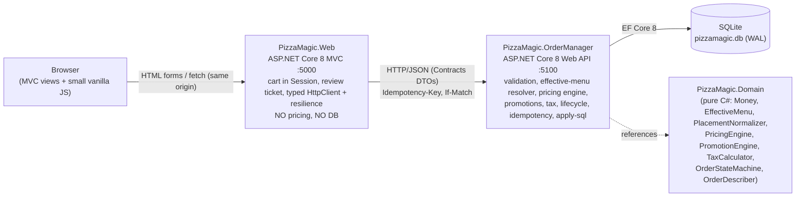

# Pizza Magic — Development Plan

## Summary

Pizza Magic is a pizza order builder with a separate order service. It has two processes:
- **PizzaMagic.Web**: an ASP.NET Core 8 MVC app for customers.
- **PizzaMagic.OrderManager**: an ASP.NET Core 8 Web API. It is the only process that touches the SQLite database.

Prices and pricing rules live entirely in the database:
- sizes, toppings, tiers, crusts, sauces and add-ons
- coverage factors for partial toppings
- per-restaurant overrides
- promotions, with their conditions, targets and conflicts
- a hierarchy of tax jurisdictions

One pure pricing engine in the order service computes both the running total and the charged total. Money is stored and calculated as **integer cents**, and rates are stored as integer **parts per million**. Rounding is **explicit**. Two named policies cover six documented points:
- **Every price** (topping charges, discounts, percentage tips) is rounded half away from zero.
- **Tax** is rounded by the method and scope its jurisdiction configures as data: `HALF_UP` or `TRUNCATE`, applied once on the `COMBINED` rate or once `PER_LEVEL`.
- The seed jurisdiction is Washington State at 6.5%: half-up on the combined rate, per RCW 82.08.054.

Every cost is rounded to whole cents **before** it is multiplied by any count.

The order lifecycle has these properties:
- It is an explicit state machine.
- Its transitions are conditional UPDATEs, so the database decides races.
- Retries are made safe with idempotency keys and `If-Match`.

The plan is test-first throughout and lists hand-computed test vectors to the cent. **Build scope (user decision UQ7): core path only.** M0–M16 are built: the spec-required path plus the README, design write-up and AI note, with the full unified schema, in about **7 h 35 m** (455 min). The extended design (X1–X6, the EXT parts of core milestones, M17–M19) stays fully specified in this plan but is **designed, not built (per user scope decision)**. The whole design would take about 12 h 45 m (765 min). Both numbers are well past the spec's 3-hour timebox. §8 says this plainly and gives a cut order. The twelve open questions are now answered by the user (§10). UQ6 (tax rounding) was revised on 2026-10-28 after legal research.

## Table of contents

- [Revision notes](#revision-notes)
- [1. Overview and architecture](#1-overview-and-architecture)
- [2. Key design decisions](#2-key-design-decisions)
- [3. Assumptions and ambiguity decisions](#3-assumptions-and-ambiguity-decisions)
- [4. Database schema](#4-database-schema)
- [5. OrderManager API](#5-ordermanager-api)
- [6. MVC front end](#6-mvc-front-end)
- [7. TDD approach](#7-tdd-approach)
- [8. Milestone plan](#8-milestone-plan)
- [9. Deliverables, Definition of Done, risks and cut list](#9-deliverables-definition-of-done-risks-and-cut-list)
- [10. Resolved decisions](#10-resolved-decisions)

---

## Revision notes

> **Status:** plan only (revision 6). No code has been written. C# signatures, SQL DDL and SQL data scripts are illustrative and show intent.
>
> **Fixed inputs:** .NET 8 (SDK 8.0.427) and C#. ASP.NET Core 8 MVC front end (`dotnet new mvc`, no auth). A separate ASP.NET Core Web API, "OrderManager", which is the **only** process that touches the database. SQLite through EF Core. Strict TDD (red → green → refactor).
>
> **Binding user decisions in this revision:**
> - **A**: promotions are data, with conditions, caps, stacking and conflicts.
> - **B**: all menu data lives in the DB.
> - **C**: multi-restaurant design.
> - **D/E**: hierarchical, additive tax.
> - **F**: global catalog plus per-restaurant overrides.
> - **G**: product types and promotion targets.
> - **H**: BOGO.
> - **I**: topping placement and coverage factors (global defaults Whole 100%, Half 60%, Quarter 40%; per-store override).
> - **J**: prices stored in integer cents, ppm rates, explicit rounding, and every cost rounded before every multiplication (confirmed again by the user).
>
> **Scope note (honest; user decision UQ7, "core path only"):** these decisions take the design well past the spec's 3-hour timebox, so the user chose to build only the core path.
> - **Built:** M0–M16, i.e. the spec-required path (420 min) plus the few EXT pieces the built code needs (allocator vectors, allocation-sum property, full schema, extra README for the unbuilt design; 35 min). That is **455 min ≈ 7 h 35 m** (§8).
> - **Designed, not built (per user scope decision):** X1–X6, the remaining EXT minutes of M1–M16, and M17–M19 (Docker compose, simulator timer, hardening). They stay fully specified here: schema, algorithms, vectors and tests.
> - The **whole design** would be about **765 min ≈ 12 h 45 m** (§8). The README states both numbers plainly.
>
> Every milestone splits its minutes into:
> - **[CORE]**: the spec-required path. **Built.**
> - **[EXT]**: extended design the user asked for and made binding. **Designed, not built (per user scope decision)**, except the pieces §8 explicitly marks "built".
> - **[STRETCH]**: optional. **Designed, not built.**
>
> Wherever this plan says [EXT] or [STRETCH] without further qualification, read "designed, not built (per user scope decision)".
>
> **What changed in revision 6 (tax rounding made jurisdiction-configurable per Washington law):**
> - **Legal basis.** RCW 82.08.054 (computation of tax due; 2003 c 168 § 210) implements SSUTA §324, and Washington is an SSUTA member state. Sellers carry the tax to the third decimal place and round to a whole cent, rounding up when the third decimal is greater than four. For non-negative amounts that is round half away from zero. The rule applies to the **aggregated** state and local tax, so rounding happens once on the combined rate, not once per level. Sellers may elect item or invoice basis, and this plan uses invoice basis: tax once per order. The spec's 6.5% equals Washington's state sales tax rate. Production use should be confirmed with a tax professional (A71).
> - **Rounding is now data per jurisdiction.** `tax_jurisdiction` gets two nullable columns, each with a CHECK on its allowed values: `tax_rounding_method` (`HALF_UP` | `TRUNCATE`) and `tax_rounding_scope` (`COMBINED` | `PER_LEVEL`).
>   - Resolution is **nearest-wins**: walk from the restaurant's jurisdiction up to the root and take the first non-null value for each setting.
>   - The root must set both. `CatalogValidator` enforces this, because a CHECK can't see other rows.
>   - The chosen method and scope are snapshotted on `customer_order`.
> - **The two scopes:**
>   - `COMBINED`: the total tax is one rounding of the exact numerator sum over every level and class. That total is then split exactly to the (level, class) `order_tax_line` rows by largest remainder (RA), weighted by each row's exact numerator, so the rows sum to the total.
>   - `PER_LEVEL`: the previous algorithm. Each level is rounded once over its classes, then split to class lines.
> - **Two named rounding policies.**
>   - `Rounding.RoundHalfAwayFromZero` / `Money.ApplyRate` serve every price point (RP1–RP4, RP6) and tax `HALF_UP`.
>   - `Rounding.Truncate` / `Money.ApplyRateTruncated` serve tax `TRUNCATE` only.
>   - The source-scan test asserts that only `TaxCalculator` references `Truncate`. RP5 now reads "per the jurisdiction's method/scope".
> - **Seed.** The default restaurant's jurisdiction is **Washington State** (`WA`, root, 6.5%, `HALF_UP`, `COMBINED`). With one level and one rate, combined half-up equals the revision 5 rule, so **every default-restaurant vector is unchanged from revision 5** (for example P1 = 533 and the README's $5.33).
> - **Built scope.** `TaxCalculator` reads `tax_rounding_method`. `HALF_UP` and `TRUNCATE` are both built and tested in M4 CORE (new vectors T13 and T18). `tax_rounding_scope` matters only with several levels, so the COMBINED/PER_LEVEL behavior is M4 EXT (designed, not built). A70 still refuses multi-level jurisdictions.
> - **Minutes.** M4 CORE +5, M8 CORE +5 and M4 EXT +5. With these alone the build scope was 415 min and the whole design 725 min; the time-zone tables below add 30 CORE minutes (current totals in §8).
> - **T vectors.**
>   - The ExampleCity fixture now defaults to `COMBINED` + `HALF_UP` at its root. T4 is 107 (lines 71/14/22) and T7 is 129 (PF 85, GEN 44), with their PER_LEVEL values (106, 128) kept as comparisons. T5 is unchanged at 38.
>   - New fixture `WaSeattle` (WA 6.5% + SEATTLE 3.85%, combined 10.35%) with vectors T14–T17: the four method × scope combinations on the same carts, a case where the methods differ, the per-level vs combined line split, and nearest-wins resolution.
> - **UQ6 superseded** (§10): "Tax rounding method and scope are per-jurisdiction data; seed follows WA RCW 82.08.054 (half-up, combined, invoice basis)", revised 2026-10-28 after legal research.
> - **Also updated:** R3, R27; §1.2 (`TaxRoundingSettings.cs`); §2.1; §2.2 (code, rounding-points table, pinned vectors); §2.3 step 6; §2.6 validator list; §2.9; A4, A33, A34, new A71; §4.3 DDL (`tax_jurisdiction`, `customer_order` snapshot); §4.4; §4.5 seed SQL; §4.7; §5.3 (`jurisdictionCode` `WA`, `taxRounding`); §7.2; §7.3 (M11, M12, T4, T7, T12–T18); §7.4; M1/M4/M8/M15 rows; §8 totals and cut list; §9.1 README guidance; §9.2 DoD; §9.3 risks; §10.
> - **User decision (time zone): the default restaurant's time zone is `America/Los_Angeles`** (seed SQL, A33). On 2026-10-27/28 Los Angeles is on PDT (UTC−7). Every UTC instant below was recomputed with a script:
>   - default `FakeTimeProvider`: `2026-10-27T16:00:00.000Z` (Tue 12:00 EDT) → `2026-10-27T19:00:00.000Z` (Tue 12:00 PDT)
>   - PR10: `2026-10-28T03:30Z` → `2026-10-28T06:30:00.000Z` (Tue 23:30); `04:30Z` → `2026-10-28T07:30:00.000Z` (Wed 00:30); `2026-10-27T03:30Z` → `2026-10-27T06:30:00.000Z` (Mon 23:30)
>   - PR16: quote at Tue 23:59:50 local = `2026-10-28T06:59:50.000Z`; submit at Wed 00:00:10 local = `2026-10-28T07:00:10.000Z`
>   - clock case: Tue 23:30 local = `2026-10-28T06:30:00.000Z`
>   - new PR10b (EXT, with `day_of_week`): Sunday across the 2026-11-01 PDT → PST change, where 01:30 occurs twice (`08:30Z`, `09:30Z`)
>   - the risks-table IANA note (later superseded: the time-zone table below removes runtime IANA/Windows lookups entirely)
>
>   No money value changes: only instants moved, and every PR10/PR16 outcome is the same, including PR16's 4260 and 5112.
> - **User rule: "All database times shall be in UTC."** It is now stated explicitly: §4.1, A72, §5 intro, §4.6 converter note, the §7.4 tests `Every_time_column_is_utc_or_local_text` and `Utc_converter_rejects_local_and_unspecified_kinds`, and DoD item 7. The audit found three violations, all fixed:
>   - `customer_order.business_date_local`, a local-date column, was removed. It was unused and is derivable.
>   - The 409 `order-not-cancellable` detail had a local "5:04 PM". The API now returns UTC `statusChangedAt`, and the MVC app renders the local time.
>   - The `invalid-transition` message had a zone-less "17:03:59". It now shows UTC with `Z`.
>   - This rule is refined by UQ16 below: **instants** are UTC, and local wall-clock **business rules** (promo schedules, and restaurant hours when modeled) are `*_local`.
> - **User decision UQ15: "Timezones shall be in a table with their offsets, populated via a database seed script. All references to timezones in the database shall be a foreign key into the timezone table."**
>   - **Schema.** New tables `time_zone` (`iana_id` UNIQUE) and `time_zone_offset_period`: half-open `[valid_from_utc, valid_to_utc)`, `utc_offset_minutes` (CHECK −840..840), abbreviation, `is_dst`, UNIQUE(zone, from).
>   - **References.** `restaurant.time_zone_id` and the `customer_order.time_zone_id` snapshot are now INTEGER FKs. No other column stores a zone: promo conditions and policy use the restaurant's zone.
>   - **Seed and generator.** The seed `data/seed/0000-time-zones.sql` is **generated at dev time** by `tools/PizzaMagic.TzSeedGen` (NodaTime's embedded tzdb). It is committed and is the runtime source of truth.
>   - **Coverage.** 2020-01-01..2041-01-01 UTC for 7 US zones (Los_Angeles, New_York, Chicago, Denver, Phoenix, Anchorage, Pacific/Honolulu), 217 periods.
>   - **LA 2026 example** (verified by script): PST until `2026-03-08T10:00:00.000Z`, PDT until `2026-11-01T09:00:00.000Z`, then PST.
>   - **Conversion.** The pure `LocalTimeResolver` is loaded with the catalog, so there is no runtime `TimeZoneInfo` or OS tz data. It maps UTC → local (unambiguous), and maps local boundaries → UTC by earliest occurrence: a fall-back time takes the first occurrence, a spring-forward gap the first instant after the gap.
>   - **Validator.** Periods must be contiguous with no overlaps, and coverage must include at least [now − 1 y, now + 5 y]. Outside coverage, local promo rules fail closed (`Misconfigured`, error logged) and orders still price.
>   - **API.** It adds server-computed `...Local` display companions (`localTime`, `utcOffsetMinutes`, `abbreviation`) next to every UTC `Z` timestamp.
>   - **Removed.** The IANA-to-Windows risk and the "tz resolves on host" check are gone.
>   - **New vectors:** TZ1–TZ14.
>   - **Minutes:** M2 +10, M8 +15, M10 +5.
> - **User decision UQ16: "All promo times should be in local time, but the database column names should reflect that, i.e. starttime_local."**
>   - **Renames.** `promotion.valid_from_utc`/`valid_to_utc` become `valid_from_local`/`valid_to_local` (offset-free `YYYY-MM-DDTHH:MM:SS`, `LTS` GLOB CHECK). Condition params use `startTimeLocal`/`endTimeLocal` (`HH:MM`) and `startDateLocal`/`endDateLocal` (`YYYY-MM-DD`). The validator rejects time-valued keys without the `Local` suffix. `promotion_code` has no validity columns, so nothing changes there.
>   - **Validity boundaries** resolve per restaurant to the earliest UTC instant its local clock reads them, then compare half-open on UTC. There is no flicker in the fall-back hour: a promo ending 01:30 on 2026-11-01 ends at `08:30:00.000Z` and is still ended at `09:15:00.000Z`. A 02:30 end on 2026-03-08 ends at `10:00:00.000Z`.
>   - **Multi-restaurant.** A multi-restaurant promo ends at each store's own local midnight: LA `08:00Z` vs NY `05:00Z` for a 2026-12-01T00:00:00 end.
>   - **Recurring windows** (`day_of_week`, `local_time_window`) compare the converted local clock. A window spanning 01:00–03:00 is 1 h longer on fall-back night and 1 h shorter on spring-forward night (documented).
>   - **Vectors.** PR13 is restated in local terms, and PR13b/PR13c and PR21 were updated.
>   - **Minutes:** M3 +5, M8 +5.
> - **User decision UQ17: "Restaurant hours should also be in local time, obviously, when that is modeled."** Restaurant hours are **not modeled** (verified: no table, column or rule references them). The time rule is generalized to cover them.
> - **User decision UQ18:** a restaurant calendar "that includes holidays, open hours, special closings/events. Open hours are by DOW, with special events and closed holidays overriding those (special events could open the restaurant on a normally closed day)."
> - **User decision UQ19:** a restaurant may be "closed to the public for a special event": operating, but not to the public.
> - UQ18 and UQ19 are designed, not built (§2.6.2):
>   - tables `restaurant_open_hours`, `restaurant_calendar_event` (with a `PRIVATE_EVENT` kind), and opt-in `holiday` / `restaurant_holiday`
>   - resolution: closure beats events, open events combine and override the DOW hours, private windows subtract from public hours
>   - an overnight span belongs to its opening date; DST behavior as for recurring windows
>   - uses, and a test list for when it is built
>
>   They also appear in A74, §4.1, §4.7 and §9.4. Vectors, minutes and built scope are unchanged.
> - **Totals with UQ15–UQ17:**
>   - CORE 420
>   - build scope **455 min ≈ 7 h 35 m**
>   - whole design **765 min ≈ 12 h 45 m**
>   - cut list 455 / 450 / 440 / 425
>
> **What changed in revision 5 (user answers to the 12 open questions; §10 is now "Resolved decisions"):**
> - **UQ1/UQ2 placement canonicalization (designed, X1).** Placements of one topping on one pizza are normalized into per-quadrant counts. The billed set is the **minimum-cost multiset of DB-defined portions whose coverage sums exactly to the counts**, priced on rounded RP2 unit charges at the restaurant's effective factors, with a total deterministic tie-break (§2.5). LEFT + RIGHT is charged as Whole (96¢, not 116¢). WHOLE + LEFT is accepted as Whole + extra Left (154¢); `OVERLAPPING_PLACEMENT` and the coverage advisory are gone. The per-pizza limit counts the distinct toppings entered (`max_toppings_per_pizza`, renamed from `max_placements_per_pizza`), which canonicalization never changes, and every per-quadrant count must be ≤ the max multiplier. R26, R34, A40, A43, A44, the schema notes, validator, N/O vectors, risks and cut list were updated. O7 now shows rounding making two quarters cheaper than a half (786, was 787), and O7b is new.
> - **UQ3 conflicting promo codes: reject the second code.** The earlier-entered code holds. A later code that conflicts with a held code (pair, shared `exclusion_group`, or `is_exclusive` on either side) is `Rejected` with `conflictsWith` and a message naming every held code it conflicts with. Conflicts are static, so a held `NotEligible` code still blocks. The `Superseded` status and "most-recent-wins" are removed everywhere. P24 is now 3148, P28 3191, PR3 2832, PR4 2615 and PR5 1461; PR5b, B11 and PR15 are updated (R4, A10, A11, §2.6).
> - **UQ4–UQ6 and UQ8–UQ12** confirm the existing defaults: tip on the post-discount, post-tax bill; SAVE5 strictly > $20.00 pre-discount; tax rounded once per level (superseded in revision 6, see §10 UQ6); private repository; store scope wins; BOGO on full unit price; stacked item promos on gross clamped at net; ppm.
> - **UQ7 scope: core path only** (above). §8 marks every unbuilt row. The totals, §9.1 deliverables (Docker compose not built), §9.2 Definition of Done (core items only), the cut list and the README guidance are recomputed. M8 still migrates the **full unified schema** (§4, with the reason). A built-scope topping rule (whole, 1x, once per pizza; `PLACEMENT_NOT_SUPPORTED`, A69) replaces the unbuilt normalizer. `CatalogValidator` fails closed on data that only unbuilt code would read (A70). Core tests that relied on EXT code were rescoped (`Review_ticket_uses_normalized_codes`).
> - **Review fixes within revision 5:**
>   - User decisions are cited as **UQ1–UQ12** (§10). Q1–Q4 now always mean quadrants.
>   - The per-pizza limit counts distinct toppings. A limit on entered rows broke `canSubmit` when store factors bill one entry as several rows (O7b: 7 LEFT entries → 14 quarter rows; N9).
>   - `CheapestCover` is a memoized DP, and its search sizes are corrected. `coverage_mask` is the last key of every portion order, so ties are total even when two portions share a `sort_order`.
>   - `conflictsWith` lists every blocking held code. PR13's restaurant gate is built in M3.
>   - Assumptions now carry built-scope clauses.
>   - P26w's total is 1380, and P29w is the built update example.
>   - Tests now sit in the milestone that has their code: the submit conflict test moves to M10, N7/N8 are built, and PR14's EXT cases are split off.
>   - The extension build order is re-derived from test dependencies (§8).
>
> **What changed in revision 4 (review fixes):**
> - The rounding points are renamed **RP1–RP6**, plus **RA** for exact splits. They no longer collide with the conflict-resolution IDs R1–R34.
> - Milestone dependencies are corrected:
>   - Half/quarter override assertions, P26's placement cases and P27–P29 parity move to X1.
>   - O12 and the end-to-end T6 move to X2.
>   - T6/T7 are EXT in M4 and are fed class bases directly.
>   - M10 parity covers only submittable vectors.
>   - The estimates were recomputed.
> - Disjoint placements of one topping are **kept as entered and priced individually**, as decision I says ("different portions are separate placements"). Coverage canonicalization is now only an advisory note plus an open question (§2.5, §10). *(Replaced in revision 5: the user chose canonicalization, UQ1/UQ2.)*
> - `canSubmit` is defined. The review ticket is built from the server's **normalized draft**. Edit/update goes through Review and the ticket.
> - In promo code handling, duplicates collapse first, then the code-count limit applies to distinct codes, and a collapsed duplicate is never a 422.
> - BOGO tie-break: at equal price, BUY-eligible units sort first, so an equal-priced GET unit on an earlier line is found (B15).
> - The reorder invariant is narrowed: S always holds; D, tax and total hold under the stated conditions.
> - The idempotency hash covers the raw normalized body and doesn't depend on the catalog.
> - New schema constraints:
>   - Allocation uniqueness, through partial unique indexes and a composite FK.
>   - Snapshots of crust/sauce `is_default` and the portion label, so historical descriptions never read the live catalog.
>   - Category activity is now part of availability.
> - The source-scan rule allows named constants. Tip parsing moves out of Domain.
> - `apply-sql` behaviour on re-runs is defined.
> - The "new condition kind" README example is now an unbuilt kind.
> - The PUT error list, the layout and the ER diagram are completed. JSON-param money is a declared assumption (A67).
>
> **What changed in revision 3** (relative to revision 2):
> - One product catalog with product types.
> - Topping placements and coverage factors.
> - The restaurant-override resolver is now CORE.
> - Item-scoped promotions and BOGO.
> - Discount allocation per price component.
> - Menu-facing limits moved into the DB.
> - SQL data scripts replace C# `HasData` seeding, and there is an `apply-sql` command.
> - Fixed-width UTC timestamps.
> - Explicit precedence of request checks.
> - A written-out PUT algorithm.
> - Pricing runs outside the writer lock.

---

## 1. Overview and architecture

### 1.1 Topology



ASCII equivalent:

```
Browser ──HTTP──► PizzaMagic.Web (MVC :5000) ──HTTP/JSON──► PizzaMagic.OrderManager (Web API :5100) ──EF Core──► SQLite
                  - Session cart + review ticket               - ONLY DB client
                  - typed client + resilience                  - EffectiveMenu resolver (menu AND pricing)
                  - renders server quotes only                 - PricingEngine (single source of truth)
                                                               - validation, state machine, idempotency
```

| Concern | Lives in | Why |
|---|---|---|
| Catalog, overrides, coverage factors, tiers, promotions, tax, ordering limits | SQLite, read only by OrderManager | All menu data is in the DB (req. B). There is one reader. |
| Effective menu (global catalog + restaurant overrides) | `EffectiveMenuBuilder` (pure), fed by `CatalogLoader` | Req. F. The menu endpoint and the pricing engine call the **same** functions. |
| Price calculation (running total **and** charged total) | `PizzaMagic.Domain.PricingEngine`, executed **only** inside OrderManager | One source of truth. The quote and the charge are the same method on the same rows. |
| Money formatting | `PizzaMagic.Contracts.MoneyFormatter` (en-US, invariant) | Used by both hosts. Domain never formats. |
| Customer-input parsing (tip strings) | `PizzaMagic.OrderManager.Services.TipInputParser` | `decimal` never enters Domain (§2.1). |
| Input validation | OrderManager is authoritative. MVC gives UX-only hints. | Never trust the client. |
| Status transitions | `OrderStateMachine` (pure) plus conditional UPDATEs in OrderManager | Transitions are explicit, and the DB decides races atomically. |
| Cart being built | MVC server-side Session. A tamper-evident review ticket built from the server's normalized draft is used at checkout. | No auth. The cart survives a refresh, and what Review shows is exactly what gets submitted. |

### 1.2 Solution layout

```
pizza-magic-2/
  PizzaMagic.sln
  global.json                       # SDK 8.0.427, rollForward latestFeature
  Directory.Build.props             # net8.0, Nullable, ImplicitUsings, TreatWarningsAsErrors
  Directory.Packages.props          # Central Package Management: every version pinned once
  .config/dotnet-tools.json         # dotnet-ef 8.0.33
  .gitignore                        # + *.db, *.db-wal, *.db-shm, the spec .docx (kept out of history)
  docker-compose.yml  .dockerignore  README.md  PizzaMagic.OrderManager.http
  docs/DEVELOPMENT_PLAN.md  docs/ai-log.md (running AI log, M0..M16)  docs/design.md (if README gets long)
  data/
    seed/0000-time-zones.sql        # GENERATED by tools/PizzaMagic.TzSeedGen (committed; runtime source of truth): 7 US zones,
                                    #   offset periods 2020-01-01..2041-01-01 UTC (UQ15)
    seed/0001-core.sql              # spec catalog: sizes, tiers, 12 toppings, default crust/sauce, portions,
                                    #   tax, restaurant, ordering policy, channels, statuses, ILOVEPIZZA/SAVE5
    seed/0002-demo.sql              # invented demo items: STUFFED/THIN crust, GARLIC_PARMESAN, add-ons (Dev only) [X2: designed, not built]
    examples/tuesday20.sql  bogo-pizza.sql  second-restaurant.sql  city-jurisdiction.sql
  src/
    PizzaMagic.Domain/              # pure: no EF, no ASP.NET, no clock, no I/O, no formatting, no decimal
      Monetary/    Money.cs, Rate.cs, Rounding.cs, LargestRemainder.cs   (namespace PizzaMagic.Domain.Monetary, so a
                   `Money` type never sits inside a `Money` namespace)
      Catalog/     CatalogSnapshot.cs, RestaurantOverrides.cs, EffectiveMenuBuilder.cs, EffectiveMenu.cs,
                   ProductType.cs, EffectiveProduct.cs, ToppingPrice.cs, Portion.cs, PortionMask.cs,
                   PlacementNormalizer.cs, CoverageCounts.cs, CheapestCover.cs, CoveragePhrase.cs,
                   IToppingPricingMethod.cs, PercentOfBaseMethod.cs,
                   FixedAmountMethod.cs, PricingMethodRegistry.cs
      Promotions/  PromotionDefinition.cs, PromotionEngine.cs, PromotionRegistry.cs, CodeNormalizer.cs,
                   PromotionContext.cs, CodeOutcome.cs, Allocation.cs, TargetScopes.cs,
                   IConditionEvaluator.cs, IEffectCalculator.cs, IConflictPolicy.cs, RejectLaterConflicts.cs,
                   Targets/{ITargetMatcher, ProductTypeMatcher, ProductMatcher, CategoryMatcher, ToppingTierMatcher}.cs,
                   Conditions/{MinSubtotal, ChannelIn, DayOfWeek, MinItemCount, LocalTimeWindow, LocalDateRange}.cs,
                   Effects/{PercentOffOrder, FixedOffOrder, PercentOffItems, AmountOffItems, Bogo}.cs
      Pricing/     OrderDraft.cs, TipInput.cs (cents / ppm, already parsed), TipCalculator.cs,
                   PricingCatalog.cs, PricingContext.cs, DraftValidator.cs, UnitLedger.cs, PricingEngine.cs,
                   PriceBreakdown.cs, PricingIssue.cs
      Tax/         JurisdictionNode.cs, JurisdictionChainResolver.cs, EffectiveRate.cs, TaxRoundingSettings.cs
                   (method/scope, nearest-wins), TaxCalculator.cs (the only caller of Rounding.Truncate)
      Ordering/    OrderStatus.cs, OrderStateMachine.cs, OrderDescriber.cs (structured, no money text)
      Time/        TimeZonePeriods.cs (one zone + its offset periods), LocalTimeResolver.cs (UTC -> local clock;
                   local boundary -> earliest UTC instant; no TimeZoneInfo, no OS tz data), LocalClock.cs
    PizzaMagic.Contracts/           # DTO records + enums + MoneyFormatter (wire contract shared by both hosts)
    PizzaMagic.OrderManager/        # Web API (controllers), EF Core in Data/
      Controllers/  Menu, Quotes, Orders, Kitchen
      Data/         PizzaMagicDbContext.cs, Entities/, Configurations/ (explicit ToTable), Converters/UtcTimestampConverter.cs,
                    Migrations/ (schema ONLY, no data), DataScripts/DataScriptRunner.cs
      Services/     CatalogLoader.cs, OrderPricer.cs, OrderService.cs, IdempotencyStore.cs, RequestHasher.cs,
                    TipInputParser.cs, CatalogValidator.cs (startup + after apply-sql), DescriptionTextRenderer.cs,
                    KitchenSimulator.cs
      Cli/          ApplySqlCommand.cs      # `PizzaMagic.OrderManager apply-sql <file.sql>`
      OrderManagerMarker.cs  Program.cs  Dockerfile
    PizzaMagic.Web/                 # dotnet new mvc --auth None
      Clients/      IOrderManagerClient.cs, OrderManagerClient.cs, ApiResult.cs
      Controllers/  BuilderController, CheckoutController, OrdersController
      Models/       view models; Session/CartState.cs; ReviewTicket.cs
      Views/  wwwroot/js/quote-sequencer.mjs (pure), order-builder.js, order-status.js
      WebMarker.cs  Program.cs  Dockerfile
  tests/
    PizzaMagic.Domain.Tests/        # fast unit tests (~70% of the suite); also references Contracts (formatter)
    PizzaMagic.OrderManager.Tests/  # WebApplicationFactory + temp-file SQLite; persistence, API, races, raw-SQL extensibility
    PizzaMagic.Web.Tests/           # typed client (stub handler, real resilience pipeline), controllers
    PizzaMagic.EndToEnd.Tests/      # Web wired to in-process OrderManager; architecture rules
    js/quote-sequencer.test.mjs     # `node --test tests/js` (Node ≥ 18; optional, not needed by `dotnet test`)
  tools/
    PizzaMagic.TzSeedGen/           # dev-time console: NodaTime tzdb -> data/seed/0000-time-zones.sql; never referenced by src/
```

**Designed, not built (per user scope decision UQ7)**, so these files from the layout above are not created in the built scope:
- `docker-compose.yml`, `.dockerignore` and both `Dockerfile`s (M17)
- `seed/0002-demo.sql` and `data/examples/*.sql` (X2, X5); `Cli/ApplySqlCommand.cs` (X5); `KitchenSimulator.cs` (M18)
- `PlacementNormalizer.cs`, `CoverageCounts.cs`, `CheapestCover.cs`, `CoveragePhrase.cs`, `PortionMask.cs` (X1). The built scope uses a small whole-toppings check in `DraftValidator` instead (A69).
- `Promotions/Targets/*`, `Effects/{PercentOffItems, AmountOffItems, Bogo}`, `Conditions/{ChannelIn, DayOfWeek, MinItemCount, LocalTimeWindow, LocalDateRange}` (X3, X4, M3 EXT)

**Dependency rules** (enforced by architecture tests that reflect over `Assembly.GetReferencedAssemblies()`, with no extra package):
- `Domain` and `Contracts` reference nothing.
- No `src/` project references `tools/PizzaMagic.TzSeedGen` or NodaTime, and no `src/` file uses `TimeZoneInfo` (source scan; UQ15).
- `OrderManager` references `Domain` and `Contracts`.
- `Web` references **only** `Contracts`. It must not reference Domain, EF Core or SQLite.

Marker types (`OrderManagerMarker`, `WebMarker`) stand in for `public partial class Program`, so the E2E project can host both apps.

### 1.3 Technology and libraries (pinned in `Directory.Packages.props`)

| Concern | Choice (version) | Note |
|---|---|---|
| ORM / DB | `Microsoft.EntityFrameworkCore.Sqlite` 8.0.33, `Microsoft.EntityFrameworkCore.Design` 8.0.33, local tool `dotnet-ef` 8.0.33 | Migrations carry the **schema only**. Data is in SQL scripts (§2.12). |
| Naming | `EFCore.NamingConventions` 8.0.3 → `UseSnakeCaseNamingConvention()` for columns, plus **explicit `ToTable("customer_order")`** etc. for every table | Avoids plural table names derived from DbSet names. A test asserts the table names against `sqlite_master`. |
| HTTP resilience (Web) | `Microsoft.Extensions.Http.Resilience` 8.10.0 (`AddStandardResilienceHandler`) | POST/PUT retries are allowed **because** every mutation is idempotent (§2.11). |
| Time | `TimeProvider` (built into .NET 8). Tests use `Microsoft.Extensions.TimeProvider.Testing` 8.10.0 (`FakeTimeProvider`). | Day-of-week promos, timestamps, simulator. |
| Time zones | **No runtime tz library and no OS tz data.** Offsets come from the `time_zone_offset_period` table (UQ15), resolved by the pure `LocalTimeResolver`. `NodaTime` 3.1.11 (embedded tzdb) is used **only at dev time**, by `tools/PizzaMagic.TzSeedGen` and the seed-verification test. | DST-correct, deterministic, and identical on Windows and Linux. A source scan forbids `TimeZoneInfo` and NodaTime in `src/`. |
| Errors | `AddProblemDetails()`, RFC 9457 `application/problem+json` | Stable `type` URIs that the MVC app switches on. |
| API docs | `Swashbuckle.AspNetCore` 6.6.2 at `/swagger` in Development, plus a `.http` file | Swagger doubles as the "kitchen console". |
| Tests | xunit 2.9.3, xunit.runner.visualstudio 2.8.2, Microsoft.NET.Test.Sdk 17.11.1, **Shouldly** 4.2.1, `Microsoft.AspNetCore.Mvc.Testing` 8.0.33 | FluentAssertions v8 has a commercial license, so it is avoided. FsCheck is [STRETCH]. |
| JS tests | Node's built-in `node --test` (Node 24 is present on the dev machine; no npm packages) | Covers the one piece of JS with real behavior: quote sequencing (§6.3). |
| Browser E2E | None (documented cut) | The JS only renders server values. |

At M0 these are known-good pins. If a newer 8.0.x / 8.x patch is available on the feed, M0 bumps the pin **once**, in `Directory.Packages.props`, and records it.

**M0 pin bump (2026-10-28, recorded once):** EF Core Sqlite/Design, `Microsoft.AspNetCore.Mvc.Testing` and `dotnet-ef` 8.0.11 → 8.0.33; xunit 2.9.2 → 2.9.3. The other pins were already the latest patch on their line, or newer releases only exist on a later major/minor line (e.g. Shouldly 4.3.0, Swashbuckle 8.x), so they stay as planned.

### 1.4 Scaffold commands (M0)

```powershell
dotnet new globaljson --sdk-version 8.0.427 --roll-forward latestFeature
dotnet new sln -n PizzaMagic
dotnet new tool-manifest
dotnet tool install dotnet-ef --version 8.0.33
dotnet new classlib -n PizzaMagic.Domain        -o src/PizzaMagic.Domain        -f net8.0
dotnet new classlib -n PizzaMagic.Contracts     -o src/PizzaMagic.Contracts     -f net8.0
dotnet new webapi   -n PizzaMagic.OrderManager  -o src/PizzaMagic.OrderManager  -f net8.0 --use-controllers --no-https
dotnet new mvc      -n PizzaMagic.Web           -o src/PizzaMagic.Web           -f net8.0 --auth None --no-https
foreach ($t in 'Domain','OrderManager','Web','EndToEnd') { dotnet new xunit -n "PizzaMagic.$t.Tests" -o "tests/PizzaMagic.$t.Tests" -f net8.0 }
dotnet sln add (Get-ChildItem -Recurse -Filter *.csproj)
dotnet add src/PizzaMagic.OrderManager reference src/PizzaMagic.Domain src/PizzaMagic.Contracts
dotnet add src/PizzaMagic.Web          reference src/PizzaMagic.Contracts
dotnet add tests/PizzaMagic.Domain.Tests       reference src/PizzaMagic.Domain src/PizzaMagic.Contracts
dotnet add tests/PizzaMagic.OrderManager.Tests reference src/PizzaMagic.OrderManager
dotnet add tests/PizzaMagic.Web.Tests          reference src/PizzaMagic.Web
dotnet add tests/PizzaMagic.EndToEnd.Tests     reference src/PizzaMagic.OrderManager src/PizzaMagic.Web
# packages: dotnet add <proj> package <id>  (versions come from Directory.Packages.props)
git add -A; git commit -m "chore: scaffold solution"     # the spec .docx is in .gitignore
gh repo create pizza-magic --private --source . --push   # private: user decision UQ8; fresh-clone check follows
```

---

## 2. Key design decisions

### 2.0 Conflict resolutions (one decision each)

These IDs (R1–R34) name **design decisions**. The six **rounding points** in §2.2 use their own labels, **RP1–RP6** (plus **RA** for exact splits), so the two never collide.

| # | Conflict between drafts / critics | Decision | Rationale |
|---|---|---|---|
| R1 | Rates in basis points vs parts-per-million | **ppm everywhere** (`*_ppm`, 6.5% = 65 000, Half = 600 000) | Real tax rates have 3 decimals (8.875% = 88 750 ppm). One scale for tax, tiers, coverage factors, promos and tips. |
| R2 | Domain money as `decimal` vs `long` cents | **`long` cents** in a `Money` struct, in the domain, the DB (`*_cents`) and on the wire (`...Cents`) | Exact. Maps to SQLite INTEGER. No 2-dp invariant to police. |
| R3 | `Math.Round(decimal, AwayFromZero)` vs integer rounding | **Two named integer policies**: `Rounding.RoundHalfAwayFromZero(n, d)` for every price and for tax `HALF_UP`, and `Rounding.Truncate(n, d)` for tax `TRUNCATE` only (n ≥ 0 for both) | No midpoint-mode default to get wrong. No decimals in the core. The policy at each point is named. |
| R4 | Conflicting promo codes: 422 vs most-recent-wins vs reject the second code | **Reject the second code** (user decision UQ3). The earlier-entered code holds. A later code that conflicts with a held code is `Rejected` (with `conflictsWith`): "SAVE5 can't be combined with ILOVEPIZZA. Remove ILOVEPIZZA to use SAVE5." Quote: 200, the rejected code is dropped from `normalizedDraft`. Submit/PUT: 422 at `promoCodes[i]`. | The user's choice. The customer keeps what they already have and is told exactly what to remove. |
| R5 | A code whose conditions fail | Quote: kept as `NotEligible`, and `canSubmit = false`. **Submit/update: 422** (`promotion-not-applied`). | Invariant: every code stored on an order actually applied. |
| R6 | Promo base: subtotal vs remaining | Conditions are checked on the **pre-discount** subtotal. Order-scoped effects apply to the **remaining** amount. Item-scoped effects apply to the **gross** unit basis, clamped at net. | Eligibility doesn't depend on evaluation order. Stacking can't go negative. Per-layer amounts stay integral (§2.6). |
| R7 | Promo schema: typed table vs JSON vs promotion + code | `promotion` (effect type + JSON params + stacking) ← `promotion_code`, `promotion_condition`, `promotion_incompatibility`, `promotion_restaurant`, `promotion_target` | New codes, conditions, targets and conflicts are pure data. Kinds are registered classes. |
| R8 | Single tax rate vs jurisdictions | **Jurisdiction tree**, additive levels, plus class-rate overrides (§2.9) | Decisions D and E. |
| R9 | "topping_category" vs "tier" | **`topping_tier`** (the spec's "topping category") | The user's term. |
| R10 | `orders` / `"order"` / `customer_order` | **`customer_order`** with a GUID TEXT id. The draft's `"order"(id) INTEGER` FKs are rejected. | Avoids the SQL keyword. One id type. |
| R11 | `PizzaMagic.Pricing` vs `PizzaMagic.Domain` | **`PizzaMagic.Domain`** | One pure library is proportionate. |
| R12 | `/api/v1/...` vs `/api/restaurants/{id}/...` | **`/api/v1`**, with an optional `restaurantId` (default = `restaurant.is_default`). OrderManager on **5100**, Web on **5000**. | One restaurant in the UI. Multi-restaurant is a parameter, not a route tree. |
| R13 | Wire money as decimal dollars vs cents | **Integer `...Cents` fields.** Tip *input* is an exact decimal **string** (`"4.50"`, `"17.5"`), parsed once in OrderManager. | No float parsing. |
| R14 | Quote: always 200 vs 422 | **200 whenever a total is computable.** That includes every promo problem: bad format, too many codes, unknown, not eligible, conflicting (rejected). **422** for invalid fields: unknown size, a per-quadrant topping count above the max multiplier, bad qty, bad tip. | A promo typo must not kill the running total. |
| R15 | Idempotent replay: current state vs stored response | **Stored response replayed byte-for-byte**, with `Idempotent-Replayed: true` | Stripe-style. |
| R16 | Idempotency PK: key vs (key, operation) | **(key, operation)** | No collision across create and update. |
| R17 | Status as CHECK vs lookup | **`order_status` lookup** plus a C# enum. Transitions live in code. | Display text is data. Transitions are core rules. |
| R18 | Discount allocation per tax class vs per line vs per component | **Per (line, component)** with largest remainder. Classes are summed from the components. | Item-scoped promos and BOGO hit specific components. One mechanism serves all promos and tax (§2.8). |
| R19 | `:memory:` vs temp-file SQLite in tests | **Temp file per test class** (WAL) | Real locking for race tests. |
| R20 | Snapshot lines: FK + snapshot vs code-only | **FK (RESTRICT) + snapshot columns**, including every value the description needs (names, labels, default flags) | Removal is deactivation, so the FK never blocks. Historical orders render from snapshots only. |
| R21 | Limits in config vs DB | **Menu-facing limits in `ordering_policy`** (DB, per restaurant): qty, lines, toppings per pizza, promo-code count, tip caps, tip presets. **Operational settings in config**: timeouts, idempotency TTL, body size, simulator. | Req. B: everything the menu payload shows is data. |
| R22 | Timestamps as unix-ms vs EF-default TEXT vs ISO | **Fixed-width ISO TEXT `yyyy-MM-ddTHH:mm:ss.fffZ` (24 chars)** written and read by one explicit converter (`ParseExact`, `AssumeUniversal\|AdjustToUniversal`), with a GLOB CHECK on every `*_utc` column | Lexical order = time order. Hand-written SQL can't silently shift by the machine offset. |
| R23 | Cart in JS only vs Session | **Session** holds the cart. JS serializes quote posts. **Checkout submits a protected review ticket** built from the server's **normalized draft** (the exact draft and total rendered on Review). | It survives refresh, and "seen = charged" holds regardless of Session write ordering (§6.2). |
| R24 | Per-restaurant menu model | **Global catalog + sparse per-restaurant overrides** ("no row = global"). **Resolution is CORE.** | One restaurant needs zero rows. The resolver costs a few LEFT JOINs. |
| R25 | Separate size/topping tables vs one `product` table | **One `product` table** with `product_type_code` (PIZZA_SIZE, TOPPING, CRUST, SAUCE, ADDON) | One FK target for overrides, promo targets, tax class and snapshots. "Add an item" is always one INSERT. |
| R26 | Placement: codes vs masks | **`portion` rows carry a 4-bit `coverage_mask`** (Q1=1, Q2=2, Q3=4, Q4=8). Per-quadrant coverage counts and the cheapest exact cover (R34) work on masks. | A new portion (TOP/BOTTOM) is data, and the cover search picks it up with no code change. |
| R27 | Tax rounding per (level × class) (draft) vs per level vs combined | **Per-jurisdiction data, never per class**: `tax_rounding_method` (`HALF_UP`/`TRUNCATE`) and `tax_rounding_scope` (`COMBINED`: once over all levels and classes, then split exactly to (level, class) lines; `PER_LEVEL`: once per level over its classes, then split), nearest-wins up the chain. Seed WA: `HALF_UP` + `COMBINED` (RCW 82.08.054). Revised in revision 6; UQ6. | Per-class rounding breaks the spec's flat 6.5% (T6: 126¢ vs 125¢). Washington law rounds the aggregated state + local tax once, half up. Other states differ, so the rule is data, not code. |
| R28 | Topping pricing kind as CHECK enum (draft) vs free-text registry key | **Free text `pricing_method`**, validated at startup against `PricingMethodRegistry` (`percent_of_base`, `fixed_amount`) | A new pricing shape is one class, not a migration. |
| R29 | Seed via EF `HasData` vs SQL scripts | **SQL data scripts** (`data/seed/*.sql`) applied once by `DataScriptRunner`, logged in `data_script_log`. Later changes go through `apply-sql`. | "No code change" really holds: a data change is never a C# change, a rebuild of changed code, or a migration. |
| R30 | Topping price precedence | **Restaurant topping override > restaurant tier override > global topping override > global tier rule** (first non-null wins). *Designed, not built (M2 EXT). Built scope: the global tier rule only; `CatalogValidator` refuses tier overrides and topping rule triples (A70).* | The user's stated order, confirmed again in UQ9 ("store scope wins"). Store-scoped rows always beat global rows. Within a scope, the item beats the tier. |
| R31 | Formatting in MVC vs Domain describer | **`MoneyFormatter` in Contracts.** `OrderDescriber` returns structured lines (no money text). Each host renders text with the same formatter. | One formatting site. Domain stays formatting-free. |
| R32 | Promo phases | **Item phase (item-scoped effects, BOGO) → order phase (order-scoped effects) → tax.** Within a phase, order by `(priority, id)`. | Item promos change which items are cheap. Order promos see the reduced remaining amount. |
| R33 | BOGO params: `promotion_bogo` table (draft) vs effect JSON | **Effect JSON** (`{"getDiscountPpm","maxApplications","priceBasis"}`) plus BUY/GET rows in `promotion_target` | Consistent with R7. The validator checks the params. |
| R34 | Several placements of one topping on one pizza, disjoint (LEFT + RIGHT) or overlapping (WHOLE + LEFT): keep as entered / reject overlaps vs canonicalize to coverage | **Coverage canonicalization** (user decisions UQ1 "charge as whole" and UQ2 "accept as extra"). All placements of one topping become per-quadrant counts `c[Q1..Q4]`. The **billed set** is the minimum-cost multiset of DB-defined portions whose coverage sums **exactly** to `c`, costed on rounded RP2 unit charges at the restaurant's effective factors, with a total tie-break (§2.5). LEFT + RIGHT → Whole 96¢. WHOLE + LEFT → Whole + Left 154¢. Billed placements are priced, snapshotted and returned in `normalizedDraft`. [EXT, X1: designed, not built] | The user's sign-off. The price follows what is on the pizza, the customer never pays more than the cheapest equivalent entry, and the result is deterministic. |

### 2.1 Money representation [CORE]

- **Amounts:** `readonly record struct Money(long Cents)`.
  - Operators are `+`, `−` and `× int count`, all `checked`.
  - Construction rejects negatives where a domain amount must be non-negative.
  - SQLite `INTEGER` columns named `*_cents`. JSON `...Cents` integers.
- **Rates:** `readonly record struct Rate(int Ppm)`, 0..1 000 000. The constructor rejects values outside that range. There is no string parsing in Domain.
  - Examples: 8% = 80 000, 11% = 110 000, 6.5% = 65 000, Half 60% = 600 000, Quarter 40% = 400 000, 10% = 100 000, tip 17.5% = 175 000.
- **Formatting** is the only place cents become dollars: `PizzaMagic.Contracts.MoneyFormatter.Format(long cents)` → `"$1,234.56"` / `"-$2.86"` with `CultureInfo("en-US")`, never `CurrentCulture`. Both hosts use it (R31).
- **Parsing customer input** happens once, at the API boundary in OrderManager (`TipInputParser`):
  - Tip amount `"4.50"`: `decimal.TryParse(InvariantCulture)`. Syntax rules: not negative, at most 2 decimal places. It is then converted to 450 cents.
  - Tip percent `"17.5"`: not negative, at most 2 decimal places, then converted to 175 000 ppm.
  - The **range** checks against `ordering_policy` (max amount, max percent) run in the pure `DraftValidator` on the already-converted cents/ppm values.
  - `decimal` exists only in this parser. It never enters the Domain.
- **Rejected: `double`/`float`.** Binary representation and accumulated error in sums and comparisons make exact cent identities untestable.
  - Note on the classic example: `Math.Round(5.00 * 0.065, 2)` gives `0.32` because of **banker's rounding** (.NET's default `MidpointRounding.ToEven`) at the 32.5¢ midpoint, not because of binary representation.
  - `Math.Round(0.325m, 2)` with `decimal` gives `0.32` for the same reason.
  - Half away from zero gives 33¢. That is also what Washington law requires for this tax (RCW 82.08.054: round up when the third decimal is greater than four), and it is the seed jurisdiction's `HALF_UP` method.
- **Rejected: EF `decimal` columns.** SQLite stores them as TEXT, so SUM and comparisons are wrong.
- **Overflow:** the largest product is cents (< 10⁹) × ppm (≤ 10⁶) ≈ 10¹⁵, which fits in `long`. `LargestRemainder` uses `Int128` for `amount × weight`.

### 2.2 Rounding policy [CORE] (decision J)

**Two named policies, to the cent, on non-negative values, each through one named function:**
- **Half away from zero** for every price point (RP1–RP4, RP6), and for tax when the jurisdiction's method is `HALF_UP` (the seed, per RCW 82.08.054).
- **Truncate** for tax only, when the jurisdiction's method is `TRUNCATE` (data; no seeded jurisdiction uses it).

**Every cost is rounded to whole cents before it is multiplied by any count** (topping multiplier 2x/3x, line quantity, BOGO units, topping layers).

```csharp
public static class Rounding {
    // THE ONLY two rounding functions in the codebase, in pure integer arithmetic.
    // DoD: no Math.Round / MidpointRounding / Math.Floor / Math.Truncate / double / float / decimal in Domain.

    // Every price (RP1-RP4, RP6) and tax HALF_UP. Equivalent to MidpointRounding.AwayFromZero.
    public static long RoundHalfAwayFromZero(long numerator, long denominator)   // numerator >= 0, denominator > 0
        => numerator < 0 ? throw new ArgumentOutOfRangeException(nameof(numerator))
                         : checked((numerator + denominator / 2) / denominator);

    // Tax TRUNCATE only: drop fractional cents (integer division, no rounding term).
    // Referenced only by TaxCalculator (source-scan test, §9.2).
    public static long Truncate(long numerator, long denominator)                // numerator >= 0, denominator > 0
        => numerator < 0 ? throw new ArgumentOutOfRangeException(nameof(numerator))
                         : numerator / denominator;
}
public readonly record struct Money(long Cents) {
    public const long PpmScale = 1_000_000;
    public Money ApplyRate(Rate r)          => new(Rounding.RoundHalfAwayFromZero(checked(Cents * r.Ppm), PpmScale));
    public Money ApplyRateTruncated(Rate r) => new(Rounding.Truncate(checked(Cents * r.Ppm), PpmScale));   // tax TRUNCATE only
}
public enum TaxRoundingMethod { HalfUp, Truncate }       // DB 'HALF_UP' / 'TRUNCATE'
public enum TaxRoundingScope  { Combined, PerLevel }     // DB 'COMBINED' / 'PER_LEVEL'
// TaxCalculator: long RoundTax(long numerator) => method == HalfUp
//     ? Rounding.RoundHalfAwayFromZero(numerator, Money.PpmScale) : Rounding.Truncate(numerator, Money.PpmScale);
public static class LargestRemainder {   // NOT rounding: an exact split whose parts sum to the whole
    public static long[] Allocate(long amount, IReadOnlyList<long> weights);   // deterministic tie-break, §2.8
}
```

**Rounding points.** There are exactly six (**RP1–RP6**). Everything else is exact integer addition and multiplication of already-rounded integers, plus the exact splits (**RA**).

| # | Point | Formula | Where | Then multiplied by |
|---|---|---|---|---|
| RP1 | Topping unit price (full coverage), per pizza | `T = round(B × rate)` for `percent_of_base`; `T = amount` for `fixed_amount` | `PercentOfBaseMethod` | – |
| RP2 | Placement unit charge | `P = round(T × coverageFactor)` (Whole = 1 000 000, so P = T) | `EffectiveMenu.PlacementUnitCharge` | multiplier, then quantity |
| RP3 | Item-scoped promo, per unit or layer | `d = round(grossBasis × rate)` (percent items, BOGO), clamped at net | `PercentOffItems`, `Bogo` | – (computed per unit or layer; equal units have equal `d`) |
| RP4 | Order-scoped percent promo | `d = round(remaining × rate)` → `min(d, cap)` → `min(d, remaining)` | `PercentOffOrder` | – |
| RP5 | Tax, **per the jurisdiction's method/scope** (§2.9) | `roundM` = `RoundHalfAwayFromZero` (`HALF_UP`) or `Truncate` (`TRUNCATE`). `COMBINED`: `tax = roundM(Σ_levels Σ_c taxable_c × rate_ppm_{level,c} / 10⁶)`, an exact numerator sum with one division, once per order. `PER_LEVEL`: `levelTax = roundM(Σ_c taxable_c × rate_ppm_{level,c} / 10⁶)` per level. Seed WA: `HALF_UP` + `COMBINED`. | `TaxCalculator` | – |
| RP6 | Percentage tip | `tip = round(bill × tipRate)` | `TipCalculator` | – |
| RA | Exact splits (not rounding) | a discount → unit components; a capped item discount → units; the rounded tax → (level, class) lines (`COMBINED`: the order total over every level and class; `PER_LEVEL`: each level total over its classes), summing exactly | `LargestRemainder` | – |

**Multiplication points** (all on already-rounded integers):
- placement charge = `P × multiplier`
- pizza unit `U = B + C + Sa + Σ(P × multiplier)`
- line total = `U × quantity`
- add-on line = `unitPrice × quantity`
- item-scoped promo totals = the sum of the per-unit `d`. Because identical units have identical `d`, this is "d × count".

**Why half away from zero:** it matches customer and receipt expectations. For tax in the seed jurisdiction it is also the law: RCW 82.08.054 rounds up when the third decimal is greater than four. A $5.00 Small has 32.5¢ of tax, which must become **33¢**. Other jurisdictions can choose `TRUNCATE` as data (T13).

**Worked partial-topping examples (decision I + J):** a premium topping on a Medium is round(700 × 11%) = **77¢** (RP1).
- Half: round(77 × 60%) = round(46.2) = **46¢** (RP2).
- Quarter: round(77 × 40%) = round(30.8) = **31¢** (RP2).
- "Bacon 2x (left half)" = 46 × 2 = **92¢**. The charge is rounded first and then multiplied, so it is not round(92.4) computed after multiplying.

**Pinned by vectors:**
- Midpoints: M1 (32.5 → 33), M3 (38.5 → 39), P12 (66.5 → 67), P15 (136.5 → 137), P21 (106.5 → 107), B12 (149.5 → 150).
- Round-before-multiply: PL2 (116, not 115), PL4 (2202, not 2201), I1 (300, not 299), P18 (8330, not 8325).
- Tax method and scope: M11/M12 (`Truncate`: 32.5 → 32, 47.97 → 47), T13 (single-level `TRUNCATE`: 533 → 532), T14–T16 (`WaSeattle`, all four method × scope combinations), T17 (nearest-wins), T4/T7 (`COMBINED` vs `PER_LEVEL`).

### 2.3 Pricing engine: location, single source of truth, pipeline [CORE: built; EXT steps marked: designed, not built]

**Decision: one pure `PricingEngine` in `PizzaMagic.Domain`, executed only inside OrderManager.**
- The MVC running total comes from `POST /api/v1/quotes`.
- Submit (`POST /orders`) and update (`PUT /orders/{id}`) call the **same** `OrderPricer.PriceAsync(draft, restaurantId, channel)`.
  - It loads one `PricingCatalog`: `EffectiveMenu` + promotions + jurisdiction chain + `OrderingPolicy` + restaurant info.
  - It then calls `PricingEngine.Price`.
- `GET /menu` renders prices by calling the **same** `EffectiveMenu` functions. "Preview = charge" is a test (O11).

| Option | Verdict |
|---|---|
| **Service-only engine + quote endpoint (chosen)** | The quote and the charge are the same method on the same rows. The cost is a debounced round trip per edit. |
| Shared library in MVC and service | The MVC app can't read the DB, so it would price from a cached catalog and drift. Rejected. |
| JS calculator | A second implementation. Rejected. |

**Guarding "seen = charged":**
- Submit and update carry `expectedTotalCents`, the total of the quote the customer last saw (from the review ticket, §6.2).
- If the re-price differs, the response is **409 `price-changed`** with the fresh quote, and nothing is persisted.
- If a promo stops applying (for example, local midnight passes for a day-of-week promo), the response is **422 `promotion-not-applied`** with `currentQuote`. The check order is in §2.11.
- **Architecture test:** `PizzaMagic.Web` doesn't reference `PizzaMagic.Domain`.

**Pipeline** (`PricingEngine.Price(OrderDraft, PricingCatalog, PricingContext{NowUtc, Channel})`; pure):

```
 0. VALIDATE + NORMALIZE (DraftValidator, PlacementNormalizer §2.5)          -> collect ALL field errors -> 422
      limits from catalog.Policy; every product available at this restaurant (§2.4)
      [EXT X1] per (line, topping): coverage counts -> cheapest exact cover, costed with the same
               RP1/RP2 functions as step 1 at this line's effective base -> billed placements
      [built scope] whole, 1x, once per pizza, else PLACEMENT_NOT_SUPPORTED (A69)
 1. PRICE LINES (EffectiveMenu; unit ledger)
      pizza line:  B  = menu.SizePrice(size)                              -- integer (override ?? global)
                   C  = menu.Price(crust ?? menu.DefaultCrust)            -- integer
                   Sa = menu.Price(sauce ?? menu.DefaultSauce)            -- integer
                   per billed (normalized) placement p:
                     T_p = menu.ToppingUnitPrice(topping, B)              -- RP1   [EXT: precedence R30]
                     P_p = round(T_p × menu.CoverageFactor(portionType))  -- RP2   [EXT]
                     Q_p = P_p × multiplier                               -- exact
                   U = B + C + Sa + Σ Q_p ;  lineTotal = U × qty          -- exact
      add-on line: U = menu.Price(addOn) ; lineTotal = U × qty            -- exact   [EXT]
      ledger: qty units per line, each with components (BASE, CRUST, SAUCE, TOPPING p), gross = net, tax class
 2. S = Σ lineTotal
 3. PROMOTIONS (PromotionEngine §2.6): normalize codes -> collapse duplicates -> count limit -> row gates
      -> conflicts (earlier code holds; later conflicting code Rejected) -> eligibility on gross S + context
      -> held, eligible set
 4. EFFECTS in (phase, priority, id) order, mutating ledger nets; every cent is allocated (§2.8)
      item phase  [EXT]: percent/amount off items, BOGO      -- RP3 per unit, allocation RA
      order phase:       percent/fixed off order             -- RP4 once, allocation RA
    D = Σ discounts ;  engine guard: every component net >= 0, Σ allocations = D
 5. CLASS BASES: taxable_c = Σ_components(class c) net   (Σ_c taxable_c = S − D)
 6. TAX (TaxCalculator §2.9): resolve method + scope (nearest-wins up the chain; snapshotted)
      COMBINED [M4 EXT for >1 level]: round once over all levels and classes (RP5), split to (level, class) lines (RA)
      PER_LEVEL [M4 EXT]: round once per level (RP5), split to class lines (RA); tax = Σ levels
      [built scope] one level: round once by the method (HALF_UP or TRUNCATE), split to class lines
 7. bill = (S − D) + tax
 8. tip = None:0 | Amount:cents | Percent: round(bill × tipRate)                  -- RP6 (TipCalculator)
 9. total = bill + tip
10. description = OrderDescriber.Describe(...)   (structured; hosts render text)
11. normalizedDraft + canSubmit (see below)
```

Output: `PriceBreakdown`. It contains:
- lines with normalized placements and every intermediate integer (T, factor, P, Q)
- S, promo outcomes with allocations, `normalizedPromoCodes`, D, taxable, tax lines, tax, bill, tip, total
- issues and normalization notes (an info note whenever the billed placements differ from the entered ones, with before/after prices)
- **`normalizedDraft`**: the draft as the server will accept it. Placements are the **billed placements** (the canonical cover from §2.5, identical portions merged into multipliers), sorted into canonical display order, so the customer sees exactly what is charged. The default crust and sauce are made explicit. The promo list equals `normalizedPromoCodes`.
- **`canSubmit`**

**`canSubmit` is defined** as true iff submitting `normalizedDraft` with `expectedTotalCents = totalCents` at this instant would succeed. That requires all of:
- no field errors
- at least one line
- every code in `normalizedPromoCodes` is `Applied`

In the designed X1 behavior, placements can't break this either. `normalizedDraft` has the same toppings and the same coverage counts as the input, so it passes the topping limit and the count range again (§2.5 steps 2 and 4), even when store factors bill one entry as several rows.

Codes that are dropped from `normalizedPromoCodes` (`Rejected` conflicting codes, `InvalidFormat`, `LimitExceeded`, gate failures, and collapsed `Duplicate`) contributed $0. Dropping them therefore doesn't change the total. A `NotEligible` code stays in the list and forces `canSubmit = false`, with its reason shown.

**The engine has no `switch` on any product, tier, portion, promo or jurisdiction code, and no pricing literals.** Every number comes from the catalog.

**Invariants the engine guarantees** (each is a test, §7.2):
- `total = S − D + tax + tip`
- `0 ≤ D ≤ S`
- `S = Σ lineTotal`
- `lineTotal = U × qty`
- `U = B + C + Sa + Σ P×m`
- `placementCharge = P × m`
- Σ allocations per promo = that promo's discount
- every component net ≥ 0
- `tax = Σ taxLines`
- Σ taxable bases per level = S − D
- all amounts ≥ 0
- determinism
- topping entry order doesn't change the price
- **line order:** S never changes when lines are reordered. D, tax and total also don't change when only order-scoped promotions apply and every tax class has the same effective rate at every level. With item-scoped promos or BOGO (tie-breaks on equal-priced units use `line_number`), or with different class rates, reordering can move a tie-broken discount or cent between components. The result is still deterministic for any given line order. This is documented, and the property tests are scoped to match (§7.2).

### 2.4 Catalog, product types and the effective-menu resolver [CORE resolver: built; EXT types/tiers/override kinds: designed, not built] (decisions B, F, G; user decision UQ9)

**One `product` table** with `product_type_code`:

| Type | Price column | Line shape |
|---|---|---|
| `PIZZA_SIZE` | `price_cents` = base price (> 0) | Pizza line: size + qty + crust + sauce + placements (spec Req 1 preserved) |
| `TOPPING` | none: priced by the R30 rule chain (tier, optional global topping override, restaurant overrides) | Placement on a pizza line |
| `CRUST` | `price_cents` (seed default HAND_TOSSED = 0) | Optional on a pizza line, defaulted |
| `SAUCE` | `price_cents` (seed default CLASSIC_TOMATO = 0) | Optional on a pizza line, defaulted |
| `ADDON` | `price_cents` (sides, drinks, desserts; grouped by `product_category`) | Add-on line: product + qty |

**Product types are structural:** they decide a line's shape. They are a C# enum mirrored by the `product_type` lookup table, and adding a *type* is a code change (stated honestly in the README). Products, tiers, categories, portions, coverage factors, overrides and tax classes are all data.

**Override tables** (sparse; no row = global value; the default restaurant has **no rows**):
- `restaurant_product_override(restaurant, product, is_available NULL, price_cents NULL, pricing_method/rate_ppm/amount_cents NULL)`. Applies to any product. `price_cents` is for non-toppings, and the rule triple is for toppings.
- `restaurant_topping_tier_override(restaurant, tier, pricing_method, rate_ppm, amount_cents)`
- `restaurant_portion_type_override(restaurant, portion_type, price_factor_ppm)`: the per-store coverage factor (decision I).

**Resolution rules** (`EffectiveMenuBuilder.Build(CatalogSnapshot, RestaurantOverrides)`, pure):

| Value | Rule (first non-null wins) |
|---|---|
| Available | All of these must hold:<br>`product.is_active` ∧ `tax_class.is_active`<br>∧ (topping ⇒ `topping_tier.is_active`)<br>∧ (`category_id` set ⇒ `product_category.is_active`)<br>∧ `COALESCE(rpo.is_available, 1) = 1` ∧ `restaurant.is_active`<br>**Global deactivation always wins**: a restaurant can't re-enable a retired product, tier or category. |
| Size / crust / sauce / add-on price | `COALESCE(rpo.price_cents, product.price_cents)`. The source (`Global`/`Restaurant`) is snapshotted. |
| Topping unit price rule (R30) | 1. restaurant topping override (`rpo.pricing_method` triple)<br>2. restaurant tier override<br>3. global topping override (`product.pricing_method` triple, NULL in seed)<br>4. global tier rule. The source is snapshotted as `price_source`. |
| Base for `percent_of_base` | The **effective** size price at that restaurant, after its size override (A1) |
| Coverage factor | `COALESCE(rpto.price_factor_ppm, portion_type.price_factor_ppm)`. The source is snapshotted. |
| Default crust / sauce | The global `is_default=1` product of that type if it is available here. Otherwise the available product of that type with the lowest `(sort_order, id)`. Otherwise field error `CRUST_REQUIRED` / `SAUCE_REQUIRED`. |
| Tax class | `product.tax_class_id` (NOT NULL on every product; tiers have none). Snapshotted per component. |

```csharp
public sealed record CatalogSnapshot(/* raw rows: products, tiers, categories, portions, portion types, tax classes */);
public sealed record RestaurantOverrides(/* raw override rows for one restaurant */);
public static class EffectiveMenuBuilder { public static EffectiveMenu Build(CatalogSnapshot c, RestaurantOverrides o, PricingMethodRegistry r); }
public sealed record ToppingPrice(Money UnitPrice, string PricingMethod, Rate? Rate, PriceSource Source);
public sealed class EffectiveMenu {
    public long RestaurantId { get; }
    public bool TryGetAvailable(string code, ProductType type, out EffectiveProduct p);
    public EffectiveProduct DefaultCrust { get; }  public EffectiveProduct DefaultSauce { get; }
    public ToppingPrice ToppingUnitPrice(EffectiveProduct topping, Money effectiveBase);   // RP1 + source
    public Rate CoverageFactor(string portionTypeCode);
    public Money PlacementUnitCharge(ToppingPrice t, string portionTypeCode);              // RP2
    public IReadOnlyList<Portion> Portions { get; }                                        // masks, labels, sort
}
public sealed record PricingCatalog(EffectiveMenu Menu, IReadOnlyList<PromotionDefinition> Promotions,
                                    IReadOnlyList<JurisdictionNode> Chain, OrderingPolicy Policy, RestaurantInfo Restaurant,
                                    TimeZonePeriods Zone);   // the restaurant's offset periods (UQ15); loaded with the catalog
public sealed record PricingContext(DateTimeOffset NowUtc, string ChannelCode);
```

`CatalogLoader.LoadAsync(restaurantId)` runs a handful of `AsNoTracking` queries and calls the builder. There is **no cache**: tables are tiny, and a data change takes effect on the next request (§2.12). Caching is [STRETCH].

### 2.5 Topping placement [EXT, X1: designed, not built (per user scope decision); binding decision I; user decisions UQ1/UQ2]

*Built scope:* a topping is whole and 1x, at most once per pizza. Anything else gets 422 `PLACEMENT_NOT_SUPPORTED` (A69). Everything below is the designed X1 behavior.

A **placement** = (topping, portion, multiplier). Portions are data rows with a 4-bit mask. Quadrant orientation is Cartesian, viewed from above as on screen, counter-clockwise from the upper right:

```
        top
   +-----+-----+
   | Q2  | Q1  |      Q1 upper-right  mask 1     LEFT  = Q2+Q3 = 6   (portion type HALF)
   |  2  |  1  |      Q2 upper-left   mask 2     RIGHT = Q1+Q4 = 9   (portion type HALF)
   +-----+-----+      Q3 lower-left   mask 4     WHOLE = 15          (portion type WHOLE)
   | Q3  | Q4  |      Q4 lower-right  mask 8     Q1..Q4              (portion type QUARTER)
   |  4  |  8  |
   +-----+-----+      TOP (3) / BOTTOM (12) are not seeded; adding them is one INSERT each.
       bottom
```

**Coverage canonicalization (R34; user decisions UQ1 "charge as whole" and UQ2 "accept as extra").** The price follows **what is on the pizza**, not how it was entered. Disjoint placements that together form a cheaper portion are charged as that portion. Overlapping placements are accepted as "extra" on the overlap.

**`PlacementNormalizer` (pure). It runs per pizza line in this fixed order and collects all errors with JSON paths:**
1. **Resolve.** The topping exists, has type TOPPING and is available here (`PRODUCT_UNAVAILABLE` names the item). The portion code exists (`INVALID_PORTION`). A multiplier that is omitted defaults to 1. Each **entered** multiplier must satisfy `1 ≤ m ≤ product.max_multiplier` (seed 3), else `MULTIPLIER_OUT_OF_RANGE`.
2. **Topping limit.** The number of **distinct toppings** on the pizza, counted on the entered input, must be ≤ `ordering_policy.max_toppings_per_pizza` (seed 12), else 422 at `lineItems[i].toppings`.
   - Canonicalization never adds or removes a topping, so the input, the billed set and `normalizedDraft` all have the same count.
   - A limit on entered **rows** would break this. Store factors can bill one entry as several rows: at O7b, 7 toppings entered LEFT bill as 14 quarter rows, and at O7 a Medium with all 12 toppings WHOLE bills as 30 rows. Resubmitting `normalizedDraft`, or the next quote after the builder writes it back (§6.3), would then fail the limit, and `canSubmit` would be wrong (N9).
   - Entries per topping are still bounded: each entry adds ≥ 1 to some quadrant, so step 4 caps them at 4 × `max_multiplier`. The billed set has at most one row per (topping, portion).
3. **Coverage counts.** For each topping, `c[q] = Σ multiplier` over its entered placements whose `coverage_mask` covers quadrant `q` (Q1..Q4). `c = 0` everywhere means the topping is absent.
4. **Count range.** Every `c[q] ≤ product.max_multiplier`. Otherwise `MULTIPLIER_OUT_OF_RANGE` at the path of the last entry (in entry order) covering an over-limit quadrant: "Pepperoni would be 4x on the left half (whole 2x + left half 2x); the most is 3x." Rejected, never clamped. WHOLE 2x + LEFT 1x (left 3x, right 2x) is fine.
5. **Cheapest exact cover (the billed set).** For each topping, the billed set is the **minimum-cost multiset of DB-defined portions** (all `portion` rows: WHOLE, LEFT, RIGHT, Q1..Q4, plus any data-added TOP/BOTTOM) whose masks, counted with multiplicity, sum **exactly** to `c` in every quadrant. It never covers a quadrant more often than `c` says, including quadrants with `c = 0`.
   - **Cost** of a portion = its **rounded** placement unit charge `P` (RP2) for this topping on this line's size at this restaurant: `round(T × effectiveFactor(portion type))` with store overrides applied (§2.4). Costs are compared **in integer cents after rounding, never on factors**. Rounding alone can make smaller portions cheaper. At factors 50% / 25%, a Medium premium half is round(77 × 0.5) = 39 but a quarter is round(77 × 0.25) = 19, so two quarters (38) beat the half (O7). A store may also set a half factor above twice the quarter factor (O7b). So larger portions are never assumed to be cheaper.
   - **Identical portions merge** into one billed placement with a multiplier (LEFT + LEFT → LEFT 2x). The charge is still `P × multiplier`, rounded before multiplying (§2.2).
   - **Tie-break (total and deterministic)** among equal-cost multisets, after merging, in this order:
     1. fewer distinct billed placements
     2. lower total multiplier (Σ m)
     3. larger portions and then canonical portion order: compare the multiplier vectors listed in canonical portion order (popcount desc, then `portion.sort_order`, then `coverage_mask`, i.e. WHOLE, LEFT, RIGHT, Q1..Q4) lexicographically, higher first

     `coverage_mask` is UNIQUE, so the canonical portion order is total even if data gives two portions the same `sort_order` (e.g. a TOP portion inserted with LEFT's `sort_order`). Two different multisets always differ in that vector, so the tie-break order is total too.
   - **Search.** `CheapestCover` is a **memoized dynamic program** over the state (portion index in canonical order, residual count vector).
     - At each state it tries every multiplier from 0 up to the minimum residual over that portion's quadrants. Only an all-zero residual is accepted after the last portion.
     - It minimizes the additive key (cost, distinct rows, Σ m), compared lexicographically. On a full tie it keeps the **higher** multiplier at the earlier canonical portion, which gives exactly the tie-break above.
     - **State bounds:** with seed data (7 portions, counts ≤ 3) there are at most 8 × 4⁴ = 2,048 states. At the schema maximum (masks unique in 1..15, `max_multiplier` ≤ 10) there are at most 16 × 11⁴ = 234,256.
     - Plain enumeration is not used, because it grows fast. At c = (3,3,3,3) with the seed portions, it visits 1,122 multiplier vectors to find 30 exact covers. At the schema maximum with c = (10,10,10,10), it visits over 400 million vectors (413,712,733 with masks in popcount order) to find 2,314,278 exact covers.
     - A brute-force oracle property test (N10) checks the DP and its tie-break against full enumeration, for random seed-portion count vectors and random factor overrides. N10 also pins the worst-case state count.
   - **Layer view (intuition only).** Layer k (k = 1..max c) is the set of quadrants with `c ≥ k`. With the seed portions the exact cover equals "cover each layer with its cheapest exact cover, then merge identical portions". The multiset definition above is normative: it stays optimal if data adds portions such as TOP/BOTTOM, where covering layer by layer can be beaten.
6. **Notes.** If the billed set differs from the entered placements, an info note gives before and after prices. Example: "Pepperoni on the left and right halves covers the whole pizza and is charged as Whole: $0.96 (entered as two halves: $1.16)." Merging exact duplicates also gets a note: "Two 'Pepperoni (left half)' entries were combined into Pepperoni 2x (left half)."
7. **Sort** billed placements into canonical display order: `portion.sort_order`, then `coverage_mask` (WHOLE, LEFT, RIGHT, Q1..Q4), then `product.sort_order`, then `product.id`. This drives the breakdown and allocation tie-breaks.

**What the customer sees.** Billed placements are what is priced (RP2 per placement unit charge, then × multiplier), snapshotted to `order_line_topping`, and returned in `normalizedDraft`. The builder therefore shows exactly what is charged. Normalizing a normalized draft is a no-op: the count vector is unchanged, and the tie-break makes the minimum unique (N10). The normalized draft also passes validation again, because the limit counts toppings, not rows (step 2).

**Description (coverage phrase; one rendering, used everywhere).** A topping's phrase describes its coverage counts, i.e. what the kitchen makes, not how it is billed:
- Group consecutive equal layers into runs (set S, count n). The layers are nested, so the runs are distinct.
- **One run:** `Name` + (n > 1 ? ` {n}x` : ``) + (S = whole ? `` : ` ({label(S)})`). Examples: "Pepperoni", "Pepperoni 2x", "Pepperoni 2x (left half)".
- **Several runs:** the first run renders as `Name` + (n > 1 ? ` {n}x` : ``) + ` ({label(S)})` and is always labeled, including "(whole)". The count always comes before the label: "Pepperoni 2x (whole) + extra (right half)". Each later run adds ` + extra` + (n > 1 ? ` {n}x` : ``) + ` ({label(S)})`. Examples: "Pepperoni (whole) + extra (left half)" (WHOLE + LEFT) and "Pepperoni (whole) + extra 2x (left half)" (WHOLE + LEFT 2x).
- `label(S)` is the snapshotted label of the portion whose mask equals S. Otherwise it is the labels of S's largest-first decomposition (canonical portion order: popcount desc, then `sort_order`, then `coverage_mask`) joined with " and ", e.g. "left half and upper-right quarter" for Q1 + Q2 + Q3.
- Toppings are listed in the order of their first layer's canonical position (WHOLE first, then the first portion of its largest-first decomposition by `sort_order`, then `coverage_mask`), then `product.sort_order`, then `product.id`.
- The phrase is snapshotted per billed row (`coverage_phrase`, §4.3), so historical descriptions never read the live catalog.

**Worked vectors** (Large, Basic topping: whole 96, half 58, quarter 38 at seed factors 100/60/40%; N1–N4, N11):

| Entered | Counts c[Q1,Q2,Q3,Q4] | Billed set | Charge | Phrase |
|---|---|---|---|---|
| LEFT + RIGHT | 1,1,1,1 | WHOLE | **96** (entered as 116) | Pepperoni |
| Q2 + Q3 (they form the left half, A42) | 0,1,1,0 | LEFT | **58** (entered as 76) | Pepperoni (left half) |
| Q1 + Q2 + Q3 + Q4 | 1,1,1,1 | WHOLE | **96** (entered as 152) | Pepperoni |
| Q1 + Q2 + Q3 | 1,1,1,0 | LEFT + Q1 | 58 + 38 = **96** (entered as 114) | Pepperoni (left half and upper-right quarter) |
| Q1 + Q3 (diagonal) | 1,0,1,0 | Q1 + Q3 | 38 + 38 = **76** | Pepperoni (upper-right quarter and lower-left quarter) |
| WHOLE + LEFT | 1,2,2,1 | WHOLE + LEFT | 96 + 58 = **154** | Pepperoni (whole) + extra (left half) |
| LEFT 1x + RIGHT 2x | 2,1,1,2 | WHOLE + RIGHT | 96 + 58 = **154** (entered as 174) | Pepperoni (whole) + extra (right half) |
| Q1 + RIGHT | 2,0,0,1 | RIGHT + Q1 | 58 + 38 = **96** | Pepperoni (right half) + extra (upper-right quarter) |
| LEFT 2x (or LEFT + LEFT) | 0,2,2,0 | LEFT 2x | 58 × 2 = **116** | Pepperoni 2x (left half) |
| WHOLE 2x | 2,2,2,2 | WHOLE 2x | 96 × 2 = **192** | Pepperoni 2x |
| WHOLE 2x + RIGHT | 3,2,2,3 | WHOLE 2x + RIGHT | 192 + 58 = **250** | Pepperoni 2x (whole) + extra (right half) |
| Store override HALF 900 000 / QUARTER 400 000 (O7b): LEFT | 0,1,1,0 | Q2 + Q3 | half = round(96 × 0.9) = 86, so two quarters 38 + 38 = **76** win | Pepperoni (left half) |
| Same store: LEFT + RIGHT | 1,1,1,1 | WHOLE | **96** (vs 2 × 76 or 2 × 86) | Pepperoni |
| Store override 500 000 / 250 000 (O7): Large pepperoni LEFT | 0,1,1,0 | LEFT | half 48 = quarters 24 + 24, so the tie goes to fewer distinct placements: **48** | Pepperoni (left half) |

With the seed factors, the single entered portion is always its own cheapest cover for every size and tier (checked by the brute-force test). Canonicalization therefore only changes prices when the entries combine into a cheaper portion, or when store factors or rounding make smaller portions cheaper.
**Pricing** (§2.2), per billed placement: `T` = RP1, `P = round(T × factor)` (RP2), charge = `P × multiplier`.

Global factors are data: WHOLE 1 000 000, HALF 600 000, QUARTER 400 000. Each store can override them with `restaurant_portion_type_override`. No row means the global default.

Seed grid (cents, whole / half / quarter):

| Size (base) | Basic 8% | Premium 11% |
|---|---|---|
| Small (500) | 40 / 24 / 16 | 55 / 33 / 22 |
| Medium (700) | 56 / 34 (33.6) / 22 (22.4) | 77 / 46 (46.2) / 31 (30.8) |
| Large (1200) | 96 / 58 (57.6) / 38 (38.4) | 132 / 79 (79.2) / 53 (52.8) |

### 2.6 Promotion engine [CORE spec kinds and conflict rule: built; EXT kinds marked: designed, not built] (decisions A, G; user decision UQ3)

**Model (pure data):**
- `promotion`: effect type + JSON params + `priority`, `is_exclusive`, `exclusion_group`, validity window (UTC instants), `is_active`.
- `promotion_code`: many codes map to one promotion.
- `promotion_condition`: 0..n rows, AND-ed. Each row is a type + JSON params.
- `promotion_incompatibility`: explicit symmetric pairs.
- `promotion_restaurant`: no rows means all restaurants.
- `promotion_target` [EXT]: rows with role `DISCOUNT` / `BUY` / `GET` and target kind `PRODUCT_TYPE` / `PRODUCT` / `CATEGORY` / `TOPPING_TIER`, with `is_exclusion`.

Money and rates inside JSON params follow the same rule as columns: integer keys named `*Cents` / `*Ppm`. The registered `Parse` and `CatalogValidator` reject non-integers (A67).

**A new promo code that uses existing kinds is only `INSERT`s.** A genuinely new *kind* of condition or effect is one small class (`IConditionEvaluator` / `IEffectCalculator`) plus one DI line. The engine, `PricingEngine`, tax and totals are untouched.

**Registered kinds:**

| Kind | Key | Params (JSON) | Semantics | Tag |
|---|---|---|---|---|
| Condition | `min_subtotal` | `{"amountCents":2000,"inclusive":false}` | Pre-discount merchandise subtotal S `>` amount (`>=` if inclusive) | CORE |
| Condition | `channel_in` | `{"channels":["ONLINE"]}` | order channel ∈ list (codes validated against `order_channel`) | EXT |
| Condition | `day_of_week` | `{"days":["Tuesday"]}` | Day of `now` in the **restaurant's time zone** | EXT |
| Condition | `min_item_count` | `{"minUnits":2,"productTypes":["PIZZA_SIZE"]}` | Units of the listed types ≥ min (the "minimum order size" by count) | EXT |
| Condition | `local_time_window` | `{"startTimeLocal":"11:00","endTimeLocal":"14:00"}` | Local wall-clock time in `[startTimeLocal, endTimeLocal)`; wraps if end < start. DST behavior is in §2.6.1. | EXT (cut #2) |
| Condition | `local_date_range` | `{"startDateLocal":"2026-12-24","endDateLocal":"2026-12-26"}` | Inclusive local dates. Boundaries resolve like validity windows (§2.6.1): the start is the first instant of the start date, and the end is the first instant of the day after the end date. | EXT (cut #2) |
| Effect (order) | `percent_off_order` | `{"ratePpm":100000,"maxDiscountCents":null}` | `d = round(remaining × rate)` (RP4) → `min(d, cap)` → `min(d, remaining)` | CORE |
| Effect (order) | `fixed_off_order` | `{"amountCents":500}` | `d = min(amount, remaining)` | CORE |
| Effect (item) | `percent_off_items` | `{"ratePpm":200000,"maxDiscountCents":null,"maxUnits":null,"priceBasis":"UnitTotal"}` | Per matched unit/layer `d = round(grossBasis × rate)` (RP3), clamped at net. Then the cap. | EXT |
| Effect (item) | `amount_off_items` | `{"amountCents":300,"maxDiscountCents":null,"maxUnits":null,"priceBasis":"UnitTotal"}` | Per matched unit/layer `d = min(amount, net)` | EXT |
| Effect (item) | `bogo` | `{"getDiscountPpm":1000000,"maxApplications":null,"priceBasis":"UnitTotal"}` | §2.7 | EXT |

**Worked "new kind" example for the README (deliberately not built):** `min_toppings_on_a_pizza` (`{"minPlacements":5}`, "Loaded pizza: 15% off when any pizza has 5+ toppings"). It needs one `IConditionEvaluator` class (about 15 lines), one DI line, and then `INSERT promotion` + `promotion_code` + `promotion_condition`. Nothing else changes. Because it is unbuilt, the README example stays true whatever gets cut. The built kinds (`local_time_window`, `local_date_range`) are listed as ordinary EXT kinds, and cut #2 can remove them.

**Discountable items for target matching (item phase):**

| Matched product type | Discountable item | Gross basis per item | Count per line |
|---|---|---|---|
| PIZZA_SIZE | one pizza unit | `U` (`priceBasis: UnitTotal`, default) or `B` (`BaseOnly`) | qty |
| TOPPING (type, product or tier target) | one layer of one placement | `P` (placement unit charge) | multiplier × qty |
| CRUST / SAUCE | the crust/sauce of one pizza unit | `C` / `Sa` | qty |
| ADDON (type, product or category target) | one add-on unit | unit price | qty |

**Matching:** an item is in scope for a role when ≥ 1 non-exclusion row of that role matches it and no exclusion row of that role does. Each `target_kind` is one `ITargetMatcher`.

**Item-effect details:**
- `maxUnits` takes the highest-basis items first. Ties go by (`line_number`, unit index, component order).
- A cap (`maxDiscountCents`) reduces the summed per-item discounts to the cap with `LargestRemainder` over the per-item amounts.
- Every per-item amount is then allocated over that item's components (§2.8).
- Item effects use the **gross** basis, clamped at the current net (decision R6). Two stacked 50% item promos therefore make an item free, not 75% off. This is documented (A52), and per-layer amounts never need a fractional net.

```csharp
public interface IConditionEvaluator { string Type { get; } object Parse(JsonElement p);       // throws PromotionDataException
                                        ConditionResult Evaluate(object parsed, PromotionContext ctx, string code); }
public interface IEffectCalculator   { string Type { get; } EffectPhase Phase { get; } object Parse(JsonElement p);
                                        IReadOnlyList<Allocation> Apply(object parsed, PromotionContext ctx,
                                                                        TargetScopes targets, UnitLedger ledger); }
public interface IConflictPolicy     { ConflictResolution Resolve(IReadOnlyList<ResolvedPromotion> inEntryOrder); }
public sealed record PromotionContext(long RestaurantId, string ChannelCode, DateTimeOffset NowUtc,
                                      LocalClock? RestaurantLocalNow,   // null = outside seed coverage (fail closed, §2.6.1)
                                      TimeZonePeriods Zone, Money GrossSubtotal, UnitLedger Ledger);
public sealed record TargetScopes(TargetSet Discount, TargetSet Buy, TargetSet Get);
public sealed record Allocation(int LineNumber, int UnitIndex, ComponentRef Component, long TaxClassId, Money Amount);
public sealed record CodeOutcome(string Code, long? PromotionId, PromoStatus Status, EffectPhase? Phase,
                                 Money Discount, IReadOnlyList<Allocation> Allocations, string Message,
                                 IReadOnlyList<string> ConflictsWith);   // every held code it conflicts with, entry order;
                                                                          // empty unless Status == Rejected
public enum PromoStatus { Applied, NotEligible, Rejected, Duplicate, InvalidFormat, LimitExceeded, Unknown,
                          Inactive, Expired, NotYetActive, NotAvailableHere, Misconfigured }
```

`PromotionRegistry` is built from the injected evaluators and calculators. A duplicate key throws at startup. The engine guards every `Apply` result: each allocation must be ≤ its component's net, and the result must be deterministic.

**Algorithm (deterministic):**
1. **Normalize, collapse, then limit, in entry order.**
   - a. Trim each code and upper-case it with the invariant culture. A code that fails `^[A-Z0-9-]{1,PromoCodeMaxLength}$` (named constant 32, the same as the DB CHECK) becomes **`InvalidFormat`**. Inner spaces are not stripped, so `I LOVE PIZZA` is `InvalidFormat` with the message "Promo codes contain only letters, digits and dashes."
   - b. Resolve each well-formed code against `promotion_code` (the engine already has the catalog).
   - c. **Collapse duplicates first.** A repeated code, or a second code for the same promotion, becomes `Duplicate` and is collapsed into the first occurrence.
   - d. **Then apply the limit to the distinct survivors.** Distinct codes beyond `ordering_policy.max_promo_codes` (seed 3), in entry order, become **`LimitExceeded`**. With policy 3, `["SAVE5","save5","A","B"]` gives save5 → Duplicate, and SAVE5, A, B as the 3 distinct codes, so none is LimitExceeded (A and B then go to the gates). This is vector PR18b.
   - **All of these are per-code outcomes on a 200 quote** (R14). On submit/PUT, `InvalidFormat` and `LimitExceeded` are a 422 at `promoCodes[i]`. **A collapsed `Duplicate` is never an error.** It is silently merged on quote and submit, so `["SAVE5","save5"]` submits fine with one 500 discount (PR12, submit test in M10).
2. **Row-level gates.** These statuses are terminal:
   - no such code → `Unknown`
   - code or promotion inactive → `Inactive`
   - `now_utc < Boundary(valid_from_local)` → `NotYetActive`
   - `now_utc ≥ Boundary(valid_to_local)` (exclusive end) → `Expired`
   - `Boundary` maps a local value to the earliest UTC instant at which **this restaurant's** local clock reads it (§2.6.1). If a boundary or `now` falls outside the seed coverage → `Misconfigured` (fail closed, error logged).
   - restricted to other restaurants → `NotAvailableHere`
   - an unregistered type, or params / targets that fail `Parse` → `Misconfigured` (fail closed, warning logged)
3. **Conflicts** are static and depend only on the definitions:
   `Conflicts(a,b) = a.IsExclusive || b.IsExclusive || (a.Group != null && a.Group == b.Group) || pairs.Contains(a,b)`.
   - **Reject the second code (user decision UQ3).** Walk the gate-passing promos in **entry order**. A promo is **held** if it conflicts with no code already held. Otherwise it is **`Rejected`**, with `conflictsWith` listing **every** held code it conflicts with (in entry order), and the message names them all: "SAVE5 can't be combined with ILOVEPIZZA. Remove ILOVEPIZZA to use SAVE5." With two blockers it reads "EXCL can't be combined with G1 or ILOVEPIZZA. Remove G1 and ILOVEPIZZA to use EXCL." (PR15). Naming only the first blocker would leave the code rejected after the customer removed it.
   - The earlier-entered code always holds. Codes dropped earlier (format, limit, gates) are never held and block nothing.
   - **Conflicts are static.** They depend on promotion rules, not current eligibility. A held code that is currently `NotEligible` still blocks conflicting codes (PR5b), and the customer can remove it.
   - `normalizedPromoCodes` = the held codes (they become `Applied` or `NotEligible`), in entry order. `Rejected` codes are dropped. They contribute $0, so dropping them never changes the total. The MVC app replaces its cart list with it.
   - On submit/PUT, a `Rejected` code is a 422 `promotion-not-applied` at `promoCodes[i]` (the path of the rejected code).
4. **Eligibility.** For each held promo, evaluate **all** of its conditions against ctx (gross S) and report every failure.
   - Any failure gives `NotEligible`, and the code stays in `normalizedPromoCodes` (so `canSubmit = false`). Example: "SAVE5 requires an order subtotal over $20.00 (yours is $20.00)."
   - An item-scoped promo that matches no items is `NotEligible` ("BOGO-PIZZA needs at least two pizzas").
5. **Effects.** Sort the eligible promos by `(phase, priority, id)`, item phase first. Apply each to the ledger. Allocations are recorded, and the status is `Applied`. An effect that computes 0 (for example, clamped) is `NotEligible` with the reason.
6. `D = Σ applied discounts`. Tax reads class bases from the ledger (§2.9).

**Why reject the second code (user decision UQ3):**
- **Most-recent-wins** (the revision 4 default) was replaced. It silently removed a code the customer had already seen applied. Rejecting the addition keeps what the customer has and tells them exactly what to remove.
- **Best-for-customer** was rejected. It is combinatorial, and the winner flips as the cart crosses thresholds.
- **Hidden priority** was rejected. The customer would type a code and "nothing happens".
- **Consequences, documented:** entry order decides which of two conflicting codes holds (PR3 vs PR4). Because conflicts are static, a held `NotEligible` code still blocks a conflicting one (PR5b), and the quote shows both messages immediately. The policy is `RejectLaterConflicts` behind `IConflictPolicy`, so swapping it is one class.

**Invalidation semantics (user requirement A).** "Applying one promotion may invalidate others" is realized in two ways:
1. **Eligibility is re-evaluated on every edit.** For example, SAVE5 drops to `NotEligible` once the subtotal falls to $20.00 or less (P14b, PR6).
2. **Conflicting additions are rejected.** Conflicts are declared through pairs, `is_exclusive` and `exclusion_group`, and a later conflicting code is refused with a message naming each held code it conflicts with (UQ3).

Thresholds read the pre-discount subtotal, so stacking a compatible promo never pushes another below its threshold (B14). A post-discount threshold would be a new condition kind (`min_subtotal_after_prior_discounts`, [STRETCH]). See A54.

**Where it runs:** every quote returns 200 with per-code outcomes. On every submit/update, any non-`Applied` outcome other than a collapsed `Duplicate` → **422 `promotion-not-applied`** with per-code messages and `currentQuote`. Persisted orders snapshot each applied code in `order_promotion`, with `definition_snapshot` JSON (effect, conditions, targets, priority, conflicts as evaluated) and its allocations.

**Fail-safe data.** `CatalogValidator` runs at startup and in a seed test (built). It is also designed to run after every `apply-sql` and roll the script back (X5, designed, not built). It refuses to start unless all of these hold:
- Every active promo's types resolve, and its params and targets parse. Money and rate params are integers.
- Item effects have ≥ 1 DISCOUNT target. `bogo` has ≥ 1 BUY and ≥ 1 GET target. Order effects have no targets.
- Codes match the code format.
- Every topping pricing method resolves and has its params.
- Override rows match their product type (`price_cents` only for non-toppings, a rule triple only for toppings, size price > 0).
- Every active product's tax class is active. Every active topping's tier is active, and every active add-on's category is active, or the item is reported as unavailable (A38).
- Exactly one default restaurant exists. Every active restaurant's `time_zone_id` references an active `time_zone` whose offset periods are contiguous (no gap, no overlap) and cover at least [now − 1 year, now + 5 years] (UQ15; TZ8–TZ10). Each restaurant's jurisdiction chain resolves (acyclic, depth ≤ `MaxJurisdictionDepth` = 16). The root of every chain (NULL parent) sets both `tax_rounding_method` and `tax_rounding_scope`. A CHECK can't see other rows, so the validator enforces this (built; T18).
- Every active restaurant has an `ordering_policy` row.
- `channel_in` codes exist.
- Time-valued promo params (any JSON string that parses as a date, a time of day or a date-time) sit under keys ending in `Local` and carry no `Z` or offset (UQ16; TZ12).
- Each restaurant has a resolvable default crust and sauce.
- **Built scope only (UQ7, A70): fail closed on data that only unbuilt code would read.** The full schema exists, so the validator rejects data the built code would otherwise silently ignore:
  - any row in `restaurant_topping_tier_override`, `restaurant_portion_type_override`, `promotion_target` or `jurisdiction_tax_class_rate`
  - a non-NULL topping rule triple on `product` or `restaurant_product_override` (R30 levels 1 and 3)
  - a WHOLE `portion_type` factor other than 1 000 000
  - a restaurant whose jurisdiction has a parent (more than one level)
  - an active `ADDON` product, or a non-default active crust or sauce

  Active promotions whose kinds aren't registered already fail closed as `Misconfigured`. Each line is removed by the milestone that builds the code that reads it (§8 build order):
  - **M2 EXT**: tier overrides and topping rule triples
  - **M4 EXT**: class-rate rows and multi-level jurisdictions
  - **X1**: portion-type overrides and the WHOLE factor
  - **X2**: add-ons and non-default crusts and sauces
  - **X3**: promotion targets (X4's BOGO reuses them)

  `promotion_restaurant` is not on the list, because the built engine reads it (PR13's `NotAvailableHere` gate, M3).

### 2.6.1 Instants vs local schedules; the restaurant's time zone [CORE: tables, resolver, validity windows; EXT: recurring condition kinds; designed: restaurant hours] (user decisions UQ13–UQ17)

**The rule.** These two kinds of time are never mixed:
- Every **instant** (created, priced, status-changed, expiry or applied time) is stored in UTC in a `*_utc` column.
- Every **local wall-clock business rule** (promo schedules now, restaurant hours when modeled) is stored offset-free in a `*_local` column or a `*Local` JSON key. It is evaluated in the time zone of the restaurant where the order is placed, using the `time_zone` / `time_zone_offset_period` tables.

**Time zones are data (UQ15).**
- `LocalTimeResolver` is pure Domain code over the restaurant's `TimeZonePeriods`, which are loaded with the catalog. Preview and charge therefore use the same data, and no `TimeZoneInfo` or OS tz data is used at runtime.
- It provides two functions:
  - `ToLocal(utc)` finds the period with `from ≤ utc < to` and adds its offset. This is always unambiguous: on 2026-11-01 the repeated hour 01:00–02:00 maps from two distinct UTC hours, and the spring-forward gap (02:00–02:59 on 2026-03-08) is simply never produced.
  - `Boundary(local)` returns the **earliest UTC instant at which the local clock reads `local` or later**: `min over periods p of max(p.from, local − p.offset)`, keeping only values `< p.to`. This rule gives:
    - **Normal:** a unique answer. LA `2026-10-28T00:00:00` → `2026-10-28T07:00:00.000Z`.
    - **Ambiguous** (fall-back repeated hour): the **first occurrence** (pre-transition offset). LA `2026-11-01T01:30:00` → `2026-11-01T08:30:00.000Z`, not `09:30:00.000Z`.
    - **Nonexistent** (spring-forward gap): the **first instant after the gap**. LA `2026-03-08T02:30:00` → `2026-03-08T10:00:00.000Z` (03:00 PDT).

**Validity windows (`valid_from_local`, `valid_to_local`; built in M3).**
- Each boundary is resolved with `Boundary`, then `now_utc` is compared half-open, `[from, to)`, on UTC.
- This avoids the flicker a plain local comparison would cause. A promo ending `2026-11-01T01:30:00` is valid at `08:29:59.999Z`, ends at `08:30:00.000Z`, and is **still ended** at `09:00:00.000Z` and `09:15:00.000Z`, even though the local clock reads 01:00–01:29 PST again. A naive local comparison would re-open it from 09:00Z to 09:30Z (PR13b).
- A promo ending `2026-03-08T02:30:00` is valid at `09:59:59.999Z` (01:59:59.999 PST) and ends at `10:00:00.000Z`, because the local clock jumps from 01:59:59 to 03:00 (PR13b).
- **Multi-restaurant promos:** each restaurant resolves the same `_local` values in its own zone. A promo ending `2026-12-01T00:00:00` (end of Nov 30) ends at `2026-12-01T05:00:00.000Z` for a New York store and `2026-12-01T08:00:00.000Z` for Los Angeles, 3 hours later in UTC (PR13c).
- `local_date_range` boundaries resolve the same way (X3).

**Recurring rules** (`day_of_week`, `local_time_window`; EXT) compare `ToLocal(now_utc)` against the rule:
- A lunch window (11:00–14:00) never touches the DST hours.
- A window spanning the repeated hour (for example 00:30–02:30) is open for its full wall-clock span each time the local clock is inside it: **1 h longer on fall-back night** and **1 h shorter on spring-forward night**.
- `day_of_week` follows the local date, so the Sunday of 2026-11-01 lasts 25 h (PR10b).
- This is the natural wall-clock meaning of a recurring window. It is documented and accepted.

**Outside coverage (fail closed).** If `now` or a boundary falls outside the restaurant's seeded periods:
- every promo with a validity window or a local condition is `Misconfigured` (not applied, error logged);
- promos without local rules are unaffected, and the order still prices;
- the API's `...Local` display fields are `null`.

The validator's coverage rule (≥ [now − 1 y, now + 5 y] at startup) makes this rare (TZ7).

**Display.** The MVC app has no DB access. The API returns every instant as UTC `Z` plus a server-computed, never-stored companion, for example `"createdAtLocal": { "localTime": "2026-10-27T10:02:11", "utcOffsetMinutes": -420, "abbreviation": "PDT" }`, computed from the order's snapshotted zone.

**Restaurant hours** are not modeled in the built design. Their designed successor is the restaurant calendar in §2.6.2 (UQ17–UQ19).

### 2.6.2 Restaurant calendar [designed, not built] (user decisions UQ17, UQ18, UQ19)

The user's requirement: "a restaurant calendar that includes holidays, open hours, special closings/events. Open hours are by DOW, with special events and closed holidays overriding those (special events could open the restaurant on a normally closed day)." A restaurant may also be **closed to the public for a private event**: it is operating, but not open to the public (a private party or buyout).

Every wall-clock value is `*_local` (`HH:MM` with `LTOD`, `YYYY-MM-DD` with `LDATE`). It is evaluated in the restaurant's zone through the `time_zone` tables (§2.6.1).

**Tables (sketch):**
- `restaurant_open_hours(id, restaurant_id FK, day_of_week 0–6, open_time_local, close_time_local)`
  - Several rows per day are allowed (split shifts).
  - A close earlier than the open spans midnight, and **an overnight span belongs to the date it opens on**.
  - No rows for a day means the store is normally closed that day.
- `restaurant_calendar_event(id, restaurant_id FK, start_date_local, end_date_local (inclusive; equal for one day), kind, name, is_name_public, open_time_local NULL, close_time_local NULL)`, where `kind` is one of:
  - `HOLIDAY_CLOSED` / `SPECIAL_CLOSING`: closed all day, with no times.
  - `SPECIAL_EVENT_OPEN` / `MODIFIED_HOURS`: times required. They replace the DOW hours for the date and **can open a normally closed day**.
  - `PRIVATE_EVENT`: times required. The store is **operating but not open to the public** during the window.
- Shared holidays (cheap, so included): `holiday(id, name, date_local)` plus `restaurant_holiday(restaurant_id, holiday_id)`. A store opts in, and the holiday is then treated as a `HOLIDAY_CLOSED` entry for that store. One row defines Thanksgiving for many stores.

**Why `PRIVATE_EVENT` is a kind and not an `is_public` flag:**
- A private event is **subtractive**. It removes its window from public hours on top of whatever the day's hours are, and it adds operating time if the store would otherwise be closed (a buyout on a normally closed day).
- The other open kinds are **replacing**: they set the day's hours.
- A flag on `MODIFIED_HOURS` would mix the two meanings. "Normal hours, but private 18:00–22:00" would then need the DOW hours copied into a second entry.
- A separate kind keeps each entry single-purpose.

**Why "operating" and "open to the public" are kept apart** (the user: "That is an important distinction because of staffing requirements"):
- The restaurant needs staff whenever it is **operating**, including private events that are closed to the public. A future staffing or scheduling feature would read `IsOperating`, not `IsOpenToPublic`.
- The calendar resolver is intended to be the single source for both customer-facing availability and future staffing needs. Staffing itself is out of scope and not modeled.

**Resolution for one restaurant and local date D:**
1. **Base hours.**
   - If any `HOLIDAY_CLOSED` / `SPECIAL_CLOSING` entry (own or opted-in shared holiday) covers D → base = closed. **Closure beats events**: if a store says it is closed, it never takes orders, which is the safe default.
   - Else, if any `SPECIAL_EVENT_OPEN` / `MODIFIED_HOURS` entry covers D → base = the **union** of their windows. Any such entry **overrides the DOW hours entirely**, and two events on one date simply combine.
   - Else base = the DOW rows for D.
2. **Private windows** = the union of the `PRIVATE_EVENT` windows covering D (they apply even when base is closed).
3. **Operating** = base ∪ private. **Open to the public** = base − private. A partial-day private event therefore shortens public hours, and a full-day one leaves none.
4. Overnight spans from D−1's resolution also apply in the early hours of D (they belong to D−1).

The resolver returns `CalendarStatus(IsOperating, IsOpenToPublic, Reason (Hours | Holiday | SpecialClosing | Event | PrivateEvent | Closed), PublicEventName?, NextPublicOpening (local and UTC))`.

**DST and multi-restaurant:**
- Windows are compared on the local clock (`ToLocal(now_utc)`), like recurring promo windows (§2.6.1). A span crossing 01:00–03:00 is 1 h longer on fall-back night and 1 h shorter on spring-forward night.
- `NextPublicOpening` converts its local boundary to UTC with `Boundary` (earliest occurrence; after the gap).
- Each restaurant evaluates its own calendar in its own zone. A shared holiday is the same local date at every store, which means different UTC instants.

**Uses:**
- An "Open now" / "Opens at 11:00 AM" indicator in the MVC app. The API computes it, because the MVC app has no DB access.
- During a private event: "Closed to the public for a private event", plus the event name only when `is_name_public`.
- Optionally, refusing public orders and submits while not open to the public (a new 422 `restaurant-closed`).
- A future scheduled/pickup-time feature validating the requested time against the calendar.

**Tests for when it's built:**
- DOW hours, including a split shift
- a holiday overriding them (own and shared)
- an event opening a normally closed day
- same-date precedence: a closure beats an event, and two open events combine
- an overnight span belongs to its opening date
- a private event: operating but not public, and a public order is refused
- a partial-day private event reduces public hours
- a DST night (fall-back and spring-forward)

### 2.7 Buy-one-get-one [EXT, X4: designed, not built (per user scope decision); binding decision H; user decision UQ10]

**As data:** effect `bogo` with params `{"getDiscountPpm": 1..1000000 (1 000 000 = free), "maxApplications": null|n, "priceBasis": "UnitTotal"|"BaseOnly"}`, plus `promotion_target` rows with role `BUY` (qualifying scope) and role `GET` (discounted scope).

**"Similar" means exactly the configured scopes:**
- "BOGO pizzas" uses BUY = GET = `PRODUCT_TYPE PIZZA_SIZE`.
- "Buy a Large, get a dessert" uses BUY = `PRODUCT LARGE` and GET = `CATEGORY DESSERTS`.

**"Same or cheaper" is always enforced:** a GET unit's basis is ≤ its BUY unit's basis. Equal is allowed.

**Compared price (`priceBasis`, configurable):**
- `UnitTotal` (default, confirmed by the user in UQ10) uses the full pizza unit price, including toppings, crust and sauce. This is what customers expect: "the cheaper pizza is free."
- `BaseOnly` uses the size base `B` only, and toppings on the free pizza are still charged.
- For add-ons both mean the unit price.

**Algorithm (`Bogo`, pure):**
1. Expand every line into units `(line_number, unit_index 0..qty-1, grossBasis, buyEligible, getEligible)` for units in BUY ∪ GET scope.
2. Sort by:
   1. `grossBasis` desc
   2. **`buyEligible` first** (a BUY-eligible unit sorts before a GET-only unit of equal basis)
   3. `line_number` asc
   4. `unit_index` asc

   This is a total, deterministic order. The second key means an equal-priced GET unit on an *earlier* line is still found by the forward search (vector B15). When BUY = GET, every unit is BUY-eligible, so the key changes nothing.
3. Walk the list. Skip used units and units that are not BUY-eligible.
   - For a BUY unit `u`, take the **first later unused GET-eligible** unit `v`. Its basis is ≤ u's by construction. If there is none, stop. Every later BUY unit has a subset of u's candidates.
   - Mark both as used and record the pair.
   - Stop after `maxApplications` pairs.
   - When BUY = GET this is exactly "1st with 2nd, 3rd with 4th…". With an odd count, the cheapest unit stays at full price.
4. For each pair, discount `d_v = round(v.grossBasis × getDiscountPpm)` (RP3), clamped at v's current net.
5. Allocate `d_v` over **v's components**, weighted by their nets, with largest remainder (RA; `BaseOnly` → all to BASE).

**Interactions:**
- **Stacking and conflicts (A):** BOGO is an ordinary promotion row. Conflicts, exclusivity and priority apply unchanged. It runs in the item phase, so an order-scoped percent promo applies to what is left (B10).
- **Tax (D):** the allocation lands on components that carry tax classes (B12).
- **Rounding (J):** one RP3 per discounted unit, computed on that unit's already-rounded gross basis. Pairing compares **gross** basis, so it never depends on promo order.

### 2.8 Discount allocation [CORE mechanism: built, because order-scoped allocations are persisted in M10; EXT for item scope: designed, not built]

Every discount cent is attributed to a `(line, component)`. Components are BASE (size base or add-on unit), CRUST, SAUCE, and each TOPPING placement.

**`LargestRemainder.Allocate(amount, weights)`:**
1. `share_i = floor(amount × w_i / Σw)`, computed in `Int128`.
2. The leftover cents go one each by remainder `(amount × w_i) mod Σw` descending. Ties go to the larger weight, then the lower **ordinal**. The ordinal is `line_number`, then component order (BASE, CRUST, SAUCE, placements in canonical display order), then unit index.
3. The shares sum exactly to the amount. No share exceeds its weight when the amount ≤ Σw. A positive amount with all-zero weights throws (the engine never asks for that).

| Discount | Weights |
|---|---|
| Item-scoped, per discounted unit or layer | That unit's component nets (a topping-layer discount goes entirely to that placement) |
| Capped item discount → units | The per-unit discounts before the cap |
| Order-scoped (`percent_off_order`, `fixed_off_order`) | Every (line, component) net aggregated over units (`gross × qty − prior allocations`) |

Allocations are persisted per promo in `order_discount_allocation`, aggregated per (line, component). Partial unique indexes enforce one row per grain (§4.3). Per-class taxable bases are `Σ net` grouped by component tax class.

### 2.9 Tax calculation [CORE single level with both rounding methods: built; EXT hierarchy, classes and rounding scope: designed, not built] (decisions D, E; user decision UQ6, revised 2026-10-28)

**Model:**
- `tax_jurisdiction(parent_jurisdiction_id NULL = outermost, default_rate_ppm, tax_rounding_method NULL, tax_rounding_scope NULL)`. NULL means "inherit from the nearest ancestor", and the root must set both.
- `jurisdiction_tax_class_rate(jurisdiction, class, rate_ppm)`.
- Each restaurant is in exactly one jurisdiction (usually a leaf).
- **Every product has a NOT NULL `tax_class_id`.** Components snapshot their class.

**Rules:**
1. **Chain** = the restaurant's jurisdiction plus all ancestors, outermost first (depth 0 = root). The resolver is a pure loop with a visited set and `MaxJurisdictionDepth` (named constant 16), and it throws on a cycle, a missing parent or excessive depth. A DB CHECK forbids a self-parent, the FK forbids a dangling parent, and the validator walks every active restaurant's chain.
2. **Effective rate per (level, class)** = that level's class row if one exists, otherwise that level's `default_rate_ppm`. Overrides are **not inherited** by children. `rate_ppm = 0` is an explicit exemption, which is different from having no row.
3. **Levels are additive** (decision E): an item's effective tax = Σ over the chain of each level's rate for its class, on the same base. There is no tax-on-tax.
4. **Discounts first:** taxable bases per class come from §2.8.
5. **Rounding settings (data, nearest-wins).** Walk from the restaurant's jurisdiction up to the root. For each setting, take the first non-null value:
   - `tax_rounding_method`: `HALF_UP` (round half away from zero) or `TRUNCATE` (drop fractional cents)
   - `tax_rounding_scope`: `COMBINED` or `PER_LEVEL`

   The root must set both (`CatalogValidator`, T18), so resolution always succeeds. The resolved pair is snapshotted on `customer_order`.
6. **Rounding (RP5),** with `roundM` = `Rounding.RoundHalfAwayFromZero` for `HALF_UP` and `Rounding.Truncate` for `TRUNCATE`. Let `n(l,c) = taxable_c × rate_ppm(l,c)` be the exact numerator of each (level, class) line.
   - **`COMBINED`** (seed; RCW 82.08.054 rounds the aggregated state + local tax once): `tax = roundM(Σ_l Σ_c n(l,c), 10⁶)`, one division over the exact sum. The total is then split across **every (level, class) line** with `LargestRemainder` (RA), weighted by `n(l,c)`, so the rows sum exactly to the total.
     - The tie-break is the RA rule (§2.8): remainder descending, then the larger weight, then the lower ordinal. For tax lines the ordinal is depth (outermost first), then `tax_class.sort_order`, then class id.
     - A line's amount can therefore differ by a cent from rounding that line on its own (T14: WA 45 + SEATTLE 27 = 72, where per-level would be 46 + 27 = 73).
   - **`PER_LEVEL`:** `levelTax(l) = roundM(Σ_c n(l,c), 10⁶)` for each level, split across that level's class lines by RA with the same tie-break. `tax = Σ_l levelTax(l)`.
   - With a single level, both scopes give the same result. That is the built scope (A70 refuses multi-level), so built code reads only the method; the scope is M4 EXT.
   - Never per (level, class): two classes would round twice and break the spec's flat 6.5% (T6: 126¢ instead of 125¢).
   - **Lines are emitted for every (level × class present in this order with a non-zero gross bucket)**, including zero-rate exemptions, which get weight 0 and amount 0. Classes absent from the order produce no line (T12).
7. The tip is never taxed. Prices are tax-exclusive. Tax is computed on **invoice basis** (once per order over the summed taxable bases), which RCW 82.08.054 permits (A71).

`TaxCalculator.Calculate(IReadOnlyList<ClassBase> bases, chain, TaxRoundingSettings settings)` takes class bases (gross, discount, taxable per class) directly. That lets M4 test multi-class and multi-level cases (T6/T7, T14–T17) before add-on lines exist. The end-to-end T6 (a real GENERAL add-on line plus allocation) is asserted in X2.

**Why the rounding rule is per-jurisdiction data:**
- **Law differs by place.** Washington (RCW 82.08.054, implementing SSUTA §324) rounds the **aggregated** state and local tax once, half up. Another jurisdiction may require rounding per authority (`PER_LEVEL`) or allow truncation. A new rule is an `UPDATE tax_jurisdiction`, not a code change (§4.7).
- **Combined rounding** collects exactly what the combined rate produces (T4: 107¢ vs per-level 106¢). The RA split still yields whole-cent rows per authority that sum to the total.
- **Per-level rounding** keeps each authority's amount independently rounded. The cost is that the total can differ from combined rounding by up to (levels − 1)¢ (T4, T7, T14).
- **Nearest-wins** lets a city override its state's rule without repeating the other setting (T17).

**Snapshot:** `order_tax_line` holds one row per (order, jurisdiction, class). It stores the gross, discount, taxable base, rate, `rate_source` (`Default`/`Override`), amount, and code/name/depth snapshots.
- `customer_order.tax_cents = Σ lines` (domain-enforced and tested).
- Historical orders never read live rates.
- An update while `NotStarted` re-prices at current rates, which the customer confirms through `expectedTotalCents`.
- `customer_order.tax_rounding_method` / `tax_rounding_scope` snapshot the resolved settings.
- A `TaxSnapshotVerifier` test helper recomputes tax from the stored lines and the snapshotted method and scope alone.

**Seed:**
- One jurisdiction, `WA` "Washington State" (root, 6.5% default, which equals Washington's state sales tax rate; `HALF_UP` + `COMBINED` per RCW 82.08.054; no class rows).
- Classes `PREPARED_FOOD` (pizzas, toppings, crusts, sauces, food add-ons), `BEVERAGE` (demo soda; no override, so 6.5%) and `GENERAL` (unused; proves a new class is data).
- So the seed yields exactly "6.5% of the total order".
- Multi-tier fixtures exist only in tests and in `data/examples/city-jurisdiction.sql`:
  - `TaxFixtures.ExampleCity()`: root `HALF_UP` + `COMBINED`
  - `TaxFixtures.WaSeattle()`: WA 6.5% + SEATTLE 3.85% = 10.35%, root `HALF_UP` + `COMBINED`, with variants that override the settings
  - a BEVERAGE 10% override

### 2.10 Order lifecycle and state machine [CORE]

| From \ To | NotStarted | Started | ReadyForPickup | Delivered | Cancelled |
|---|---|---|---|---|---|
| **NotStarted** | (content edit: Customer) | Kitchen/Simulator | ✗ | ✗ | Customer |
| **Started** | ✗ | – | Kitchen/Simulator | ✗ | ✗ |
| **ReadyForPickup** | ✗ | ✗ | – | Kitchen/Simulator | ✗ |
| **Delivered** | ✗ | ✗ | ✗ | – (terminal) | ✗ |
| **Cancelled** | ✗ | ✗ | ✗ | ✗ | – (terminal; a repeat cancel is an idempotent 200) |

- There are **exactly 3 forward kitchen transitions plus Customer cancel from NotStarted**.
- `OrderStateMachine.CanTransition(from, to, actor)`, `NextKitchenStatus(from)` and `IsCustomerModifiable(status)` are pure and table-driven. A test covers all 25 pairs × actors.
- `Cancelled` isn't in the spec's status list but is implied by "cancel it" (A26). The kitchen can't skip steps or cancel.
- **Every status change and every content edit is one conditional UPDATE whose WHERE clause carries the precondition.** The affected-row count decides the outcome:

```sql
-- cancel (write-first; no read before it)
UPDATE customer_order SET status='Cancelled', version=version+1, status_changed_at_utc=@now, updated_at_utc=@now
 WHERE id=@id AND status='NotStarted' AND (@v IS NULL OR version=@v);
-- kitchen: SET status=@to ... WHERE id=@id AND status=@expected      (@expected required; @to = Next(@expected))
-- edit:    SET <new totals>, version=version+1 ... WHERE id=@id AND status='NotStarted' AND version=@ifMatch
```

- EF Core 8 uses `ExecuteUpdateAsync` inside `BeginTransactionAsync()`.
  - If 1 row is affected, insert `order_status_history` (and for an edit, replace the children) in the same transaction.
  - If 0 rows, re-read and **diagnose** (the outcome is already decided):
    - missing → 404
    - cancel on an already `Cancelled` order → 200 idempotent with no new history row
    - kitchen with `status == Next(expected)` → 200 `alreadyApplied: true`, with no new history row
    - status ≠ expected → 409
    - otherwise version mismatch → 412
- `customer_order` is **never tracked** in mutation transactions (it is read with `AsNoTracking`, children are added as new entities), and it has **no EF concurrency token**. `ExecuteUpdate` ignores tokens anyway, and a tracked stale entity would throw on `SaveChanges`. Test: `Edit_path_SaveChanges_after_version_bump_does_not_throw`.

### 2.11 Idempotency, concurrency and request-check precedence [CORE]

**Threat model:** a timeout can hit either hop. Browser → MVC (double click, refresh) and MVC → OrderManager (resilience retries). The request may or may not have committed.

| Operation | Mechanism |
|---|---|
| `POST /quotes` | No writes, so freely retried. |
| `POST /orders` | **`Idempotency-Key` required.** |
| `PUT /orders/{id}` | **`If-Match: "<version>"` required**, plus an optional `Idempotency-Key` (MVC always sends one) so a lost-response retry replays the 200 instead of getting 412. |
| `POST /orders/{id}/cancel` | Naturally idempotent (Cancelled → 200). `If-Match` is optional and enforced if sent. |
| `POST /kitchen/orders/{id}/advance` | **`expectedStatus` required.** A repeat returns 200 `alreadyApplied` (§2.10), so a retry can't double-advance. |

**Check precedence** (one order for every mutating endpoint; each step is tested):
1. **400** malformed JSON or unknown property, or a bad `Idempotency-Key`/`If-Match` header. **400** missing `Idempotency-Key` (create). **428** missing `If-Match` (PUT).
2. **Idempotency lookup**: replay the stored response, or **422** `idempotency-key-reused` if the body differs.
3. **404** order not found (PUT/cancel/kitchen).
4. **409** `order-not-modifiable` / `order-not-cancellable` / `invalid-transition`.
5. **412** `version-mismatch`.
6. **422** `validation` (fields, placements, availability, limits).
7. **422** `promotion-not-applied` (with `currentQuote`).
8. **409** `price-changed` (with `currentQuote`).

Steps 3–5 are fast pre-checks. The conditional UPDATE is authoritative and re-diagnoses with the same order if it affects 0 rows. Rationale for status before fields on PUT: a customer can't usefully fix fields on an order that can no longer change.

**Request hash (catalog-independent).** The hash is SHA-256 over a canonical serialization of the **raw request body after syntactic normalization only**:
- fixed property order
- codes trimmed and upper-cased (size, crust, sauce, topping, portion, promo codes)
- omitted optional fields made explicit (multiplier 1, portion `WHOLE`)
- lines and placements **in entry order**
- tip input string as sent
- `expectedTotalCents`, `customerName`, restaurantId and channel
- the operation, and on PUT also the order id and the `If-Match` value

It does **not** use catalog data such as defaults, masks or merging, so it can be computed before the catalog loads. Two bodies that differ only in how placements were written (two LEFT entries vs one LEFT 2x) are different requests: replaying under the same key gets 422 `idempotency-key-reused`. The MVC app always submits the ticket's normalized draft, so its retries are byte-identical.

**Create algorithm.** Pricing happens **outside** the writer lock. The lock covers only the writes.
1. Validate the headers, parse the body, and compute the request hash (above).
2. Look up `(key, 'CreateOrder')` with no transaction. If found and not expired: same hash → replay the stored status, body and ETag with `Idempotent-Replayed: true`; different hash → 422 `idempotency-key-reused`.
3. Load the catalog and price. Return 422 / 422 / 409 per the precedence. **These are not stored**, so the client can fix the request and retry with the same key.
4. `BEGIN` (Microsoft.Data.Sqlite starts an IMMEDIATE transaction by default; **verified by test** `Transaction_is_immediate`). The writer lock is held from here.
5. Re-check the key inside the lock.
   - Live record → roll back and replay or 422. A concurrent duplicate won.
   - **Expired record → `DELETE` it** (otherwise the PK would block a legitimate reuse after 24 h).
6. Insert the order, lines, placements, promotions, allocations, tax lines and history (`NULL → NotStarted`), then the `idempotency_record` with the 201 body.
7. Commit.

The order is charged at the prices computed in step 3, which is what the customer confirmed. A catalog change in the milliseconds between steps 3 and 6 does not alter an agreed price (A24).

**PUT algorithm:**
1. Headers: `If-Match` (428/400), optional key. The body is `UpdateOrderRequest`, which has **no `restaurantId` or `channel`**. Those are fixed at creation and are unknown properties → 400 (A58). The hash includes the order id and the `If-Match` value.
2. Idempotency lookup `(key,'UpdateOrder')` → replay / 422.
3. Read the order (`AsNoTracking`) → 404 / 409 not-modifiable / 412.
4. Price with the **stored** restaurant and channel at current catalog data → 422 fields. A retired item gives "Artichoke hearts is no longer available; please remove it" (A59). Then 422 promo, then 409 price-changed.
5. `BEGIN` IMMEDIATE. Re-check idempotency (replay if a concurrent same-key retry won) and delete an expired row.
6. Conditional UPDATE `WHERE id AND status='NotStarted' AND version=@ifMatch`. 0 rows → roll back and diagnose (404/409/412).
7. Delete and re-insert lines, placements, promotions, allocations and tax lines. Insert history (`Updated`) and the idempotency record. Commit.

**The PK is a backstop, not the mechanism.** On SQLite in one process, step 5's re-check under the IMMEDIATE lock makes a duplicate insert unreachable. The `(key, operation)` PK stays for multi-process deployments and for Postgres/SQL Server. A PK violation (`SQLITE_CONSTRAINT_PRIMARYKEY`, extended 1555) is handled by rolling back, re-reading and replaying.

**Key source:**
- The MVC app holds `SubmissionKey` (GUID) in Session. It is reused while the cart revision is unchanged and rotated after a content change or a definitive success.
- The key travels inside the review ticket (§6.2). "Try again" re-posts the same ticket, and therefore the same key and byte-identical body, which also answers "did it go through?": a committed order replays.
- Records live 24 h (`expires_at_utc`, config `Ordering:IdempotencyTtlHours`). Expired rows are ignored at lookup and deleted on reuse. A purge job is [STRETCH].

**SQLite settings and lock discipline:**
- `PRAGMA journal_mode=WAL` at startup. `Default Timeout=5` (busy timeout).
- **Create/PUT:** reads and pricing happen before `BEGIN`. Inside the IMMEDIATE transaction there is only a key re-check and writes, so the lock is short.
- **Cancel/kitchen:** the **first statement is the conditional UPDATE** (write-first).
- **Portability:** on Postgres or SQL Server at READ COMMITTED the same conditional UPDATE is safe. The second writer re-evaluates the WHERE after the row lock is released.

**Guarantees (write-up):**
1. At most one order per idempotency key. Every retry with the same body gets the same order id.
2. Exactly one of {cancel, kitchen start} commits. The loser gets a definitive 409 naming the current status and time, and a retry can't flip the outcome.
3. An edit is never half-applied and never lands on a started order. A stale editor gets 412.
4. Every committed transition has exactly one history row. The latest row's `to_status`/`order_version` equals the order's.
5. The total charged equals the total the customer confirmed on Review, or the order isn't accepted (409 `price-changed` / 422 `promotion-not-applied`).

### 2.12 Data-only change delivery [CORE seed path: built; EXT `apply-sql` + tests: designed, not built] (decisions A, B)

*Built scope:* the migration, the seed runner and `0001-core.sql`, with its no-op/refuse re-run rules, are built in M8. `apply-sql`, `data/examples/*.sql`, the demo seed and `Extensibility_via_SQL_only` (X2, X5) are designed below but not built. The README says so and explains the designed route.

- **Migrations hold schema only.** No `HasData`.
- **Seeds** are SQL files, applied in name order: the generated `data/seed/0000-time-zones.sql` (UQ15) and `data/seed/0001-core.sql` always, and `0002-demo.sql` when `Seed:IncludeDemo=true` (Development and compose; the demo seed is X2 and compose is M17, both designed, not built).
  - `DataScriptRunner` applies each script once, in a transaction, after `MigrateAsync`.
  - It records `(name, sha256, applied_at_utc)` in `data_script_log`. The name is the path relative to `data/`.
  - A changed hash for an applied seed script is a startup error.
- **Changes in production or demo** are a new `.sql` file applied with `PizzaMagic.OrderManager apply-sql data/examples/tuesday20.sql` (or `dotnet run --project src/PizzaMagic.OrderManager -- apply-sql <file>`).
  - The command runs the script in one transaction, runs `CatalogValidator` against the result, and **rolls back if the catalog becomes invalid**.
  - It then logs the script.
  - No C# changes, no migration, no rebuild of changed code. The service doesn't even need a restart, because the catalog is loaded per request.
  - It replaces the missing `sqlite3` CLI.
- **Re-runs are defined** (the same runner serves seeds and `apply-sql`):
  - Same name and same hash → **no-op**, with the message "already applied on …", exit code 0.
  - Same name and a different hash → **refused** before anything runs: "already applied with different content; put the change in a new file". Exit code 2.
  - Scripts are therefore append-only, like migrations.
- **Proof:** the `Extensibility_via_SQL_only` integration theory (§7.4) inserts rows with raw SQL into the migrated DB and asserts the result through `GET /menu` and `POST /quotes`.

---

## 3. Assumptions and ambiguity decisions

This table feeds the README "Assumptions" section. Rows marked *designed, not built* describe the designed behavior (UQ7). Where the built code behaves differently, the row also states the built rule. The README lists the built rules first and the designed ones under "designed, not built".

| # | Ambiguity | Decision | Rationale |
|---|---|---|---|
| A1 | "% of the base pizza price": base of what? | The line's **effective size price** at the restaurant (after any store override), excluding crust, sauce and other toppings | Literal reading; a store's price is its base |
| A2 | Fractional cents in toppings | Topping unit price rounded per pizza (RP1), placement charge rounded per coverage (RP2), **then** × multiplier and × quantity | Decision J: every cost is rounded before any multiplication |
| A3 | Does quantity multiply toppings? | Yes. A line is N identical pizzas: `(B + C + Sa + Σ P×m) × qty` | Natural meaning |
| A4 | Rounding mode | Prices: half away from zero, through `RoundHalfAwayFromZero`. Tax: the jurisdiction's `tax_rounding_method`. The seed is `HALF_UP` (the same function, per RCW 82.08.054), and `TRUNCATE` uses `Truncate`. | Customer expectation and Washington law; banker's rounding would make the $5.00 tax 32¢ |
| A5 | "6.5% of the total order": which total? | Merchandise subtotal **minus discounts**, excluding the tip. Computed per jurisdiction level per order, never per line. | Promos are "before tax"; per-line rounding drifts |
| A6 | Is the tip taxed or discounted? | Neither | A tip isn't a sale |
| A7 | ILOVEPIZZA base | 10% of the **remaining** pre-tax subtotal after item-phase promos and higher-priority compatible order promos (none seeded), rounded once (RP4) | Literal reading, extended consistently to stacking |
| A8 | SAVE5 "over $20" | **Strictly greater** than $20.00 on the **pre-discount, pre-tax, pre-tip** merchandise subtotal (incl. crust/sauce upgrades and add-ons). $20.00 doesn't qualify, $20.01 does. | "Over" means >. Confirmed by the user (UQ5). |
| A9 | SAVE5 before or after tax | Before tax; tax is charged on the reduced amount | Consistent with ILOVEPIZZA |
| A10 | SAVE5 + ILOVEPIZZA together | The **earlier-entered code holds**. A later conflicting code is **rejected** with a message naming every held code it conflicts with: "SAVE5 can't be combined with ILOVEPIZZA. Remove ILOVEPIZZA to use SAVE5." Quote: 200, the rejected code gets status `Rejected` (`conflictsWith`), is dropped from `normalizedDraft`, and the total is unaffected. Submit/PUT with both: 422 `promotion-not-applied` at `promoCodes[i]`. Conflicts are a property of the definitions (pairs, shared `exclusion_group`, `is_exclusive` on either side), not of current eligibility. | User decision UQ3. Requirement A's "adding one promotion may invalidate others" is realized by re-evaluating eligibility on every edit (e.g. SAVE5 dropping when the subtotal falls to $20.00) and by rejecting conflicting additions. |
| A11 | Held code isn't currently eligible | It still holds and still blocks conflicting codes. The quote shows $0 with both messages and `canSubmit = false` until the customer removes the held code or the cart qualifies (PR5b). The rejected code is dropped from `normalizedPromoCodes`, so in the builder the customer removes the held code and then enters the rejected code again. | Static conflicts never flip as the cart changes |
| A12 | Valid code whose conditions fail | Quote: kept at $0 with a reason, `canSubmit = false`, and reapplied automatically when the cart qualifies. **Submit/update: 422 `promotion-not-applied`.** | Never persist a code the customer may think applied |
| A13 | Edit that makes a promo ineligible | The running total updates at once with a warning. PUT → 422, and the stored order is unchanged (P14b). | Same rule as A12 |
| A14 | Compatible promos (none seeded) | Applied in `(phase, priority, id)` order; total discount ≤ subtotal | Deterministic, never negative |
| A15 | Promo code input | Trimmed, case-insensitive, `[A-Z0-9-]{1,32}`, inner spaces kept. **Duplicates (same code or same promotion) collapse first** and are never an error. Then at most `max_promo_codes` (seed 3) **distinct** codes. **Quote:** bad format → `InvalidFormat`, extra distinct codes → `LimitExceeded`, both 200 with the total intact. **Submit/PUT:** 422 at `promoCodes[i]` for those. | Forgiving of mobile keyboards, strict about identity, never kills the total |
| A16 | Unknown/inactive/expired code | Quote: 200 with status and message. Submit: 422. | "Clear message" |
| A17 | Promo codes in the menu payload | Not listed; customers must know them | Codes are marketing secrets |
| A18 | Tip % "of the total bill": what base? | **Bill = (subtotal − discount) + tax**, excluding the tip. The UI says "15% of $27.75". | Most natural meaning of "bill". Confirmed by the user (UQ4). |
| A19 | Tip limits | Amount 0..`max_tip_amount_cents` (seed $500.00), ≤ 2 dp. Percent 0..`max_tip_percent_ppm` (seed 100%), ≤ 2 dp. Zero allowed. Negative, non-numeric or more decimal places → 422. Syntax is checked by the OrderManager parser; ranges by the Domain validator. | "Whole cents"; caps catch typos; limits are data |
| A20 | Tip mode when the cart changes | A percent tip recomputes from the new bill; a dollar tip stays fixed | Matches intent |
| A21 | Quantity / lines | Integer qty 1..`max_line_quantity` (seed 20), 1..`max_lines` (20). **qty 0 → 422.** Removing a line = leaving it out of the draft (the draft is a full replacement). Identical lines are allowed and not merged. | Sanity bounds |
| A22 | Pizza with no toppings | Valid | Plain cheese |
| A23 | Empty order | Quote: 200, $0.00, `ORDER_EMPTY`, `canSubmit=false`. Submit: 422. | "One or more line items" |
| A24 | Prices change between Review and submit | 409 `price-changed` with the new quote; nothing created. A change in the milliseconds between pricing and commit doesn't affect the agreed price. | Seen = charged, enforced |
| A25 | Catalog/promo/tax changes after placing an order | The order keeps its snapshot, including names, labels and default flags, so its description never changes. An update while Not Started re-prices at current data, and the customer confirms. | Simple and honest |
| A26 | Cancelled status | Added as a terminal status; cancelled orders are kept | Required by "cancel it" |
| A27 | Who can cancel or skip states | Only the customer cancels, and only while Not Started. The kitchen advances one step at a time. | Spec |
| A28 | "Delivered" | Handed to the customer; no delivery logistics | Spec forbids delivery integration |
| A29 | Order identity without auth | A random GUID is the capability: holding the id = authority to view, update or cancel | Prevents enumeration |
| A30 | Kitchen endpoint auth | None (spec). It can be disabled by config. In production it would sit behind restaurant credentials. | Spec |
| A31 | Retry semantics | Replays return the **original** response. A different body under the same key → 422; "different" means a different syntactically normalized body (§2.11). Failures aren't stored. Keys expire after 24 h, and an expired key may be reused. | Stripe-style |
| A32 | Multiple restaurants | Schema supports many: global catalog + sparse overrides, per-restaurant jurisdiction, time zone and ordering policy. **One is seeded** (`is_default = 1`), and there's no UI to choose. Requests may omit `restaurantId`. | Honors the spec's "don't build multiple locations" and the request to design for it |
| A33 | Restaurant time zone and jurisdiction | Seed: `restaurant.time_zone_id` → the `time_zone` row `America/Los_Angeles` (FK; user decisions UQ13, UQ15); jurisdiction `WA` "Washington State" (root) at 6.5%, `HALF_UP` + `COMBINED` (A71). On the vector dates (2026-10-27/28) Los Angeles is on PDT (UTC−7); DST ends on 2026-11-01 (PST, UTC−8). | The spec names neither; its 6.5% equals Washington's state rate, and a Washington store keeps Pacific time |
| A34 | Jurisdiction tiers | **Additive**: each level's class rate (override, else default) on the same base. Rounding is per-jurisdiction data, resolved nearest-wins up the chain (the root sets both values): `COMBINED` rounds once over all levels and classes, then splits exactly to (level, class) lines; `PER_LEVEL` rounds each level once and can differ from `COMBINED` by up to (levels − 1)¢. Rate overrides apply only to their own level. *Designed, not built (M4 EXT). Built scope: a single level with no class-rate rows (A70).* | Decision E, §2.9 |
| A35 | Discounts vs tax classes | Every discount is allocated to (line, component) by largest remainder with a deterministic tie-break. Class bases are summed from the components. | Exact, reproducible |
| A36 | Day-of-week/time promos | Evaluated on the restaurant's local clock: `ToLocal(now_utc)` with the restaurant's offset periods (UQ15). On DST nights a window spanning 01:00–03:00 is open for its full wall-clock span each time the clock is inside it: 1 h longer on fall-back night, 1 h shorter on spring-forward night (§2.6.1). Submit re-prices. *Designed, not built (`day_of_week` M3 EXT; time windows X3).* | The restaurant's day, not the server's |
| A37 | Order channel | Supplied by the client and stored at creation. Codes are data (`order_channel`: ONLINE, IN_STORE, PHONE). The web app always sends `ONLINE`, which is trusted (no auth). | Needed for channel promos; a new channel is one INSERT |
| A38 | Removing menu items | Deactivate (`is_active = 0`), never delete; FK RESTRICT blocks hard deletes. **Available** = product active ∧ tax class active ∧ (topping ⇒ tier active) ∧ (category set ⇒ category active) ∧ store override doesn't disable it ∧ restaurant active. An inactive tier or category makes all its products unavailable. | History stays valid; semantics are explicit |
| A39 | Currency and display | USD only. `$1,234.56` / `-$2.86` en-US, regardless of server locale. | One chain |
| A40 | Order description | One line per item: `"2 x Large pizza with Bacon, Pepperoni 2x (left half)"`. Crust/sauce are named only when not the default (snapshotted flag); `"1 x Medium pizza — no toppings"`; add-ons `"3 x Garlic knots"`. Each topping appears once, as its **coverage phrase** (§2.5): "Pepperoni (whole) + extra (left half)", "Pepperoni 2x (left half)", "Pepperoni 2x". The phrase is snapshotted, so it describes what is on the pizza, while the price breakdown lists the billed placements. A price footer follows (promos, tax, tip, total). Built scope: whole toppings only, so the phrase is just the topping name. | Req. 3 asks for qty, size, toppings; placement detail is decision I; one rendering everywhere (UQ1/UQ2) |
| A41 | Session/cart persistence | In-memory Session (2 h idle), lost on MVC restart, doesn't scale out | Acceptable for the exercise |
| A42 | Quadrant orientation | Viewed from above: Q1 upper-right, then counter-clockwise (Q2 upper-left, Q3 lower-left, Q4 lower-right). Halves are LEFT and RIGHT only. *Designed, not built (X1).* | Must be documented; TOP/BOTTOM are data-only additions |
| A43 | Repeated/overlapping/disjoint placements [X1: designed, not built] | **Coverage canonicalization** (§2.5). All placements of one topping become per-quadrant counts. The billed set is the minimum-cost exact cover of those counts by DB-defined portions, costed on rounded RP2 charges at the store's effective factors, with a total tie-break. Disjoint placements are **charged as the whole they form**: Large pepperoni LEFT + RIGHT = **96¢** (Whole), not 116¢. Q1..Q4 = 96¢, and Q1 + Q2 + Q3 = LEFT + Q1 = 96¢. Overlaps are **accepted as extra**: WHOLE + LEFT = Whole + Left = **154¢**, and LEFT 1x + RIGHT 2x = Whole + Right = 154¢. Exact duplicates merge into a multiplier: LEFT + LEFT = LEFT 2x = 116¢. Billed placements are snapshotted and returned in `normalizedDraft`, with an info note when they differ from the input. The per-pizza limit counts **distinct toppings** (`max_toppings_per_pizza`), which canonicalization never changes, so `normalizedDraft` always passes it again. | User decisions UQ1 ("charge as whole") and UQ2 ("accept as extra"). The customer pays for what is on the pizza at the cheapest equivalent entry. |
| A44 | Multiplier | Each entered multiplier is 1..`product.max_multiplier` (seed 3), and every per-quadrant coverage count is ≤ `max_multiplier` (WHOLE 2x + LEFT 2x = 4x on the left → `MULTIPLIER_OUT_OF_RANGE`). Rejected rather than clamped. Shown as "2x". *Designed, not built (X1). Built scope: the multiplier must be 1 (A69).* | Decision I; UQ2 makes overlaps add up |
| A45 | Coverage factors | Data: Whole 100%, Half 60%, Quarter 40% of the topping's unit price. Each store may override any portion type, including Whole. *Designed, not built (X1). Built scope: global factors only; the WHOLE factor must be 100% and portion-type overrides are refused (A70).* | Decision I |
| A46 | Topping price precedence | Restaurant topping override > restaurant tier override > global topping override > global tier rule (R30). A store tier override therefore also beats a global per-topping price (O6); a store that wants to keep it adds a topping override row. *Designed, not built (M2 EXT). Built scope: the global tier rule only; tier overrides and topping rule triples are refused (A70).* | The user's stated order: store scope beats global scope (confirmed in UQ9) |
| A47 | Store-exclusive products | Not supported: a store can disable or reprice a global product but can't add one (stretch: `restaurant_product` rows) | Keeps one catalog |
| A48 | Crust and sauce | Optional per pizza. They default to free Hand tossed / Classic tomato. Prices are fixed per product (not size-dependent). *Built scope: only the default crust and sauce exist; other active crusts and sauces are refused (A70; upgrades are X2).* | Keeps the spec prices exact |
| A49 | Add-on lines | Product + quantity only, with no modifiers. *Designed, not built (X2). Built scope: active add-on products are refused (A70).* | Decision G |
| A50 | Product types | Structural (C# enum mirrored by a lookup table). A new **type** is a code change; everything else in the catalog is data. | Types decide line shape |
| A51 | Tax class assignment | Every product (sizes, toppings, crusts, sauces, add-ons) has an explicit NOT NULL tax class; tiers have none. The resolved class is snapshotted per component. | "Each menu item is assigned a tax class" |
| A52 | Item-scoped promo arithmetic | Per unit (or topping layer) on the **gross** basis (RP3), clamped at the current net, then summed. Two stacked item promos on one item can make it free but never negative. Order-scoped promos use the remaining net once (RP4). *Item-scoped promos are designed, not built (X3); the built order-scoped rule is RP4.* | Decision J; integral per-layer amounts |
| A53 | BOGO | Pairs from the most expensive unit down, discounting the cheaper (or equal) unit of each pair. Ties by BUY-eligible first, then line number, then unit index. An odd leftover pays full price. Compares gross unit price including toppings by default (`BaseOnly` configurable). Scopes are BUY/GET target rows. *Designed, not built (X4).* | Decision H |
| A54 | Promo thresholds vs stacking | Thresholds read the pre-discount subtotal, so stacking never invalidates a compatible promo. Invalidation happens only through edits that change eligibility and through declared conflicts (pairs, exclusive, exclusion group), where a later conflicting code is rejected (A10). | Order-independent eligibility; a post-discount threshold is a new kind |
| A55 | "Minimum order size" | `min_subtotal` (amount). `min_item_count` covers counts (e.g. "2+ pizzas"). *`min_item_count` is designed, not built (M3 EXT); `min_subtotal` is built.* | Both readings supported |
| A56 | Promo date windows | `valid_from_local`/`valid_to_local` are **local wall-clock** date-times (UQ16; core, built), half-open. Each restaurant resolves them to UTC in its own zone: the earliest instant its local clock reads the value, so an ambiguous fall-back time takes the first occurrence and a gap time the first instant after the gap. `now_utc` is then compared half-open, with no flicker in the repeated hour (PR13, PR13b). A multi-restaurant promo ends at each store's local midnight (PR13c). Local date ranges resolve the same way, and time windows compare the local clock. *The condition kinds are designed, not built (X3).* | User decision UQ16: promo times are local; precise and testable |
| A57 | Limits: data vs config | Menu-facing limits and tip presets are in `ordering_policy` (DB). Timeouts, idempotency TTL, body size and simulator timings are config. Structural format limits (promo code length 32, jurisdiction depth 16) are named constants. | Req. B covers what customers see |
| A58 | Changing restaurant/channel on update | Not allowed. They are fixed at creation, and the PUT contract doesn't contain them (unknown property → 400). | Snapshot columns stay true |
| A59 | Editing an order that contains a since-retired item | GET shows the snapshot. PUT → 422 naming the item ("…is no longer available; please remove it"). | Never silently drop or reprice |
| A60 | Which error wins when several apply | §2.11 precedence: 400/428 → replay → 404 → 409 status → 412 → 422 fields → 422 promo → 409 price | One documented order |
| A61 | Demo items | STUFFED/THIN crust, GARLIC_PARMESAN sauce, Garlic knots, Soda 2L and Brownie are invented, in a separate demo seed (Development only). *Designed, not built (X2, per user scope decision).* | Makes G visible without inventing spec prices |
| A62 | What gets submitted | Exactly the **normalized draft** and total rendered on Review (protected ticket), for both new orders and edits. Two tabs editing one builder are last-write-wins, but neither can submit something it didn't show. | Seen = charged |
| A63 | Strict TDD for JS | The only behavioral JS (quote sequencing) is a pure module tested with `node --test`. Rendering code is checked manually. | Records the boundary honestly |
| A64 | Kitchen retries | `expectedStatus` is required. A repeat after success returns 200 `alreadyApplied`. | Retry-safe restaurant side |
| A65 | How menu/promo changes ship | SQL scripts through `apply-sql`, validated before commit, effective on the next request. Scripts are append-only: re-applying the same file is a no-op; changed content under an applied name is refused. *`apply-sql` is designed, not built (X5). In the built scope, all catalog data is still only in SQL (`data/seed/0001-core.sql`, applied once by the built runner with the same no-op/refuse rules).* | "Without changing code" |
| A66 | Tax lines shown | One per (level × class present in the order), including zero-rate exemptions. *Exemptions need class-rate rows (M4 EXT, designed, not built).* | Exemptions are visible; no noise lines |
| A67 | Money inside promo JSON params | Decision J's "INTEGER cents in `*_cents` columns" applies to columns. Promo amounts and rates inside `effect_params` / condition `params` are JSON **integers** named `*Cents` / `*Ppm` (`amountCents`, `maxDiscountCents`, `ratePpm`, `getDiscountPpm`). The registered `Parse` and `CatalogValidator` reject non-integers, fractions and strings. | Declared exception; the same units and scale as columns |
| A68 | Line reorder and tie-breaks | S never depends on line order. With item-scoped promos/BOGO or different class rates, which of two equal-priced units gets a tie-broken discount follows `line_number`, so tax and total can differ by a cent between reorderings. Each ordering is deterministic. | Honest statement of a tie-break; §2.3 |
| A69 | Toppings in the built scope (UQ7) | The wire contract keeps `portion` and `multiplier`, so X1 can be added without a contract change. The built validator accepts only `portion` omitted or `WHOLE`, `multiplier` omitted or 1, and each topping at most once per pizza. Anything else gets 422 `PLACEMENT_NOT_SUPPORTED`, always at the entry's path `lineItems[i].toppings[j]`: "Half, quarter and extra toppings are designed but not built in this version." There is one error per offending entry, whether its portion, its multiplier or a repeat is wrong, and a repeat is reported at its later index. The built menu returns only the `WHOLE` grid entry and no portion list. | Core path only. An honest refusal beats a half-built normalizer. |
| A70 | Data for unbuilt features (UQ7) | The full schema exists (§4), but `CatalogValidator` rejects rows that only unbuilt code would read (§2.6 list), at startup and in the seed test. | Fail closed: never silently ignore a price rule |
| A71 | Tax rounding law and basis (UQ6, revised 2026-10-28 after legal research) | **The seed follows Washington's RCW 82.08.054** (computation of tax due; 2003 c 168 § 210), which implements SSUTA §324. Washington is an SSUTA member state. The rule: carry the computation to the third decimal place and round to a whole cent, rounding up when the third decimal is greater than four. That is `HALF_UP` (round half away from zero) for non-negative amounts. It applies to the **aggregated** state and local tax, so the scope is `COMBINED`. Sellers may elect item or invoice basis; this plan uses **invoice basis** (tax once per order on the summed taxable amounts). The rule is data per jurisdiction (§2.9), so another jurisdiction can configure `TRUNCATE` or `PER_LEVEL`. **Out of scope:** Washington's 2026 cash-rounding law (SHB 2334, signed 2026-03-23) only permits rounding **cash** payment totals to the nearest nickel, after tax is computed on the unrounded price. It does not authorize rounding the tax, and this app takes no cash. **Production use should be confirmed with a tax professional.** Built: the method on the single seeded level (both methods tested). Designed (M4 EXT): the scope across levels. | User decision UQ6 (revised); legal research |
| A72 | Time storage: instants are UTC; local business rules are local (UQ14, refined by UQ16 and UQ17) | **Instants** are `*_utc` fixed-width UTC TEXT columns with the `TS` GLOB CHECK (the list is in §4.1): order created, updated, priced and status-changed times, status history, idempotency created and expiry times, the script log, and the offset-period boundaries. **Local wall-clock business rules** are `*_local` columns (offset-free `LTS` text): promo validity windows, and restaurant hours when modeled. Their JSON params use `*Local` keys. They are evaluated in the restaurant's zone (§2.6.1). There is no other local-time column (`business_date_local` was removed). `restaurant.time_zone_id` is an FK to `time_zone` (UQ15), used only to evaluate local rules and to compute the API's display companions. `UtcTimestampConverter` rejects `DateTimeKind.Local`/`Unspecified`, `LocalWallClockConverter` rejects `Utc`/`Local` kinds, and entities have no `DateTimeOffset` properties. The API returns UTC ISO-8601 with `Z`, plus server-computed `...Local` display fields. Built: the columns, the converters and the tests (`Every_time_column_is_utc_or_local_text`, `Utc_converter_rejects_local_and_unspecified_kinds`, `Utc_timestamp_round_trips_on_non_utc_machine_zone`). | User rules; lexical order = time order for instants; local rules mean what the store's clock says |
| A73 | Time zones as offset periods (UQ15) | Zones are rows, and offsets are **periods** `[valid_from_utc, valid_to_utc)` with `utc_offset_minutes`, abbreviation and `is_dst`, not a single offset per zone, because DST changes the offset twice a year (LA: PST −480 until `2026-03-08T10:00:00.000Z`, PDT −420 until `2026-11-01T09:00:00.000Z`, then PST). The seed is generated at dev time from tzdb (NodaTime) for 2020–2041 and committed. When a DST law changes, regenerate and ship the change as a **new** seed script (applied scripts are append-only, §2.12). The validator requires contiguity and coverage of at least [now − 1 y, now + 5 y]; outside coverage, local promo rules fail closed. | Correct DST without OS tz data; reproducible on every OS |
| A74 | Restaurant hours and calendar (UQ17–UQ19) | **Not modeled in the built design.** The designed successor is a restaurant calendar (§2.6.2): DOW open hours (split shifts and overnight spans allowed); calendar entries (holiday, special closing, special event open, modified hours) that override the DOW hours for their date, where closure beats events and open events combine; opt-in shared holidays; and a `PRIVATE_EVENT` kind for "operating, but closed to the public", which subtracts from public hours and can operate a closed day. All values are `*_local`, evaluated in the restaurant's zone. Designed, not built (§9.4). | User decisions UQ17–UQ19 |

---

## 4. Database schema

One unified schema.

**Built scope (UQ7): M8's `InitialSchema` migration creates the full unified schema, every table and constraint below, not just the core tables.** Why:
- The DDL is already designed. Adding the EXT tables' entities and configurations costs about 15 min (§8).
- "Data modeling" is an evaluated area, and the schema is the most concrete evidence of the designed model: overrides, targets, jurisdictions, allocations.
- Building any X milestone later needs no migration.
- The core code already uses several tables that look "extended": `restaurant_product_override` (O2, O8, O9), `order_discount_allocation` (order-scoped allocations), `order_tax_line`, `portion` / `portion_type` (WHOLE), `order_channel`, `promotion_restaurant` (PR13's gate).

**Tables that stay unused by built code:**
- `restaurant_topping_tier_override`, `restaurant_portion_type_override`, `promotion_target`, `jurisdiction_tax_class_rate`, `product_category`
- These columns: the topping rule triples on `product` and `restaurant_product_override`, `tax_jurisdiction.parent_jurisdiction_id` beyond NULL, `order_line.line_kind = 'ADDON'`, and `order_line_topping` values other than WHOLE × 1

`CatalogValidator` rejects data in them (A70). The seed still inserts all seven portions and the three portion types, because the data model is complete even though only WHOLE is orderable.

### 4.1 Conventions
- **Names:** snake_case columns via `UseSnakeCaseNamingConvention()`. **Every table is named explicitly** with `ToTable("…")`. Test: `Migration_creates_expected_tables` compares against `sqlite_master`.
- **Money:** `INTEGER` cents (`*_cents`). **Rates and factors:** `INTEGER` ppm (`*_ppm`). **Booleans:** `INTEGER 0/1`. JSON params use integer `*Cents`/`*Ppm` keys (A67).
- **Timestamps:** UTC `TEXT` in exactly `yyyy-MM-ddTHH:mm:ss.fffZ` through `UtcTimestampConverter`. Every `*_utc` column has the CHECK `TS(col)`, which is shorthand for `col GLOB '[0-9][0-9][0-9][0-9]-[0-9][0-9]-[0-9][0-9]T[0-9][0-9]:[0-9][0-9]:[0-9][0-9].[0-9][0-9][0-9]Z'`. It is generated by one helper in the EF configurations, which keeps lexical order equal to time order.
- **Instants are UTC; local business rules are local (binding user rules UQ14, UQ16, UQ17; A72; §2.6.1).**
  - **Instants** go in `*_utc` columns in the format above, with the `TS` CHECK:
    - `customer_order.priced_at_utc`/`created_at_utc`/`updated_at_utc`/`status_changed_at_utc`
    - `order_status_history.occurred_at_utc`
    - `idempotency_record.created_at_utc`/`expires_at_utc`
    - `data_script_log.applied_at_utc`
    - `time_zone_offset_period.valid_from_utc`/`valid_to_utc`
  - **Local wall-clock rules** go in `*_local` columns as offset-free text with a GLOB CHECK that rejects a trailing `Z` or an offset:
    - `LTS(col)` = `col GLOB '[0-9][0-9][0-9][0-9]-[0-9][0-9]-[0-9][0-9]T[0-9][0-9]:[0-9][0-9]:[0-9][0-9]'` (exactly 19 characters, `YYYY-MM-DDTHH:MM:SS`; lexical order = local order)
    - for times of day, `LTOD(col)` = `col GLOB '[0-2][0-9]:[0-5][0-9]'` (`HH:MM`); for dates, `LDATE(col)` = `col GLOB '[0-9][0-9][0-9][0-9]-[0-9][0-9]-[0-9][0-9]'`
  - Current `*_local` columns: `promotion.valid_from_local`/`valid_to_local`. The designed restaurant calendar (§2.6.2) would add `open_time_local`, `close_time_local`, `start_date_local`/`end_date_local` and `holiday.date_local`. `promotion_code` has no validity columns.
  - JSON promo params use camelCase keys with the `Local` suffix (`startTimeLocal`, `endTimeLocal`, `startDateLocal`, `endDateLocal`). The validator rejects time-valued keys without it (TZ12).
  - There are no other local-time or local-date columns. Revision 5's `customer_order.business_date_local` was removed: it was unused and derivable from `priced_at_utc` + the zone.
  - **Zone references are FKs (UQ15):** `restaurant.time_zone_id` and the `customer_order.time_zone_id` snapshot reference `time_zone(id)`. No other column stores a zone. Promo conditions, the ordering policy and jurisdictions use the restaurant's zone.
  - Entities use `DateTime` only (no `DateTimeOffset` properties). `UtcTimestampConverter` (on `*_utc`) throws for `DateTimeKind.Local` and `Unspecified`. `LocalWallClockConverter` (on `*_local`) accepts only `Unspecified` and throws for `Utc` and `Local`.
  - Tests:
    - `Every_time_column_is_utc_or_local_text`, a schema/architecture test: every `DateTime` entity property maps to a column ending in `_utc` (with `TS`) or `_local` (with `LTS`); no other time columns; no `DateTimeOffset` properties; a raw insert of `'2026-10-28T00:00:00Z'` into a `_local` column and of local text into a `_utc` column both fail.
    - `Utc_converter_rejects_local_and_unspecified_kinds`
    - `Local_converter_rejects_utc_and_local_kinds`
    - `Utc_timestamp_round_trips_on_non_utc_machine_zone`
- **Ids:** order ids are GUID `TEXT`. Reference ids are small `INTEGER` values fixed in the seed scripts.
- **Registry keys** (`pricing_method`, `effect_type`, `condition_type`) are **free text** validated at startup. A CHECK enum would make a new kind a schema change.
- **Lookups:** structural enums with behavior (product type, line kind, status) are lookups or CHECKs. Extensible codes without behavior (channels) are lookup tables. Informational text (`tax_jurisdiction.kind`) is free text.

### 4.2 ER diagram

```mermaid
erDiagram
  tax_jurisdiction ||--o{ tax_jurisdiction : "parent (NULL = outermost)"
  tax_jurisdiction ||--o{ jurisdiction_tax_class_rate : "class rates"
  tax_class ||--o{ jurisdiction_tax_class_rate : ""
  tax_jurisdiction ||--o{ restaurant : "located in"
  time_zone ||--o{ time_zone_offset_period : "offset periods"
  time_zone ||--o{ restaurant : "local rules (FK)"
  time_zone ||--o{ customer_order : "zone snapshot (FK)"
  restaurant ||--|| ordering_policy : "limits"
  product_type ||--o{ product_category : ""
  product_type ||--o{ product : ""
  product_category |o--o{ product : "groups"
  topping_tier |o--o{ product : "prices toppings"
  tax_class ||--o{ product : "NOT NULL"
  portion_type ||--o{ portion : "factor for"
  restaurant ||--o{ restaurant_product_override : ""
  product ||--o{ restaurant_product_override : ""
  restaurant ||--o{ restaurant_topping_tier_override : ""
  topping_tier ||--o{ restaurant_topping_tier_override : ""
  restaurant ||--o{ restaurant_portion_type_override : ""
  portion_type ||--o{ restaurant_portion_type_override : ""
  promotion ||--o{ promotion_code : ""
  promotion ||--o{ promotion_condition : "AND-ed"
  promotion ||--o{ promotion_incompatibility : "low/high pair"
  promotion ||--o{ promotion_restaurant : ""
  restaurant ||--o{ promotion_restaurant : ""
  promotion ||--o{ promotion_target : "DISCOUNT/BUY/GET"
  product_type |o--o{ promotion_target : ""
  product |o--o{ promotion_target : ""
  product_category |o--o{ promotion_target : ""
  topping_tier |o--o{ promotion_target : ""
  restaurant ||--o{ customer_order : ""
  order_channel ||--o{ customer_order : ""
  order_status ||--o{ customer_order : ""
  tax_jurisdiction ||--o{ customer_order : "snapshot"
  customer_order ||--|{ order_line : "1..N"
  product ||--o{ order_line : "size/add-on RESTRICT"
  product |o--o{ order_line : "crust RESTRICT"
  product |o--o{ order_line : "sauce RESTRICT"
  tax_class ||--o{ order_line : "base/crust/sauce class"
  order_line ||--o{ order_line_topping : "placements"
  product ||--o{ order_line_topping : "topping RESTRICT"
  portion ||--o{ order_line_topping : ""
  portion_type ||--o{ order_line_topping : ""
  tax_class ||--o{ order_line_topping : ""
  customer_order ||--o{ order_promotion : ""
  promotion ||--o{ order_promotion : "RESTRICT"
  order_promotion ||--o{ order_discount_allocation : ""
  order_line ||--o{ order_discount_allocation : ""
  order_line_topping |o--o{ order_discount_allocation : "(id, line) composite FK"
  tax_class ||--o{ order_discount_allocation : ""
  customer_order ||--o{ order_tax_line : ""
  tax_jurisdiction ||--o{ order_tax_line : ""
  tax_class ||--o{ order_tax_line : ""
  customer_order ||--o{ order_status_history : ""
  order_status ||--o{ order_status_history : ""
  customer_order ||--o{ idempotency_record : ""
  tax_jurisdiction {
    integer id PK
    integer parent_jurisdiction_id FK "NULL = root"
    integer default_rate_ppm
    text tax_rounding_method "HALF_UP|TRUNCATE, NULL = inherit"
    text tax_rounding_scope "COMBINED|PER_LEVEL, NULL = inherit"
  }
  time_zone_offset_period {
    integer time_zone_id FK
    text valid_from_utc "half-open start"
    text valid_to_utc "half-open end"
    integer utc_offset_minutes
    text abbreviation
  }
  promotion {
    text valid_from_local "local wall clock, inclusive"
    text valid_to_local "local wall clock, exclusive"
  }
  data_script_log {
    text name PK
    text sha256
    text applied_at_utc
  }
```



### 4.3 DDL

#### Tax, restaurants, policy, channels [CORE]

```sql
CREATE TABLE tax_class (
  id          INTEGER PRIMARY KEY,
  code        TEXT    NOT NULL UNIQUE,                  -- 'PREPARED_FOOD'
  name        TEXT    NOT NULL,
  sort_order  INTEGER NOT NULL DEFAULT 0,               -- display + tie-break
  is_active   INTEGER NOT NULL DEFAULT 1 CHECK (is_active IN (0,1))
);

CREATE TABLE tax_jurisdiction (
  id                      INTEGER PRIMARY KEY,
  code                    TEXT    NOT NULL UNIQUE,
  name                    TEXT    NOT NULL,
  kind                    TEXT    NOT NULL,             -- informational free text: 'State','County','City','Province',...
  parent_jurisdiction_id  INTEGER NULL REFERENCES tax_jurisdiction(id) ON DELETE RESTRICT,   -- NULL = outermost
  default_rate_ppm        INTEGER NOT NULL CHECK (default_rate_ppm BETWEEN 0 AND 1000000),
  -- tax rounding (§2.9): NULL = inherit from the nearest ancestor; the root (NULL parent) must set both
  -- (CatalogValidator; a CHECK can't see other rows). Seed WA: 'HALF_UP' + 'COMBINED' (RCW 82.08.054).
  tax_rounding_method     TEXT    NULL CHECK (tax_rounding_method IS NULL OR tax_rounding_method IN ('HALF_UP','TRUNCATE')),
  tax_rounding_scope      TEXT    NULL CHECK (tax_rounding_scope  IS NULL OR tax_rounding_scope  IN ('COMBINED','PER_LEVEL')),
  CHECK (parent_jurisdiction_id IS NULL OR parent_jurisdiction_id <> id)
);
CREATE INDEX ix_tax_jurisdiction_parent ON tax_jurisdiction(parent_jurisdiction_id);

CREATE TABLE jurisdiction_tax_class_rate (                -- no row => jurisdiction default applies
  tax_jurisdiction_id INTEGER NOT NULL REFERENCES tax_jurisdiction(id) ON DELETE CASCADE,
  tax_class_id        INTEGER NOT NULL REFERENCES tax_class(id)        ON DELETE RESTRICT,
  rate_ppm            INTEGER NOT NULL CHECK (rate_ppm BETWEEN 0 AND 1000000),   -- 0 = explicit exemption
  PRIMARY KEY (tax_jurisdiction_id, tax_class_id)
);

CREATE TABLE time_zone (                                  -- UQ15; rows come from the GENERATED data/seed/0000-time-zones.sql
  id            INTEGER PRIMARY KEY,
  iana_id       TEXT    NOT NULL UNIQUE,                  -- 'America/Los_Angeles' (a name only; no runtime tz lookup)
  display_name  TEXT    NOT NULL,                         -- 'Pacific Time (Los Angeles)'
  is_active     INTEGER NOT NULL DEFAULT 1 CHECK (is_active IN (0,1))
);

CREATE TABLE time_zone_offset_period (                    -- half-open [valid_from_utc, valid_to_utc)
  id                  INTEGER PRIMARY KEY,
  time_zone_id        INTEGER NOT NULL REFERENCES time_zone(id) ON DELETE CASCADE,
  valid_from_utc      TEXT    NOT NULL CHECK (TS(valid_from_utc)),
  valid_to_utc        TEXT    NOT NULL CHECK (TS(valid_to_utc)),
  utc_offset_minutes  INTEGER NOT NULL CHECK (utc_offset_minutes BETWEEN -840 AND 840),
  abbreviation        TEXT    NOT NULL,                   -- 'PDT' / 'PST'
  is_dst              INTEGER NOT NULL CHECK (is_dst IN (0,1)),
  UNIQUE (time_zone_id, valid_from_utc),
  CHECK (valid_from_utc < valid_to_utc)                   -- fixed-width text: lexical order = time order
);   -- contiguity (each to = next from), no overlap and coverage are cross-row: CatalogValidator (TZ8-TZ10)
CREATE INDEX ix_tzop_lookup ON time_zone_offset_period(time_zone_id, valid_from_utc, valid_to_utc);

CREATE TABLE restaurant (
  id                   INTEGER PRIMARY KEY,
  code                 TEXT    NOT NULL UNIQUE,
  name                 TEXT    NOT NULL,
  time_zone_id         INTEGER NOT NULL REFERENCES time_zone(id) ON DELETE RESTRICT,   -- UQ15 FK; evaluates *_local rules
  tax_jurisdiction_id  INTEGER NOT NULL REFERENCES tax_jurisdiction(id) ON DELETE RESTRICT,
  currency_code        TEXT    NOT NULL DEFAULT 'USD' CHECK (currency_code = 'USD'),
  is_default           INTEGER NOT NULL DEFAULT 0 CHECK (is_default IN (0,1)),
  is_active            INTEGER NOT NULL DEFAULT 1 CHECK (is_active IN (0,1))
);
CREATE UNIQUE INDEX ux_restaurant_one_default ON restaurant(is_default) WHERE is_default = 1;

CREATE TABLE ordering_policy (                            -- menu-facing limits (A57); one row per restaurant
  restaurant_id             INTEGER PRIMARY KEY REFERENCES restaurant(id) ON DELETE CASCADE,
  max_lines                 INTEGER NOT NULL CHECK (max_lines >= 1),
  max_line_quantity         INTEGER NOT NULL CHECK (max_line_quantity >= 1),
  max_toppings_per_pizza    INTEGER NOT NULL CHECK (max_toppings_per_pizza >= 0),   -- distinct toppings (§2.5 step 2)
  max_promo_codes           INTEGER NOT NULL CHECK (max_promo_codes >= 1),
  max_tip_amount_cents      INTEGER NOT NULL CHECK (max_tip_amount_cents >= 0),
  max_tip_percent_ppm       INTEGER NOT NULL CHECK (max_tip_percent_ppm BETWEEN 0 AND 1000000),
  tip_presets_ppm           TEXT    NOT NULL DEFAULT '[]' CHECK (json_valid(tip_presets_ppm))
);

CREATE TABLE order_channel (
  code          TEXT    PRIMARY KEY CHECK (code NOT GLOB '*[^A-Z_]*' AND length(code) BETWEEN 1 AND 20),  -- 'ONLINE'
  display_name  TEXT    NOT NULL,
  sort_order    INTEGER NOT NULL DEFAULT 0,
  is_active     INTEGER NOT NULL DEFAULT 1 CHECK (is_active IN (0,1))
);
```

#### Catalog [CORE; override and portion tables populated by EXT work]

```sql
CREATE TABLE product_type (                               -- mirrors a C# enum; structural (A50)
  code  TEXT PRIMARY KEY CHECK (code IN ('PIZZA_SIZE','TOPPING','CRUST','SAUCE','ADDON')),
  name  TEXT NOT NULL
);

CREATE TABLE product_category (                           -- 'SIDES','DRINKS','DESSERTS'
  id                 INTEGER PRIMARY KEY,
  code               TEXT    NOT NULL UNIQUE,
  name               TEXT    NOT NULL,
  product_type_code  TEXT    NOT NULL REFERENCES product_type(code),
  sort_order         INTEGER NOT NULL DEFAULT 0,
  is_active          INTEGER NOT NULL DEFAULT 1 CHECK (is_active IN (0,1))   -- 0 => its products unavailable (A38)
);

CREATE TABLE topping_tier (                               -- the spec's "topping category"
  id              INTEGER PRIMARY KEY,
  code            TEXT    NOT NULL UNIQUE,                -- 'BASIC','PREMIUM'
  display_name    TEXT    NOT NULL,
  pricing_method  TEXT    NOT NULL DEFAULT 'percent_of_base',   -- registry key (validator checks params)
  rate_ppm        INTEGER NULL CHECK (rate_ppm IS NULL OR rate_ppm BETWEEN 0 AND 1000000),
  amount_cents    INTEGER NULL CHECK (amount_cents IS NULL OR amount_cents >= 0),
  sort_order      INTEGER NOT NULL DEFAULT 0,
  is_active       INTEGER NOT NULL DEFAULT 1 CHECK (is_active IN (0,1))
);

CREATE TABLE product (
  id                 INTEGER PRIMARY KEY,
  product_type_code  TEXT    NOT NULL REFERENCES product_type(code),
  code               TEXT    NOT NULL UNIQUE CHECK (code NOT GLOB '*[^A-Z0-9_]*' AND length(code) BETWEEN 1 AND 40),
  display_name       TEXT    NOT NULL,
  category_id        INTEGER NULL REFERENCES product_category(id) ON DELETE RESTRICT,
  topping_tier_id    INTEGER NULL REFERENCES topping_tier(id)     ON DELETE RESTRICT,
  price_cents        INTEGER NULL CHECK (price_cents IS NULL OR price_cents >= 0),  -- size base / crust / sauce / add-on
  pricing_method     TEXT    NULL,     -- TOPPING only: optional GLOBAL per-topping rule (NULL => tier rule)
  rate_ppm           INTEGER NULL CHECK (rate_ppm IS NULL OR rate_ppm BETWEEN 0 AND 1000000),
  amount_cents       INTEGER NULL CHECK (amount_cents IS NULL OR amount_cents >= 0),
  max_multiplier     INTEGER NULL CHECK (max_multiplier IS NULL OR max_multiplier BETWEEN 1 AND 10),
  tax_class_id       INTEGER NOT NULL REFERENCES tax_class(id) ON DELETE RESTRICT,   -- every sellable (A51)
  is_default         INTEGER NOT NULL DEFAULT 0 CHECK (is_default IN (0,1)),
  sort_order         INTEGER NOT NULL DEFAULT 0,
  is_active          INTEGER NOT NULL DEFAULT 1 CHECK (is_active IN (0,1)),            -- removal = deactivate
  CHECK ( (product_type_code = 'TOPPING'
             AND topping_tier_id IS NOT NULL AND price_cents IS NULL AND max_multiplier IS NOT NULL)
       OR (product_type_code <> 'TOPPING'
             AND topping_tier_id IS NULL AND price_cents IS NOT NULL AND max_multiplier IS NULL
             AND pricing_method IS NULL AND rate_ppm IS NULL AND amount_cents IS NULL) ),
  CHECK (product_type_code <> 'PIZZA_SIZE' OR price_cents > 0),
  CHECK (is_default = 0 OR product_type_code IN ('CRUST','SAUCE')),
  CHECK (category_id IS NULL OR product_type_code = 'ADDON')
);
CREATE UNIQUE INDEX ux_product_one_default ON product(product_type_code) WHERE is_default = 1;
CREATE INDEX ix_product_tier ON product(topping_tier_id);

CREATE TABLE portion_type (                               -- coverage price factor (decision I)
  code              TEXT    PRIMARY KEY,                  -- 'WHOLE','HALF','QUARTER'
  name              TEXT    NOT NULL,
  price_factor_ppm  INTEGER NOT NULL CHECK (price_factor_ppm BETWEEN 0 AND 1000000)
);

CREATE TABLE portion (                                    -- which half / quarter
  code               TEXT    PRIMARY KEY,                 -- 'WHOLE','LEFT','RIGHT','Q1'..'Q4'
  portion_type_code  TEXT    NOT NULL REFERENCES portion_type(code),
  coverage_mask      INTEGER NOT NULL UNIQUE CHECK (coverage_mask BETWEEN 1 AND 15),
  label              TEXT    NOT NULL,                    -- 'left half', 'upper-right quarter'
  sort_order         INTEGER NOT NULL                     -- display order; ties broken by coverage_mask (UNIQUE), §2.5
);

-- Sparse per-restaurant overrides: no row => global value. Default restaurant has none.
CREATE TABLE restaurant_product_override (
  restaurant_id   INTEGER NOT NULL REFERENCES restaurant(id) ON DELETE CASCADE,
  product_id      INTEGER NOT NULL REFERENCES product(id)    ON DELETE RESTRICT,
  is_available    INTEGER NULL CHECK (is_available IS NULL OR is_available IN (0,1)),   -- NULL = inherit
  price_cents     INTEGER NULL CHECK (price_cents IS NULL OR price_cents >= 0),         -- non-topping products
  pricing_method  TEXT    NULL,                                                          -- toppings: rule triple
  rate_ppm        INTEGER NULL CHECK (rate_ppm IS NULL OR rate_ppm BETWEEN 0 AND 1000000),
  amount_cents    INTEGER NULL CHECK (amount_cents IS NULL OR amount_cents >= 0),
  PRIMARY KEY (restaurant_id, product_id),
  CHECK (price_cents IS NULL OR pricing_method IS NULL)
);   -- type-specific rules (price only for non-toppings, size price > 0) need a join: CatalogValidator

CREATE TABLE restaurant_topping_tier_override (
  restaurant_id    INTEGER NOT NULL REFERENCES restaurant(id)   ON DELETE CASCADE,
  topping_tier_id  INTEGER NOT NULL REFERENCES topping_tier(id) ON DELETE RESTRICT,
  pricing_method   TEXT    NOT NULL,
  rate_ppm         INTEGER NULL CHECK (rate_ppm IS NULL OR rate_ppm BETWEEN 0 AND 1000000),
  amount_cents     INTEGER NULL CHECK (amount_cents IS NULL OR amount_cents >= 0),
  PRIMARY KEY (restaurant_id, topping_tier_id)
);

CREATE TABLE restaurant_portion_type_override (           -- per-store coverage factor (decision I)
  restaurant_id      INTEGER NOT NULL REFERENCES restaurant(id) ON DELETE CASCADE,
  portion_type_code  TEXT    NOT NULL REFERENCES portion_type(code),
  price_factor_ppm   INTEGER NOT NULL CHECK (price_factor_ppm BETWEEN 0 AND 1000000),
  PRIMARY KEY (restaurant_id, portion_type_code)
);
```

**There is no size × topping price matrix.** Topping prices derive from `effective base × tier rate` exactly as the spec states them. A per-size matrix would be a new `IToppingPricingMethod` plus a params table, without touching the pipeline.

#### Promotions [CORE; `promotion_target` EXT]

```sql
CREATE TABLE promotion (
  id                    INTEGER PRIMARY KEY,
  name                  TEXT    NOT NULL,
  customer_description  TEXT    NOT NULL,               -- '10% off your order before tax'
  effect_type           TEXT    NOT NULL,               -- registry key; phase comes from the registered class
  effect_params         TEXT    NOT NULL CHECK (json_valid(effect_params)),   -- integer *Cents / *Ppm keys (A67)
  priority              INTEGER NOT NULL DEFAULT 100,   -- order within a phase (lower first)
  is_exclusive          INTEGER NOT NULL DEFAULT 0 CHECK (is_exclusive IN (0,1)),
  exclusion_group       TEXT    NULL,
  -- UQ16: local wall-clock 'YYYY-MM-DDTHH:MM:SS' (no Z/offset), evaluated in EACH restaurant's zone (§2.6.1)
  valid_from_local      TEXT    NULL CHECK (valid_from_local IS NULL OR LTS(valid_from_local)),   -- inclusive
  valid_to_local        TEXT    NULL CHECK (valid_to_local   IS NULL OR LTS(valid_to_local)),     -- exclusive
  is_active             INTEGER NOT NULL DEFAULT 1 CHECK (is_active IN (0,1)),
  CHECK (valid_from_local IS NULL OR valid_to_local IS NULL OR valid_from_local < valid_to_local)
  -- [STRETCH] max_redemptions INTEGER NULL, redemption_count INTEGER NOT NULL DEFAULT 0
);

CREATE TABLE promotion_code (                            -- many codes -> one promotion
  code          TEXT    PRIMARY KEY CHECK (length(code) BETWEEN 1 AND 32 AND code NOT GLOB '*[^A-Z0-9-]*'),
  promotion_id  INTEGER NOT NULL REFERENCES promotion(id) ON DELETE RESTRICT,
  is_active     INTEGER NOT NULL DEFAULT 1 CHECK (is_active IN (0,1))
);
CREATE INDEX ix_promotion_code_promotion ON promotion_code(promotion_id);

CREATE TABLE promotion_condition (                       -- all rows AND-ed
  id               INTEGER PRIMARY KEY,
  promotion_id     INTEGER NOT NULL REFERENCES promotion(id) ON DELETE CASCADE,
  condition_type   TEXT    NOT NULL,                     -- registry key
  params           TEXT    NOT NULL CHECK (json_valid(params)),
  failure_message  TEXT    NULL,
  sort_order       INTEGER NOT NULL DEFAULT 0
);
CREATE INDEX ix_promotion_condition_promotion ON promotion_condition(promotion_id);

CREATE TABLE promotion_incompatibility (                 -- symmetric, stored once (low < high)
  promotion_id_low   INTEGER NOT NULL REFERENCES promotion(id) ON DELETE CASCADE,
  promotion_id_high  INTEGER NOT NULL REFERENCES promotion(id) ON DELETE CASCADE,
  PRIMARY KEY (promotion_id_low, promotion_id_high),
  CHECK (promotion_id_low < promotion_id_high)
);
CREATE INDEX ix_promotion_incompat_high ON promotion_incompatibility(promotion_id_high);

CREATE TABLE promotion_restaurant (                      -- no rows for a promotion => all restaurants
  promotion_id   INTEGER NOT NULL REFERENCES promotion(id)  ON DELETE CASCADE,
  restaurant_id  INTEGER NOT NULL REFERENCES restaurant(id) ON DELETE CASCADE,
  PRIMARY KEY (promotion_id, restaurant_id)
);

CREATE TABLE promotion_target (                          -- [EXT] item scope; none => order-scoped
  id                 INTEGER PRIMARY KEY,
  promotion_id       INTEGER NOT NULL REFERENCES promotion(id) ON DELETE CASCADE,
  role               TEXT    NOT NULL CHECK (role IN ('DISCOUNT','BUY','GET')),
  target_kind        TEXT    NOT NULL CHECK (target_kind IN ('PRODUCT_TYPE','PRODUCT','CATEGORY','TOPPING_TIER')),
  product_type_code  TEXT    NULL REFERENCES product_type(code),
  product_id         INTEGER NULL REFERENCES product(id)          ON DELETE RESTRICT,
  category_id        INTEGER NULL REFERENCES product_category(id) ON DELETE RESTRICT,
  topping_tier_id    INTEGER NULL REFERENCES topping_tier(id)     ON DELETE RESTRICT,
  is_exclusion       INTEGER NOT NULL DEFAULT 0 CHECK (is_exclusion IN (0,1)),
  CHECK ( (target_kind='PRODUCT_TYPE' AND product_type_code IS NOT NULL AND product_id IS NULL AND category_id IS NULL AND topping_tier_id IS NULL)
       OR (target_kind='PRODUCT'      AND product_id IS NOT NULL AND product_type_code IS NULL AND category_id IS NULL AND topping_tier_id IS NULL)
       OR (target_kind='CATEGORY'     AND category_id IS NOT NULL AND product_type_code IS NULL AND product_id IS NULL AND topping_tier_id IS NULL)
       OR (target_kind='TOPPING_TIER' AND topping_tier_id IS NOT NULL AND product_type_code IS NULL AND product_id IS NULL AND category_id IS NULL) )
);   -- target kinds have typed FK columns, so a NEW target kind is a migration + matcher class (rare; documented)
CREATE INDEX ix_promotion_target_promotion ON promotion_target(promotion_id);
```

`json_valid` is available because the SQLite bundled with Microsoft.Data.Sqlite includes JSON1. Params are mapped as `string` and parsed by the registered class. EF `ToJson()` is not used.

#### Orders [CORE]

```sql
CREATE TABLE order_status (
  code          TEXT    PRIMARY KEY,   -- 'NotStarted','Started','ReadyForPickup','Delivered','Cancelled'
  display_name  TEXT    NOT NULL,
  sort_order    INTEGER NOT NULL,
  is_terminal   INTEGER NOT NULL DEFAULT 0 CHECK (is_terminal IN (0,1))
);

CREATE TABLE customer_order (
  id                     TEXT    PRIMARY KEY,                       -- GUID (unguessable)
  restaurant_id          INTEGER NOT NULL REFERENCES restaurant(id) ON DELETE RESTRICT,
  channel_code           TEXT    NOT NULL REFERENCES order_channel(code),
  status                 TEXT    NOT NULL DEFAULT 'NotStarted' REFERENCES order_status(code),
  version                INTEGER NOT NULL DEFAULT 1 CHECK (version >= 1),   -- ETag; incremented explicitly
  customer_name          TEXT    NULL CHECK (customer_name IS NULL OR length(customer_name) BETWEEN 1 AND 50),
  -- pricing context snapshot
  tax_jurisdiction_id    INTEGER NOT NULL REFERENCES tax_jurisdiction(id),
  time_zone_id           INTEGER NOT NULL REFERENCES time_zone(id) ON DELETE RESTRICT,   -- zone snapshot (UQ15 FK)
  priced_at_utc          TEXT    NOT NULL CHECK (TS(priced_at_utc)),
  -- money snapshot
  subtotal_cents         INTEGER NOT NULL CHECK (subtotal_cents >= 0),
  discount_cents         INTEGER NOT NULL DEFAULT 0,
  taxable_cents          INTEGER NOT NULL,
  tax_cents              INTEGER NOT NULL CHECK (tax_cents >= 0),
  tax_rounding_method    TEXT    NOT NULL CHECK (tax_rounding_method IN ('HALF_UP','TRUNCATE')),   -- resolved settings,
  tax_rounding_scope     TEXT    NOT NULL CHECK (tax_rounding_scope  IN ('COMBINED','PER_LEVEL')),  -- snapshotted (§2.9)
  tip_mode               TEXT    NOT NULL DEFAULT 'None' CHECK (tip_mode IN ('None','Amount','Percent')),
  tip_input              TEXT    NULL,                              -- exact text entered: '4.50' / '17.5'
  tip_rate_ppm           INTEGER NULL CHECK (tip_rate_ppm IS NULL OR tip_rate_ppm BETWEEN 0 AND 1000000),
  tip_cents              INTEGER NOT NULL DEFAULT 0 CHECK (tip_cents >= 0),
  total_cents            INTEGER NOT NULL,
  -- timestamps
  created_at_utc         TEXT    NOT NULL CHECK (TS(created_at_utc)),
  updated_at_utc         TEXT    NOT NULL CHECK (TS(updated_at_utc)),
  status_changed_at_utc  TEXT    NOT NULL CHECK (TS(status_changed_at_utc)),
  CONSTRAINT ck_order_discount CHECK (discount_cents BETWEEN 0 AND subtotal_cents),
  CONSTRAINT ck_order_taxable  CHECK (taxable_cents = subtotal_cents - discount_cents),
  CONSTRAINT ck_order_total    CHECK (total_cents = taxable_cents + tax_cents + tip_cents),
  CONSTRAINT ck_order_tip_mode CHECK (
       (tip_mode = 'None'    AND tip_input IS NULL     AND tip_rate_ppm IS NULL     AND tip_cents = 0)
    OR (tip_mode = 'Amount'  AND tip_input IS NOT NULL AND tip_rate_ppm IS NULL)
    OR (tip_mode = 'Percent' AND tip_input IS NOT NULL AND tip_rate_ppm IS NOT NULL))
);
CREATE INDEX ix_customer_order_status_changed ON customer_order(status, status_changed_at_utc);  -- simulator / kitchen queue

CREATE TABLE order_line (
  id                   INTEGER PRIMARY KEY,
  order_id             TEXT    NOT NULL REFERENCES customer_order(id) ON DELETE CASCADE,
  line_number          INTEGER NOT NULL CHECK (line_number >= 1),       -- customer order; tie-break ordinal
  line_kind            TEXT    NOT NULL CHECK (line_kind IN ('PIZZA','ADDON')),
  product_id           INTEGER NOT NULL REFERENCES product(id) ON DELETE RESTRICT,   -- size (PIZZA) / add-on (ADDON)
  product_code         TEXT    NOT NULL,                                -- snapshots ↓
  product_name         TEXT    NOT NULL,
  base_price_cents     INTEGER NOT NULL CHECK (base_price_cents >= 0),  -- effective size base / add-on unit price
  base_price_source    TEXT    NOT NULL CHECK (base_price_source IN ('Global','Restaurant')),
  tax_class_id         INTEGER NOT NULL REFERENCES tax_class(id),
  crust_product_id     INTEGER NULL REFERENCES product(id) ON DELETE RESTRICT,
  crust_code           TEXT    NULL,
  crust_name           TEXT    NULL,
  crust_is_default     INTEGER NULL CHECK (crust_is_default IS NULL OR crust_is_default IN (0,1)),  -- description (A40)
  crust_price_cents    INTEGER NULL CHECK (crust_price_cents IS NULL OR crust_price_cents >= 0),
  crust_tax_class_id   INTEGER NULL REFERENCES tax_class(id),
  sauce_product_id     INTEGER NULL REFERENCES product(id) ON DELETE RESTRICT,
  sauce_code           TEXT    NULL,
  sauce_name           TEXT    NULL,
  sauce_is_default     INTEGER NULL CHECK (sauce_is_default IS NULL OR sauce_is_default IN (0,1)),  -- description (A40)
  sauce_price_cents    INTEGER NULL CHECK (sauce_price_cents IS NULL OR sauce_price_cents >= 0),
  sauce_tax_class_id   INTEGER NULL REFERENCES tax_class(id),
  quantity             INTEGER NOT NULL CHECK (quantity >= 1),
  unit_price_cents     INTEGER NOT NULL,                                -- U (exact sum of rounded parts)
  line_total_cents     INTEGER NOT NULL,
  discount_cents       INTEGER NOT NULL DEFAULT 0,                      -- Σ allocations to this line (all promos)
  UNIQUE (order_id, line_number),
  CHECK ( (line_kind = 'PIZZA' AND crust_product_id IS NOT NULL AND crust_price_cents IS NOT NULL AND crust_tax_class_id IS NOT NULL
                               AND crust_is_default IS NOT NULL AND crust_code IS NOT NULL AND crust_name IS NOT NULL
                               AND sauce_product_id IS NOT NULL AND sauce_price_cents IS NOT NULL AND sauce_tax_class_id IS NOT NULL
                               AND sauce_is_default IS NOT NULL AND sauce_code IS NOT NULL AND sauce_name IS NOT NULL)
       OR (line_kind = 'ADDON' AND crust_product_id IS NULL AND sauce_product_id IS NULL
                               AND crust_is_default IS NULL AND sauce_is_default IS NULL
                               AND unit_price_cents = base_price_cents) ),
  CHECK (unit_price_cents >= base_price_cents),
  CHECK (line_total_cents = unit_price_cents * quantity),
  CHECK (discount_cents BETWEEN 0 AND line_total_cents)
);

CREATE TABLE order_line_topping (                        -- one row per BILLED placement (canonical cover, §2.5)
  id                           INTEGER PRIMARY KEY,
  order_line_id                INTEGER NOT NULL REFERENCES order_line(id) ON DELETE CASCADE,
  sort_order                   INTEGER NOT NULL,          -- canonical display order (portion, topping)
  topping_product_id           INTEGER NOT NULL REFERENCES product(id) ON DELETE RESTRICT,
  topping_code                 TEXT    NOT NULL,
  topping_name                 TEXT    NOT NULL,
  tier_code                    TEXT    NOT NULL,
  portion_code                 TEXT    NOT NULL REFERENCES portion(code),
  portion_label                TEXT    NOT NULL,          -- snapshot: 'left half' (description never reads live catalog)
  coverage_mask                INTEGER NOT NULL CHECK (coverage_mask BETWEEN 1 AND 15),   -- snapshot of portion.coverage_mask
  coverage_phrase              TEXT    NOT NULL,          -- snapshot: the topping's coverage phrase (§2.5), e.g.
                                                          --   'Pepperoni (whole) + extra (left half)'; same on every row of
                                                          --   this (line, topping); the description renders it once
  portion_type_code            TEXT    NOT NULL REFERENCES portion_type(code),
  multiplier                   INTEGER NOT NULL CHECK (multiplier >= 1),
  price_source                 TEXT    NOT NULL CHECK (price_source IN ('RestaurantTopping','RestaurantTier','GlobalTopping','GlobalTier')),
  pricing_method               TEXT    NOT NULL,
  rate_ppm                     INTEGER NULL,
  topping_unit_price_cents     INTEGER NOT NULL CHECK (topping_unit_price_cents >= 0),     -- RP1
  coverage_factor_ppm          INTEGER NOT NULL CHECK (coverage_factor_ppm BETWEEN 0 AND 1000000),
  coverage_factor_source       TEXT    NOT NULL CHECK (coverage_factor_source IN ('Global','Restaurant')),
  placement_unit_charge_cents  INTEGER NOT NULL CHECK (placement_unit_charge_cents >= 0),  -- RP2
  placement_charge_cents       INTEGER NOT NULL,                                           -- per pizza
  tax_class_id                 INTEGER NOT NULL REFERENCES tax_class(id),
  UNIQUE (order_line_id, topping_product_id, portion_code),   -- identical billed portions are merged into a multiplier
  UNIQUE (order_line_id, sort_order),
  UNIQUE (id, order_line_id),                                 -- target of the composite FK below
  CHECK (placement_charge_cents = placement_unit_charge_cents * multiplier)
);   -- "billed rows of a topping = cheapest exact cover of their own coverage counts, each count <= max_multiplier"
     -- is a domain rule (SQL can't express it without triggers); verified by the §4.4 reload test
CREATE INDEX ix_olt_topping ON order_line_topping(topping_product_id);

CREATE TABLE order_promotion (                           -- applied codes only (A12)
  id                   INTEGER PRIMARY KEY,
  order_id             TEXT    NOT NULL REFERENCES customer_order(id) ON DELETE CASCADE,
  sequence             INTEGER NOT NULL,                 -- entry order
  code                 TEXT    NOT NULL,
  promotion_id         INTEGER NOT NULL REFERENCES promotion(id) ON DELETE RESTRICT,
  effect_type          TEXT    NOT NULL,
  phase                TEXT    NOT NULL CHECK (phase IN ('Item','Order')),
  discount_cents       INTEGER NOT NULL CHECK (discount_cents > 0),
  message              TEXT    NOT NULL,
  definition_snapshot  TEXT    NOT NULL CHECK (json_valid(definition_snapshot)),   -- effect+conditions+targets+priority+conflicts
  UNIQUE (order_id, sequence)
);

CREATE TABLE order_discount_allocation (                 -- where each discount cent landed (aggregated over units)
  id                     INTEGER PRIMARY KEY,
  order_promotion_id     INTEGER NOT NULL REFERENCES order_promotion(id)    ON DELETE CASCADE,
  order_line_id          INTEGER NOT NULL REFERENCES order_line(id)         ON DELETE CASCADE,
  component_kind         TEXT    NOT NULL CHECK (component_kind IN ('BASE','CRUST','SAUCE','TOPPING')),
  order_line_topping_id  INTEGER NULL,
  tax_class_id           INTEGER NOT NULL REFERENCES tax_class(id),
  amount_cents           INTEGER NOT NULL CHECK (amount_cents > 0),            -- zero shares are not stored
  CHECK ((component_kind = 'TOPPING') = (order_line_topping_id IS NOT NULL)),
  -- the placement must belong to the same line (not enforced when NULL, i.e. non-topping components)
  FOREIGN KEY (order_line_topping_id, order_line_id)
    REFERENCES order_line_topping(id, order_line_id) ON DELETE CASCADE
);
-- one row per aggregated grain; two partial indexes because SQLite treats NULLs in UNIQUE as distinct
CREATE UNIQUE INDEX ux_oda_component ON order_discount_allocation(order_promotion_id, order_line_id, component_kind)
  WHERE order_line_topping_id IS NULL;
CREATE UNIQUE INDEX ux_oda_topping   ON order_discount_allocation(order_promotion_id, order_line_topping_id)
  WHERE order_line_topping_id IS NOT NULL;
CREATE INDEX ix_oda_line ON order_discount_allocation(order_line_id);

CREATE TABLE order_tax_line (
  id                   INTEGER PRIMARY KEY,
  order_id             TEXT    NOT NULL REFERENCES customer_order(id) ON DELETE CASCADE,
  tax_jurisdiction_id  INTEGER NOT NULL REFERENCES tax_jurisdiction(id),
  jurisdiction_code    TEXT    NOT NULL,
  jurisdiction_name    TEXT    NOT NULL,
  jurisdiction_depth   INTEGER NOT NULL CHECK (jurisdiction_depth >= 0),  -- 0 = outermost
  tax_class_id         INTEGER NOT NULL REFERENCES tax_class(id),
  tax_class_code       TEXT    NOT NULL,
  gross_cents          INTEGER NOT NULL CHECK (gross_cents > 0),          -- class bucket before discounts
  discount_cents       INTEGER NOT NULL CHECK (discount_cents >= 0),
  taxable_base_cents   INTEGER NOT NULL CHECK (taxable_base_cents >= 0),
  rate_ppm             INTEGER NOT NULL CHECK (rate_ppm BETWEEN 0 AND 1000000),
  rate_source          TEXT    NOT NULL CHECK (rate_source IN ('Default','Override')),
  tax_cents            INTEGER NOT NULL CHECK (tax_cents >= 0),
  UNIQUE (order_id, tax_jurisdiction_id, tax_class_id),
  CHECK (taxable_base_cents = gross_cents - discount_cents)
);

CREATE TABLE order_status_history (
  id               INTEGER PRIMARY KEY,
  order_id         TEXT    NOT NULL REFERENCES customer_order(id) ON DELETE CASCADE,
  from_status      TEXT    NULL REFERENCES order_status(code),     -- NULL on creation
  to_status        TEXT    NOT NULL REFERENCES order_status(code),
  event_type       TEXT    NOT NULL CHECK (event_type IN ('Created','Updated','StatusChanged','Cancelled')),
  actor            TEXT    NOT NULL CHECK (actor IN ('Customer','Kitchen','Simulator','System')),
  order_version    INTEGER NOT NULL,                                -- version AFTER this event
  occurred_at_utc  TEXT    NOT NULL CHECK (TS(occurred_at_utc))
);
CREATE INDEX ix_osh_order ON order_status_history(order_id, id);

CREATE TABLE idempotency_record (
  idempotency_key  TEXT    NOT NULL CHECK (length(idempotency_key) BETWEEN 1 AND 64),
  operation        TEXT    NOT NULL CHECK (operation IN ('CreateOrder','UpdateOrder')),
  request_hash     TEXT    NOT NULL CHECK (length(request_hash) = 64),   -- SHA-256 hex of the normalized raw body
  response_status  INTEGER NOT NULL,
  response_body    TEXT    NOT NULL,
  response_etag    TEXT    NULL,
  order_id         TEXT    NOT NULL REFERENCES customer_order(id) ON DELETE CASCADE,
  created_at_utc   TEXT    NOT NULL CHECK (TS(created_at_utc)),
  expires_at_utc   TEXT    NOT NULL CHECK (TS(expires_at_utc)),
  PRIMARY KEY (idempotency_key, operation)
);   -- expired row for the same (key, operation) is DELETEd inside the writing txn before INSERT (§2.11)
CREATE INDEX ix_idem_expires ON idempotency_record(expires_at_utc);   -- purge job [STRETCH]

CREATE TABLE data_script_log (                           -- §2.12 (same name + same hash => no-op; different hash => refused)
  name            TEXT PRIMARY KEY,                      -- 'seed/0001-core.sql', 'examples/tuesday20.sql'
  sha256          TEXT NOT NULL CHECK (length(sha256) = 64),
  applied_at_utc  TEXT NOT NULL CHECK (TS(applied_at_utc))
);

-- [STRETCH] order_revision(order_id, version, snapshot_json, created_at_utc)  — pre-edit audit
```

### 4.4 Cross-row invariants

SQLite CHECKs can't span rows. These invariants are enforced by the single domain builder that writes them, and are verified by an integration test that reloads each order and re-derives them:
- `subtotal = Σ line_total`
- pizza `unit_price = base + crust + sauce + Σ placement_charge`; add-on `unit_price = base`
- for each topping on a line, the billed rows' coverage counts (Σ `coverage_mask` bits × `multiplier`) are each ≤ the topping's `max_multiplier`. The rows are the cheapest exact cover of those counts. The snapshot holds only the billed rows' charges, not those of the portions they beat, so the test re-runs the normalizer against the **unchanged test catalog** the order was priced with and asserts a no-op. The rows are in canonical display order, and every row carries the same `coverage_phrase`
- `discount = Σ order_promotion.discount = Σ order_discount_allocation.amount`; each promo's Σ allocations = its discount; `line.discount = Σ its allocations`; each component's allocations ≤ its gross × qty; each allocation's tax class equals its component's snapshotted class
- for each level, `Σ taxable_base = taxable_cents`; each class's `discount_cents` = Σ allocations of that class
- `tax = Σ order_tax_line.tax`, and the lines re-derive from their stored bases and rates under the order's snapshotted `tax_rounding_method` / `tax_rounding_scope` (`COMBINED`: one rounding of the total, then the RA split; `PER_LEVEL`: per level)
- ≥ 1 line per order
- no conflicting pair among applied promos
- latest history row matches `status`/`version`
- the description renders from snapshot columns only (no join to `product`, `portion` or `promotion` for display)

**Not persisted:** drafts and quotes. The cart lives in the MVC Session and is priced statelessly.

### 4.5 Seed data (`data/seed/0001-core.sql`; matches the spec exactly)

```sql
INSERT INTO tax_class (id, code, name, sort_order) VALUES
 (1,'PREPARED_FOOD','Prepared food',10), (2,'BEVERAGE','Beverage',20),
 (3,'GENERAL','General merchandise',30);                          -- GENERAL unused: "new class = data"
INSERT INTO tax_jurisdiction (id, code, name, kind, parent_jurisdiction_id, default_rate_ppm,
                              tax_rounding_method, tax_rounding_scope) VALUES
 (1,'WA','Washington State','State',NULL,65000,'HALF_UP','COMBINED');
  -- 6.5% = WA state sales tax rate; no class-rate rows. Rounding per RCW 82.08.054 / SSUTA §324:
  -- aggregated state + local tax, third decimal > 4 rounds up (half away from zero), invoice basis.
INSERT INTO restaurant (id, code, name, time_zone_id, tax_jurisdiction_id, is_default) VALUES
 (1,'MAIN','Pizza Magic',1,1,1);   -- time_zone 1 = America/Los_Angeles (from 0000-time-zones.sql; UQ13, UQ15)
INSERT INTO ordering_policy VALUES (1, 20, 20, 12, 3, 50000, 1000000, '[150000,180000,200000]');
INSERT INTO order_channel (code, display_name, sort_order) VALUES
 ('ONLINE','Online',1), ('IN_STORE','In store',2), ('PHONE','Phone',3);

INSERT INTO product_type (code, name) VALUES ('PIZZA_SIZE','Pizza size'), ('TOPPING','Topping'),
 ('CRUST','Crust'), ('SAUCE','Sauce'), ('ADDON','Add-on');
INSERT INTO topping_tier (id, code, display_name, pricing_method, rate_ppm, sort_order) VALUES
 (1,'BASIC','Basic','percent_of_base', 80000,1),
 (2,'PREMIUM','Premium','percent_of_base',110000,2);
INSERT INTO product (id, product_type_code, code, display_name, price_cents, tax_class_id, sort_order) VALUES
 (1,'PIZZA_SIZE','SMALL','Small',500,1,1), (2,'PIZZA_SIZE','MEDIUM','Medium',700,1,2),
 (3,'PIZZA_SIZE','LARGE','Large',1200,1,3);
INSERT INTO product (id, product_type_code, code, display_name, topping_tier_id, max_multiplier, tax_class_id, sort_order) VALUES
 (101,'TOPPING','PEPPERONI','Pepperoni',1,3,1,1),         (102,'TOPPING','SAUSAGE','Sausage',1,3,1,2),
 (103,'TOPPING','EXTRA_CHEESE','Extra cheese',1,3,1,3),   (104,'TOPPING','ONIONS','Onions',1,3,1,4),
 (105,'TOPPING','BLACK_OLIVES','Black olives',1,3,1,5),   (106,'TOPPING','GREEN_PEPPERS','Green peppers',1,3,1,6),
 (107,'TOPPING','BACON','Bacon',2,3,1,7),                 (108,'TOPPING','CHICKEN','Chicken',2,3,1,8),
 (109,'TOPPING','GARLIC','Garlic',2,3,1,9),               (110,'TOPPING','ARTICHOKE_HEARTS','Artichoke hearts',2,3,1,10),
 (111,'TOPPING','SUN_DRIED_TOMATOES','Sun-dried tomatoes',2,3,1,11), (112,'TOPPING','PINEAPPLE','Pineapple',2,3,1,12);
INSERT INTO product (id, product_type_code, code, display_name, price_cents, tax_class_id, is_default, sort_order) VALUES
 (201,'CRUST','HAND_TOSSED','Hand tossed',0,1,1,1),
 (301,'SAUCE','CLASSIC_TOMATO','Classic tomato',0,1,1,1);

INSERT INTO portion_type (code, name, price_factor_ppm) VALUES
 ('WHOLE','Whole',1000000), ('HALF','Half',600000), ('QUARTER','Quarter',400000);
INSERT INTO portion (code, portion_type_code, coverage_mask, label, sort_order) VALUES
 ('WHOLE','WHOLE',15,'whole',1), ('LEFT','HALF',6,'left half',2), ('RIGHT','HALF',9,'right half',3),
 ('Q1','QUARTER',1,'upper-right quarter',4), ('Q2','QUARTER',2,'upper-left quarter',5),
 ('Q3','QUARTER',4,'lower-left quarter',6),  ('Q4','QUARTER',8,'lower-right quarter',7);

INSERT INTO promotion (id, name, customer_description, effect_type, effect_params, priority,
                       valid_from_local, valid_to_local) VALUES       -- NULL/NULL = no validity window (UQ16)
 (1,'I Love Pizza','10% off your order before tax','percent_off_order','{"ratePpm":100000,"maxDiscountCents":null}',100,NULL,NULL),
 (2,'Save Five','$5 off orders over $20 before tax','fixed_off_order','{"amountCents":500}',100,NULL,NULL);
INSERT INTO promotion_code (code, promotion_id) VALUES ('ILOVEPIZZA',1), ('SAVE5',2);
INSERT INTO promotion_condition (id, promotion_id, condition_type, params) VALUES
 (1,2,'min_subtotal','{"amountCents":2000,"inclusive":false}');   -- "over $20" = strictly greater
INSERT INTO promotion_incompatibility (promotion_id_low, promotion_id_high) VALUES (1,2);

INSERT INTO order_status (code, display_name, sort_order, is_terminal) VALUES
 ('NotStarted','Not Started',1,0), ('Started','Started',2,0), ('ReadyForPickup','Ready for Pickup',3,0),
 ('Delivered','Delivered',4,1), ('Cancelled','Cancelled',5,1);
-- No restaurant_*_override rows: every spec price comes straight from the global catalog.
```

**Time zone seed** (`data/seed/0000-time-zones.sql`; GENERATED by `tools/PizzaMagic.TzSeedGen` from NodaTime's embedded tzdb, committed, applied first by name order; UQ15):
- Zones: 1 America/Los_Angeles, 2 America/New_York, 3 America/Chicago, 4 America/Denver, 5 America/Phoenix (no DST), 6 America/Anchorage, 7 Pacific/Honolulu (no DST).
- Coverage `[2020-01-01T00:00:00.000Z, 2041-01-01T00:00:00.000Z)`, clipped at both ends: 43 periods each for the five DST zones, 1 each for Phoenix and Honolulu, **217 rows**.
- Counted by script, and pinned by `Time_zone_seed_matches_tzdb`.

Excerpt (Los Angeles; verified by script):
```sql
INSERT INTO time_zone (id, iana_id, display_name) VALUES
 (1,'America/Los_Angeles','Pacific Time (Los Angeles)'), (2,'America/New_York','Eastern Time (New York)'), ...;
INSERT INTO time_zone_offset_period (time_zone_id, valid_from_utc, valid_to_utc, utc_offset_minutes, abbreviation, is_dst) VALUES
 (1,'2020-01-01T00:00:00.000Z','2020-03-08T10:00:00.000Z',-480,'PST',0),
 ...
 (1,'2025-11-02T09:00:00.000Z','2026-03-08T10:00:00.000Z',-480,'PST',0),
 (1,'2026-03-08T10:00:00.000Z','2026-11-01T09:00:00.000Z',-420,'PDT',1),
 (1,'2026-11-01T09:00:00.000Z','2027-03-14T10:00:00.000Z',-480,'PST',0),
 ...
 (1,'2040-11-04T09:00:00.000Z','2041-01-01T00:00:00.000Z',-480,'PST',0);
```

**Demo seed** (`data/seed/0002-demo.sql`, Development only, invented per A61):
- categories (1 SIDES, 2 DRINKS, 3 DESSERTS; type ADDON)
- crusts 202 STUFFED 150 and 203 THIN 0
- sauce 302 GARLIC_PARMESAN 50
- add-ons 401 GARLIC_KNOTS 499 (SIDES, PREPARED_FOOD), 402 SODA_2L 299 (DRINKS, **BEVERAGE**, still 6.5% because there is no override) and 403 BROWNIE 399 (DESSERTS, PREPARED_FOOD)

Derived grid (seed sanity test `Seed_topping_grid`): whole/half/quarter per §2.5, i.e. Small 40/24/16 · 55/33/22, Medium 56/34/22 · 77/46/31, Large 96/58/38 · 132/79/53.

### 4.6 EF Core 8 mapping notes
- **Converters** are registered once in `ConfigureConventions`:
  - `Money ↔ long`, `Rate ↔ int`
  - `DateTime ↔ string` via `UtcTimestampConverter`. It writes `v.ToString("yyyy-MM-dd'T'HH:mm:ss.fff'Z'")` and throws unless `Kind == Utc` (so `Local` and `Unspecified` are rejected, never silently shifted; A72). Entities have no `DateTimeOffset` properties, and the domain's `DateTimeOffset NowUtc` is converted with `.UtcDateTime` before it reaches an entity. It reads with `DateTime.ParseExact(s, fmt, Invariant, AssumeUniversal | AdjustToUniversal)`.
  - `DateTime ↔ string` via `LocalWallClockConverter` on `*_local` columns (UQ16). It writes `yyyy-MM-dd'T'HH:mm:ss` with no `Z`, accepts only `Kind == Unspecified`, and reads with `DateTimeStyles.None`, so it is never shifted.
  - No `decimal` or `double` reaches the provider.
- **Enums** use `.HasConversion<string>()`. `Status` also has an FK to `order_status`. Channel is a string code with an FK to `order_channel`.
- **Concurrency:** no EF concurrency token. The version is incremented explicitly by `ExecuteUpdateAsync` inside `Database.BeginTransactionAsync()`, and `customer_order` is never tracked in mutation paths (§2.10).
- **CHECK constraints** go through `ToTable(t => t.HasCheckConstraint(...))`, using snake_case column names. `TsCheck(col)` generates the timestamp GLOB.
- **Partial unique indexes** use `HasIndex(...).IsUnique().HasFilter("order_line_topping_id IS NULL")`. The composite FK uses `HasOne().WithMany().HasForeignKey(a => new { a.OrderLineToppingId, a.OrderLineId }).HasPrincipalKey(t => new { t.Id, t.OrderLineId })`. Both are asserted by a persistence test.
- **FKs:** EF's SQLite connection enables `PRAGMA foreign_keys`. A test proves that deleting a referenced topping fails.
- **Startup** (built; the compose variant is M17, designed, not built): `Database.MigrateAsync()`, then `PRAGMA journal_mode=WAL`, then `DataScriptRunner` (seed scripts), then `CatalogValidator.Validate()` (fail fast).
- **CLI** (X5, designed, not built): `apply-sql <file>` runs the same runner and validator, and then exits.
- **Connection:** `Data Source=pizzamagic.db;Default Timeout=5`.
- **Catalog loading:** `CatalogLoader.LoadAsync(restaurantId)` issues a handful of `AsNoTracking` queries: products, tiers, categories, portions, portion types, the restaurant's three override tables, policy, active promotions with codes, conditions, targets, incompatibilities and restaurant scopes, the jurisdiction chain, rates and classes, and the restaurant's `time_zone` with its offset periods (UQ15). It then builds `EffectiveMenu` and `TimeZonePeriods`. There is no cache.
- **Tests** use real SQLite on a temp file with `Migrate()` plus the seed scripts, so real constraints are exercised. **Never the EF InMemory provider.**

### 4.7 Extensibility scenarios → data changes (each is a case in `Extensibility_via_SQL_only`)

*Built scope:* `apply-sql` and `Extensibility_via_SQL_only` (X5) are designed, not built.
- **Refused** by the built `CatalogValidator` (A70), because only unbuilt code reads the data: portion/tier/topping-rule overrides, targets, BOGO, add-ons, **non-default crusts and sauces**, jurisdiction tiers, and **class-rate overrides and exemptions** (`jurisdiction_tax_class_rate`). TUESDAY20 is refused too, because its `channel_in` / `day_of_week` kinds are unregistered. At runtime it would fail closed as `Misconfigured`.
- **Pure data in the built code:** new sizes, toppings, percent or fixed tiers, store price/availability overrides, retirements, promotions limited to restaurants (`promotion_restaurant`, PR13), new channels, a second restaurant, the single root jurisdiction's rate and `tax_rounding_method` (`HALF_UP`/`TRUNCATE`), and new codes of the built kinds (`min_subtotal`, `percent_off_order`, `fixed_off_order`, incompatibility pairs, `is_exclusive`, `exclusion_group`).

The table rows for the refused scenarios describe the designed behavior.

| Scenario | Change (SQL script via `apply-sql`) | Core logic touched? |
|---|---|---|
| New size (XL $15) | `INSERT product ('PIZZA_SIZE','XLARGE','Extra Large',1500, tax 1)`. Toppings derive as 120/165 whole, 72/99 half, 48/66 quarter. | No |
| Remove a topping | `UPDATE product SET is_active=0`. Gone from the menu, 422 if ordered, history intact. | No |
| New topping | `INSERT product ('TOPPING', …, tier, max_multiplier, tax_class)` | No |
| New tier, percent-priced (Gourmet 15%) | `INSERT topping_tier ('GOURMET','percent_of_base',150000)` plus toppings | No |
| New tier, flat $2 | `INSERT topping_tier (…,'fixed_amount', amount_cents 200)`. The `fixed_amount` method is already registered. | No |
| New pricing shape (per-size matrix) | New `IToppingPricingMethod` class + one DI line + params table | No (new class only) |
| New crust/sauce/add-on/category | `INSERT product` / `product_category` | No |
| Retire a whole add-on category | `UPDATE product_category SET is_active=0` | No |
| Store price/availability for any item | `INSERT restaurant_product_override` | No |
| Store tier rule / coverage factor | `INSERT restaurant_topping_tier_override` / `restaurant_portion_type_override` | No |
| New portion (TOP/BOTTOM) | `INSERT portion ('TOP','HALF',3,'top half',8)` | No (masks) |
| New promo of existing kinds (TUESDAY20: 20% max $8, online, Tuesdays) | `INSERT promotion` + `promotion_code` + 2 `promotion_condition` rows (below) | No |
| Item-scoped promo ("20% off add-ons") | `INSERT promotion ('percent_off_items', …)` + `promotion_target (DISCOUNT, PRODUCT_TYPE, ADDON)` | No |
| BOGO ("buy a pizza, get one free") | `INSERT promotion ('bogo', …)` + BUY/GET `promotion_target` rows | No |
| Promo that conflicts with others | `INSERT promotion_incompatibility`, or `is_exclusive=1`, or a shared `exclusion_group` | No |
| Promo with a genuinely new condition ("Loaded pizza: 5+ toppings"; README example, **not built**) | `MinToppingsOnAPizzaCondition` class + one DI line, plus rows | No (new class only) |
| Promo limited to one restaurant | `INSERT promotion_restaurant` | No |
| Retire / pause a promo | `UPDATE promotion SET is_active=0`, or set `valid_to_local` (local wall clock, UQ16) | No |
| Add a time zone, or extend or correct offset coverage (a DST law change) | Re-run `tools/PizzaMagic.TzSeedGen`, and ship the new zones or periods as a **new** seed script (for example `0003-time-zones-2041-2051.sql`). Applied scripts are append-only (§2.12). | No |
| Restaurant calendar (UQ17–UQ19; **designed, not built**) | New tables `restaurant_open_hours`, `restaurant_calendar_event` (`HOLIDAY_CLOSED`, `SPECIAL_CLOSING`, `SPECIAL_EVENT_OPEN`, `MODIFIED_HOURS`, `PRIVATE_EVENT`), `holiday` + `restaurant_holiday`, a `RestaurantCalendarResolver`, and an optional submit check. Once built, new hours, holidays, closings and private events are pure data. | Yes, once (new tables + resolver; §2.6.2). Then no. |
| New tax class, or an exemption in one jurisdiction | `INSERT tax_class`; `INSERT jurisdiction_tax_class_rate (…, 0)` | No |
| New tax tier (city inside a county) | `INSERT tax_jurisdiction (parent=county)`, then repoint the restaurant | No |
| Different tax rounding law (truncate, or round per authority) | `UPDATE tax_jurisdiction SET tax_rounding_method='TRUNCATE'` and/or `tax_rounding_scope='PER_LEVEL'` on the root, or on a child to override it (nearest-wins) | No |
| New order channel ("KIOSK") | `INSERT order_channel` | No |
| Second restaurant | `INSERT restaurant` + `ordering_policy` (+ optional overrides) | No |
| New product *type* / new promo target kind | Enum + line shape / typed FK column + matcher | **Yes** (documented) |
| Compound tax / tax-on-tax | New combination strategy | **Yes** (out of scope) |

README example (`data/examples/tuesday20.sql`):

```sql
INSERT INTO promotion (id, name, customer_description, effect_type, effect_params, priority,
                       valid_from_local, valid_to_local)
VALUES (10,'Online Tuesday','20% off online orders on Tuesdays (max $8.00)','percent_off_order',
        '{"ratePpm":200000,"maxDiscountCents":800}',100,
        '2026-11-03T00:00:00','2027-01-01T00:00:00');   -- local wall clock in EACH restaurant's zone (UQ16)
INSERT INTO promotion_code (code, promotion_id) VALUES ('TUESDAY20',10);
INSERT INTO promotion_condition (promotion_id, condition_type, params) VALUES
 (10,'channel_in','{"channels":["ONLINE"]}'),
 (10,'day_of_week','{"days":["Tuesday"]}');
INSERT INTO promotion_incompatibility (promotion_id_low, promotion_id_high) VALUES (2,10);  -- not with SAVE5
-- apply:  dotnet run --project src/PizzaMagic.OrderManager -- apply-sql data/examples/tuesday20.sql
-- re-running the same file is a no-op; editing it after it was applied is refused (§2.12)
```

---

## 5. OrderManager API

Base `/api/v1`, camelCase JSON, enums as strings, money in integer cents, codes are catalog codes.
- **Every instant on the wire is UTC ISO-8601 with `Z`**, in the same fixed-width format as the DB (`"2026-10-27T17:02:11.000Z"`): `createdAt`, `statusChangedAt` and the status history.
  - Because the MVC app has no DB access, each instant also gets a **server-computed, never-stored display companion**: `createdAtLocal: { "localTime": "2026-10-27T10:02:11", "utcOffsetMinutes": -420, "abbreviation": "PDT" }`. It is computed by `LocalTimeResolver` from the order's snapshotted zone.
  - The companion is `null` outside seed coverage, and the MVC app then shows UTC.
  - Clients never send local times (A72, §2.6.1).
- Unknown JSON properties → 400 (`JsonUnmappedMemberHandling.Disallow`). Body limit 32 KB.
- Route constraint `{orderId:guid}`, so a malformed id gives 404.
- **400** = the request can't be understood. **422** = understood but breaks business rules. Precedence is in §2.11.

### 5.1 Endpoint summary

| # | Verb and route | Purpose | Success | Errors | Tag |
|---|---|---|---|---|---|
| 1 | `GET /api/v1/menu?restaurantId=` | Effective menu: sizes, crusts, sauces, add-ons by category, toppings by tier with **server-computed price grid** (size × portion type), portions, max multipliers, ordering policy (limits, tip presets) | 200 | 404 unknown/inactive restaurant | CORE |
| 2 | `POST /api/v1/quotes` | Price a draft. Stateless. Returns `normalizedDraft` and `canSubmit`. | 200 (incl. every promo issue and an empty cart) | 400, 422 field errors | CORE |
| 3 | `POST /api/v1/orders` | Submit. **`Idempotency-Key` required.** | 201 + `Location` + `ETag: "1"`; replay = same 201 + `Idempotent-Replayed: true` | 400, 422 `validation`, 422 `promotion-not-applied`, 409 `price-changed`, 422 `idempotency-key-reused` | CORE |
| 4 | `GET /api/v1/orders/{id}` | Stored snapshot (never re-priced), status, version, `allowedActions`, description | 200 + `ETag` | 404 | CORE |
| 5 | `GET /api/v1/orders/{id}/status` | Light polling payload | 200 + `ETag` | 404 | CORE |
| 6 | `GET /api/v1/orders/{id}/description` | Written description (from snapshots) | 200 `text/plain` | 404 | CORE |
| 7 | `PUT /api/v1/orders/{id}` | Replace content while NotStarted. **`If-Match` required**, optional `Idempotency-Key`. No `restaurantId`/`channel` in the body. | 200 + new `ETag`; replay = same 200 + `Idempotent-Replayed: true` | 400, 428, 422 `idempotency-key-reused`, 404, 409 `order-not-modifiable`, 412, 422 `validation`, 422 `promotion-not-applied`, 409 `price-changed` | CORE |
| 8 | `POST /api/v1/orders/{id}/cancel` | Cancel while NotStarted. Idempotent. | 200 | 404, 409 `order-not-cancellable`, 412 (only if `If-Match` sent and stale) | CORE |
| 9 | `POST /api/v1/kitchen/orders/{id}/advance` | Restaurant side: next status. **`expectedStatus` required.** | 200 (or 200 `alreadyApplied`) | 400, 404, 409 `invalid-transition` | CORE |
| 10 | `GET /api/v1/kitchen/orders?status=NotStarted` | Kitchen queue | 200 | 400 | STRETCH |
| 11 | `GET /health` | Liveness + DB check | 200 / 503 | | CORE |

**Problem types** (`https://pizzamagic.local/problems/<type>`), with stable values that the MVC app switches on:

| type | status |
|---|---|
| `validation` | 422 (400 for malformed JSON). `errors` keyed by JSON path, e.g. `lineItems[1].toppings[0].portion`, `lineItems[0].quantity`, `tip.value`, plus a `code` per error (`MULTIPLIER_OUT_OF_RANGE`, `PRODUCT_UNAVAILABLE`, `PLACEMENT_NOT_SUPPORTED` (built scope), …) |
| `promotion-not-applied` | 422, with `errors["promoCodes[i]"]` and `currentQuote` (also for a `Rejected` conflicting code) |
| `idempotency-key-missing` / `idempotency-key-invalid` | 400 |
| `idempotency-key-reused` | 422 |
| `price-changed` | 409, with `currentQuote` |
| `order-not-found` | 404 |
| `order-not-modifiable` / `order-not-cancellable` | 409, with `currentStatus`, `statusChangedAt` |
| `version-mismatch` | 412, with `currentVersion` |
| `precondition-required` | 428 |
| `invalid-transition` | 409, with `currentStatus` |

### 5.2 Validation rules (pure `DraftValidator` + `PlacementNormalizer`; collect all errors; limits from `ordering_policy`)

| Field | Rule (error code) |
|---|---|
| `restaurantId` | Optional (create/quote only; default = `is_default`). Must exist and be active. |
| `channel` | Optional on create/quote (default `ONLINE`). Must be an active `order_channel` code. Not allowed on PUT. |
| `lineItems` | 1..`max_lines` on submit/PUT (0 allowed on quote → `ORDER_EMPTY`) |
| `lineItems[i].kind` | `Pizza` or `AddOn` |
| `lineItems[i].sizeCode` (Pizza) | Exists, type PIZZA_SIZE, available here (`UNKNOWN_PRODUCT`, `WRONG_PRODUCT_TYPE`, `PRODUCT_UNAVAILABLE`); trimmed, case-insensitive |
| `lineItems[i].crustCode` / `sauceCode` | Optional; type CRUST/SAUCE, available; default resolved per §2.4 (`CRUST_REQUIRED`/`SAUCE_REQUIRED` if none) |
| `lineItems[i].toppings[j]` | **Built scope (A69):** `code` available TOPPING; `portion` omitted or `WHOLE`; `multiplier` omitted or 1; each topping at most once per pizza; otherwise `PLACEMENT_NOT_SUPPORTED` at `lineItems[i].toppings[j]`; ≤ `max_toppings_per_pizza` toppings. **Designed (X1, §2.5):** `portion` (default `WHOLE`) a valid portion code (`INVALID_PORTION`); entered `multiplier` (default 1) in 1..`max_multiplier`; ≤ `max_toppings_per_pizza` **distinct toppings** (the same count before and after normalization); every per-quadrant coverage count ≤ `max_multiplier` (`MULTIPLIER_OUT_OF_RANGE`). Overlaps are accepted as extra, and disjoint placements are charged as the cheapest exact cover. |
| `lineItems[i].productCode` (AddOn) | Exists, type ADDON, available (including category active). `crustCode`/`sauceCode`/`toppings` not allowed (`FIELD_NOT_ALLOWED`). |
| `lineItems[i].quantity` | Integer 1..`max_line_quantity` (`QUANTITY_OUT_OF_RANGE`). **0 is an error.** Remove a line by leaving it out. |
| `promoCodes` | Quote: per-code outcomes only (`InvalidFormat`, `LimitExceeded`, `Rejected` for a later code that conflicts with a held one, …; never 422). Duplicates collapse first and are never an error. Submit/PUT: every surviving distinct code must be `Applied`, else 422 at `promoCodes[i]` (a conflicting second code is reported at its own index). |
| `tip` | null = none. `mode ∈ {Amount, Percent}`. `value` is a decimal string ≥ 0 with ≤ 2 dp (`TipInputParser`, `TIP_INVALID`). Amount ≤ `max_tip_amount_cents`. Percent ≤ `max_tip_percent_ppm` (`DraftValidator`, `TIP_OUT_OF_RANGE`). |
| `expectedTotalCents` | Required on submit/PUT. Integer ≥ 0. Mismatch → 409. |
| `customerName` | Optional, trimmed, 1..50 chars, no control characters |
| headers | `Idempotency-Key` ≤ 64 chars `[A-Za-z0-9-]`. `If-Match` is a quoted integer. |

### 5.3 Examples

*Scope note:* the menu excerpt and the P27–P29 examples show the **designed** X1 shape, with portions and multipliers. The built scope (A69) returns only `WHOLE` grid entries and no `portions` list, and refuses half, quarter and extra toppings with `PLACEMENT_NOT_SUPPORTED`. The README's API examples therefore use whole-topping carts:
- **P9** for the quote and submit: 2 × Large + pepperoni + bacon, ILOVEPIZZA, 15% → **$31.48**
- **P24** for the conflict: `["ILOVEPIZZA","SAVE5"]` → ILOVEPIZZA applied, SAVE5 `Rejected`, same **$31.48**
- **P29w** for the update with `If-Match: "1"`: P9's order changed to 1 × L+pep+bacon with ILOVEPIZZA and 15%. S 1428, D 142.8 → 143, taxable 1285, tax 83.525 → 84, bill 1369, tip 205.35 → 205, **total 1574 ($15.74)**, `ETag: "2"`

**Menu (excerpt)** (designed: in X1 each `prices` entry is the billed price of a single 1x placement of a portion of that type, i.e. its cheapest exact cover. That equals the RP2 charge with the seed factors, and O7/O7b show where it doesn't.)
```json
{ "restaurantId": 1, "restaurantName": "Pizza Magic",
  "sizes":  [ { "code": "SMALL", "name": "Small", "priceCents": 500 }, { "code": "MEDIUM", "name": "Medium", "priceCents": 700 },
              { "code": "LARGE", "name": "Large", "priceCents": 1200 } ],
  "crusts": [ { "code": "HAND_TOSSED", "name": "Hand tossed", "priceCents": 0, "isDefault": true } ],
  "sauces": [ { "code": "CLASSIC_TOMATO", "name": "Classic tomato", "priceCents": 0, "isDefault": true } ],
  "addOnCategories": [],
  "portions": [ { "code": "WHOLE", "label": "whole", "type": "WHOLE", "mask": 15 },
                { "code": "LEFT", "label": "left half", "type": "HALF", "mask": 6 }, "…Q1..Q4…" ],
  "toppingTiers": [ { "code": "PREMIUM", "name": "Premium", "toppings": [
      { "code": "BACON", "name": "Bacon", "maxMultiplier": 3,
        "prices": { "SMALL":  { "WHOLE": 55,  "HALF": 33, "QUARTER": 22 },
                    "MEDIUM": { "WHOLE": 77,  "HALF": 46, "QUARTER": 31 },
                    "LARGE":  { "WHOLE": 132, "HALF": 79, "QUARTER": 53 } } } ] } ],
  "policy": { "maxLines": 20, "maxLineQuantity": 20, "maxToppingsPerPizza": 12, "maxPromoCodes": 3,
              "maxTipAmountCents": 50000, "maxTipPercentPpm": 1000000, "tipPresetsPpm": [150000,180000,200000] } }
```

**Quote** (vector P27): 2 × Large with Pepperoni 2x on the left half and Bacon on the whole pizza, ILOVEPIZZA, 15% tip.

```http
POST /api/v1/quotes
Content-Type: application/json

{ "channel": "ONLINE",
  "lineItems": [ { "kind": "Pizza", "sizeCode": "LARGE", "quantity": 2,
                   "toppings": [ { "code": "PEPPERONI", "portion": "LEFT", "multiplier": 2 },
                                 { "code": "BACON" } ] } ],
  "promoCodes": ["ILOVEPIZZA"],
  "tip": { "mode": "Percent", "value": "15" } }
```
```json
200 OK
{
  "restaurantId": 1, "channel": "ONLINE",
  "lineItems": [
    { "index": 0, "lineNumber": 1, "kind": "Pizza", "quantity": 2,
      "size":  { "code": "LARGE", "name": "Large", "priceCents": 1200, "priceSource": "Global" },
      "crust": { "code": "HAND_TOSSED", "name": "Hand tossed", "priceCents": 0, "isDefault": true },
      "sauce": { "code": "CLASSIC_TOMATO", "name": "Classic tomato", "priceCents": 0, "isDefault": true },
      "toppings": [
        { "code": "BACON", "name": "Bacon", "tier": "PREMIUM", "portion": "WHOLE", "portionLabel": "whole", "multiplier": 1,
          "priceSource": "GlobalTier", "toppingUnitPriceCents": 132, "coverageFactorPpm": 1000000,
          "placementUnitChargeCents": 132, "placementChargeCents": 132 },
        { "code": "PEPPERONI", "name": "Pepperoni", "tier": "BASIC", "portion": "LEFT", "portionLabel": "left half", "multiplier": 2,
          "priceSource": "GlobalTier", "toppingUnitPriceCents": 96, "coverageFactorPpm": 600000,
          "placementUnitChargeCents": 58, "placementChargeCents": 116 } ],
      "unitPriceCents": 1448, "lineTotalCents": 2896, "discountCents": 290,
      "normalizationNotes": [],
      "description": "2 x Large pizza with Bacon, Pepperoni 2x (left half)" }
  ],
  "subtotalCents": 2896,
  "promotions": [ { "code": "ILOVEPIZZA", "status": "Applied", "phase": "Order", "discountCents": 290,
                    "message": "ILOVEPIZZA: 10% off your order before tax",
                    "allocations": [ { "lineNumber": 1, "component": "Base", "amountCents": 240 },
                                     { "lineNumber": 1, "component": "Topping", "toppingCode": "BACON", "portion": "WHOLE", "amountCents": 27 },
                                     { "lineNumber": 1, "component": "Topping", "toppingCode": "PEPPERONI", "portion": "LEFT", "amountCents": 23 } ] } ],
  "normalizedPromoCodes": ["ILOVEPIZZA"],
  "discountCents": 290,
  "taxableCents": 2606,
  "taxRounding": { "method": "HALF_UP", "scope": "COMBINED" },
  "taxLines": [ { "jurisdictionCode": "WA", "depth": 0, "taxClassCode": "PREPARED_FOOD", "grossCents": 2896,
                  "discountCents": 290, "taxableBaseCents": 2606, "ratePpm": 65000, "rateSource": "Default", "taxCents": 169 } ],
  "taxCents": 169,
  "billCents": 2775,
  "tip": { "mode": "Percent", "input": "15", "ratePpm": 150000, "tipCents": 416 },
  "totalCents": 3191,
  "issues": [],
  "normalizedDraft": { "channel": "ONLINE",
    "lineItems": [ { "kind": "Pizza", "sizeCode": "LARGE", "crustCode": "HAND_TOSSED", "sauceCode": "CLASSIC_TOMATO", "quantity": 2,
                     "toppings": [ { "code": "BACON", "portion": "WHOLE", "multiplier": 1 },
                                   { "code": "PEPPERONI", "portion": "LEFT", "multiplier": 2 } ] } ],
    "promoCodes": ["ILOVEPIZZA"], "tip": { "mode": "Percent", "value": "15" } },
  "canSubmit": true,
  "description": "2 x Large pizza with Bacon, Pepperoni 2x (left half) — $28.96\nPromo ILOVEPIZZA: -$2.90\nTax: $1.69\nTip (15%): $4.16\nTotal: $31.91"
}
```

How the numbers are derived:
- Pepperoni: 96 × 60% = 57.6 → 58 (RP2), × 2 = 116. Unit = 1200 + 0 + 0 + 132 + 116 = 1448.
- D = 289.6 → 290 (RP4). It is allocated (RA) over [base 2400, crust 0, sauce 0, bacon 264, pepperoni 232]: floors 240/0/0/26/23 = 289, and the leftover cent goes to bacon (remainder 1264).
- Tax 2606 × 6.5% = 169.39 → 169 (RP5; WA: `HALF_UP`, `COMBINED`). Tip 2775 × 15% = 416.25 → 416 (RP6).

**Conflict example** (P28; user decision UQ3, reject the second code): the same cart with `"promoCodes": ["ILOVEPIZZA","SAVE5"]` returns 200:
- ILOVEPIZZA `Applied` (290), entered first, so it holds
- SAVE5 `Rejected`: `{ "code": "SAVE5", "status": "Rejected", "conflictsWith": ["ILOVEPIZZA"], "discountCents": 0, "message": "SAVE5 can't be combined with ILOVEPIZZA. Remove ILOVEPIZZA to use SAVE5." }`
- `normalizedPromoCodes: ["ILOVEPIZZA"]`, and `normalizedDraft.promoCodes: ["ILOVEPIZZA"]`, `canSubmit: true`
- discount 290, taxable 2606, tax 169.39 → 169, bill 2775, tip 416.25 → 416, **total 3191**, unchanged from P27 because the rejected code contributes $0
- The raw draft with both codes submitted directly → 422 `promotion-not-applied`, `errors["promoCodes[1]"] = ["SAVE5 can't be combined with ILOVEPIZZA. Remove ILOVEPIZZA to use SAVE5."]`
- With `["SAVE5","ILOVEPIZZA"]`, SAVE5 holds instead: D 500, taxable 2396, tax 155.74 → 156, bill 2552, tip 382.8 → 383, total 2935, and ILOVEPIZZA is `Rejected` ("ILOVEPIZZA can't be combined with SAVE5. Remove SAVE5 to use ILOVEPIZZA.")

**Promo typo example** (PR17): `"promoCodes": ["I LOVE PIZZA"]` returns 200 with `status: "InvalidFormat"` and the total without a discount. The normalized draft drops the code. The same raw draft submitted directly gives 422 `promotion-not-applied` at `promoCodes[0]`.

**Field error example.** The request has a quantity out of range, Pepperoni WHOLE 2x at `toppings[0]`, Pepperoni LEFT 2x at `toppings[1]` and an invalid tip. The designed X1 rule is shown for the toppings. In the built scope the same request gets two `PLACEMENT_NOT_SUPPORTED` errors instead, "Half, quarter and extra toppings are designed but not built in this version.":
- `lineItems[0].toppings[0]` (multiplier 2)
- `lineItems[0].toppings[1]` (LEFT, multiplier 2, and a repeat)

The quantity and tip errors are the same in both scopes.
```json
422 Unprocessable Entity  (application/problem+json)
{ "type": "https://pizzamagic.local/problems/validation", "title": "The order has invalid fields.", "status": 422,
  "errors": {
    "lineItems[0].quantity":            [ { "code": "QUANTITY_OUT_OF_RANGE", "message": "Quantity must be between 1 and 20." } ],
    "lineItems[0].toppings[1]":         [ { "code": "MULTIPLIER_OUT_OF_RANGE",
        "message": "Pepperoni would be 4x on the left half (whole 2x + left half 2x); the most is 3x." } ],
    "tip.value":                        [ { "code": "TIP_INVALID", "message": "Tip must be zero or more, with at most two decimal places." } ] },
  "traceId": "00-…" }
```

**Submit**
```http
POST /api/v1/orders
Idempotency-Key: 6f1c2a0e-8d4b-4f7e-9a51-2b3c4d5e6f70
Content-Type: application/json

{ "channel": "ONLINE",
  "lineItems": [ { "kind": "Pizza", "sizeCode": "LARGE", "crustCode": "HAND_TOSSED", "sauceCode": "CLASSIC_TOMATO", "quantity": 2,
                   "toppings": [ { "code": "BACON", "portion": "WHOLE", "multiplier": 1 },
                                 { "code": "PEPPERONI", "portion": "LEFT", "multiplier": 2 } ] } ],
  "promoCodes": ["ILOVEPIZZA"], "tip": { "mode": "Percent", "value": "15" },
  "expectedTotalCents": 3191, "customerName": "Dana" }
```
```json
201 Created
Location: /api/v1/orders/0192f3a4-5b6c-7d8e-9f01-23456789abcd
ETag: "1"
{ "orderId": "0192f3a4-5b6c-7d8e-9f01-23456789abcd", "status": "NotStarted", "statusDisplay": "Not Started",
  "version": 1, "createdAt": "2026-10-27T17:02:11.000Z", "statusChangedAt": "2026-10-27T17:02:11.000Z",
  "createdAtLocal":       { "localTime": "2026-10-27T10:02:11", "utcOffsetMinutes": -420, "abbreviation": "PDT" },
  "statusChangedAtLocal": { "localTime": "2026-10-27T10:02:11", "utcOffsetMinutes": -420, "abbreviation": "PDT" },
  "allowedActions": ["update","cancel"],
  "pricing": { "...same shape as quote...": "", "totalCents": 3191 },
  "description": "…" }
```

Failure cases:
- Same key, same body → the identical 201 plus `Idempotent-Replayed: true`.
- Same key, different body (even only `customerName`) → 422 `idempotency-key-reused`.
- `expectedTotalCents: 3100` → 409 `price-changed` with `currentQuote`; no order is created.
- SAVE5 on a $20.00 cart → 422 `promotion-not-applied`, `errors["promoCodes[0]"] = ["SAVE5 requires an order subtotal over $20.00 (yours is $20.00)."]`.
- `["SAVE5","save5"]` on a qualifying cart → 201 with one `order_promotion` row (the duplicate collapses; PR12).

**Update** (P29): change the cart to 1 × the same pizza, ILOVEPIZZA, 15%. Expected: S 1448, D 144.8 → 145, taxable 1303, tax 84.695 → 85, bill 1388, tip 208.2 → 208, **total 1596**.
```http
PUT /api/v1/orders/0192f3a4-…
If-Match: "1"
Idempotency-Key: 0b8e6d1c-…
{ "lineItems": [ { "kind": "Pizza", "sizeCode": "LARGE", "crustCode": "HAND_TOSSED", "sauceCode": "CLASSIC_TOMATO", "quantity": 1,
                   "toppings": [ { "code": "BACON", "portion": "WHOLE", "multiplier": 1 },
                                 { "code": "PEPPERONI", "portion": "LEFT", "multiplier": 2 } ] } ],
  "promoCodes": ["ILOVEPIZZA"], "tip": { "mode": "Percent", "value": "15" }, "expectedTotalCents": 1596 }
```

| Outcome (precedence order) | Response |
|---|---|
| `restaurantId`/`channel` in the body | 400 (unknown property) |
| No `If-Match` | 428 |
| Same key replayed after a lost response | the stored 200 + `Idempotent-Replayed: true` |
| Same key, different body | 422 `idempotency-key-reused` |
| Kitchen already started / cancelled | 409 `order-not-modifiable` `currentStatus` |
| Stale version, still NotStarted | 412 `currentVersion` |
| Invalid fields / retired item | 422 `validation` |
| Promo no longer applies | 422 `promotion-not-applied` |
| Total mismatch | 409 `price-changed` |
| Updated | 200, `ETag: "2"` |

**Cancel:** `POST /api/v1/orders/{id}/cancel`.

| Current | Response |
|---|---|
| NotStarted | 200 `{ "status":"Cancelled", "version": n+1, … }` |
| Cancelled | 200, same representation, no new history row |
| Started / ReadyForPickup / Delivered | 409 `order-not-cancellable` with `currentStatus` and `statusChangedAt: "2026-10-27T17:04:00.000Z"` (UTC). Detail: "The kitchen has started this order; it can no longer be cancelled." The response also carries `statusChangedAtLocal` (`2026-10-27T10:04:00`, −420, PDT), and the MVC app renders it: "The kitchen started your order at 10:04 AM PDT; it can no longer be cancelled." |

**Kitchen advance**
```http
POST /api/v1/kitchen/orders/0192f3a4-…/advance
{ "expectedStatus": "NotStarted" }
```
```json
200 OK
{ "orderId": "0192f3a4-…", "previousStatus": "NotStarted", "status": "Started", "version": 3, "alreadyApplied": false,
  "lineItems": [ … ], "description": "…" }     // the content the kitchen committed to, read in the same txn
```
- A repeat of the same call → 200 with `alreadyApplied: true`.
- 409 `invalid-transition` if the order is terminal ("Order was cancelled at 2026-10-27T17:03:59.000Z", with `currentStatus` and `statusChangedAt` in UTC) or in another state.
- Missing `expectedStatus` → 400.

### 5.4 Restaurant-side simulation
1. **Manual endpoint [CORE].** Deterministic. Used in demos (Swagger, `.http`, `curl.exe`) and in integration tests.
2. **`KitchenSimulator : BackgroundService` [STRETCH, M18: designed, not built (per user scope decision)].** The built restaurant side is the manual endpoint above. `PeriodicTimer` + `TimeProvider`. Config:
   `"KitchenSimulator": { "Enabled": false, "PollIntervalSeconds": 5, "StartAfterSeconds": 60, "ReadyAfterSeconds": 90, "DeliverAfterSeconds": 120 }`.
   - Each tick selects orders past their threshold. It compares fixed-width `status_changed_at_utc` TEXT, which is correct thanks to R22.
   - It calls the **same** `TransitionAsync(id, expected, Actor.Simulator)`.
   - Losing a race to a customer cancel is expected and logged at Debug.
   - Disabled in tests. Enabled in compose for a live demo (`KitchenSimulator__Enabled=true`). Compose (M17) is also designed, not built.

---

## 6. MVC front end

The front end is the `PizzaMagic.Web` project.

### 6.1 Pages and controllers

| Route | Controller/action | Purpose |
|---|---|---|
| `GET /` | `BuilderController.Index` | Builder rendered from `GET /menu`. Per pizza line: size, crust and sauce selects ("+$1.50" from the menu), and placement rows (topping select, portion select "Whole / Left half / Right half / Upper-right quarter (Q1) / …", multiplier stepper 1..max; X6, designed, not built). **Built scope:** whole toppings as checkboxes per pizza line (A69). Plus add-on section by category (X2/X6, designed, not built), promo box with chips, tip mode, value and presets, running total panel, "Describe my order". |
| `POST /Builder/Quote` (JSON, antiforgery) | `BuilderController.Quote` | Save the posted draft (with `revision`) to Session if it is newer, call `QuoteAsync`, return the quote JSON or `{ errors }` |
| `GET /Checkout` | `CheckoutController.Review` | Fresh server quote of the Session cart and full description (Req. 3). Builds a **protected review ticket from the quote's `normalizedDraft`** and `totalCents`, plus `SubmissionKey`, revision and (when editing) `OrderId` + `Version`. Shows removed-code messages and "Place order — $31.48" (P9) (or "Update order — $15.74", P29w). **If `canSubmit` is false** (field errors, empty cart, a `NotEligible` code), no ticket is issued and Place is disabled with the reasons and a "Back to builder" link. |
| `POST /Checkout/Place` | `CheckoutController.Place` | Unprotects the ticket and submits **exactly** its normalized draft, with its total as `expectedTotalCents` and its key (PRG). If the ticket carries an `OrderId`, it calls `UpdateAsync` with `If-Match` = the ticket's version. Otherwise it calls `SubmitAsync`. Handles 201/200 / 409 / 412 / 422 / Unavailable (§6.4). |
| `GET /Orders/{id}` | `OrdersController.Details` | Order id shown prominently ("save this link"), status, breakdown with placements and multipliers, description. Buttons come from `allowedActions`. |
| `GET /Orders/{id}/Status` (JSON) | `OrdersController.Status` | Polled every 5 s; stops at a terminal status. `<meta refresh>` fallback without JS. |
| `GET /Orders/{id}/Edit` | `OrdersController.Edit` | Load the order into the Session cart with `EditingOrderId`/`EditingVersion`, then go to the builder (reuses it). Review/Place then perform the update. |
| `POST /Orders/{id}/Cancel` | `OrdersController.Cancel` | Confirm, then `CancelAsync` |
| `GET /Orders` / `GET /Orders/Lookup` | `OrdersController.Recent/Lookup` | Recent orders from a data-protected cookie (≤ 10 ids, 7 days). Paste-an-id lookup for other devices. [STRETCH-able, cut #5] |

**View models:**
- `BuilderViewModel(MenuDto Menu, CartState Cart)`
- `CheckoutViewModel(QuoteDto Quote, string? ProtectedTicket, bool IsUpdate, string? Banner)`
- `OrderDetailsViewModel(OrderDto Order, bool CanModify, bool CanCancel)`
- `ProblemBanner(string Message, IDictionary<string, FieldError[]> FieldErrors)`

All money is rendered by `Contracts.MoneyFormatter`. Toppings render as their coverage phrase (§2.5), e.g. "Pepperoni 2x (left half)" or "Pepperoni (whole) + extra (left half)". The breakdown lists the billed placements (X6, designed, not built; built scope: topping names only).

### 6.2 Cart state, review ticket and "seen = charged"

```csharp
public sealed record CartState(
    long Revision,                       // incremented by the JS on every edit; stale posts ignored (best effort)
    List<CartLine> Lines,                // Pizza(size, crust?, sauce?, placements[(code, portion, multiplier)], qty) | AddOn(code, qty)
    List<string> PromoCodes, TipInput? Tip,
    string SubmissionKey, long KeyRevision,   // key reused while Revision == KeyRevision; rotated on content change / success
    string? PendingTicket,               // set before submit; cleared on a definitive answer
    Guid? EditingOrderId, long? EditingVersion);
public sealed record ReviewTicket(OrderDraftDto NormalizedDraft, long ExpectedTotalCents, string SubmissionKey,
                                  long Revision, Guid? OrderId, long? Version);
// serialized + IDataProtector.Protect -> hidden form field (tamper-evident; no Session race at Place)
```

- **Session:** `AddDistributedMemoryCache` + `AddSession`. The cookie is HttpOnly, `SameSite=Lax`, `IsEssential`, 2 h idle. All form POSTs use antiforgery.
- **Why a ticket:** ASP.NET Core Session loads at request start and commits at request end (last commit wins). A Session-only "compare revision then save" is itself check-then-act across concurrent requests.
  - Place therefore never reads the cart. It submits the ticket rendered on Review: the exact normalized draft and total the customer saw.
  - Two tabs editing one builder are last-write-wins (A62), but neither can submit something it didn't show.
- **Why the normalized draft:** the Session cart can still hold un-normalized input when the customer clicks Review: a `Rejected` conflicting code, an omitted crust or sauce, or (designed, X1) placements that canonicalize to a different billed set. The ticket uses the server's `normalizedDraft` from the **fresh Review quote**. Its total equals the quoted total (dropped codes contributed $0), so Place can't fail on a code the server already removed. Review also writes the normalized draft back to the Session cart, so the builder shows the same thing.
- **Edit flow:** Review sees `EditingOrderId` and puts `OrderId` + `Version` into the ticket. Place calls `UpdateAsync(id, version, ticket.NormalizedDraft, key)`. The re-priced total the customer confirms is the one Review showed, which is `expectedTotalCents`. A 412 means the order changed elsewhere; a 409 means the kitchen started it.

### 6.3 Running total behavior
- `quote-sequencer.mjs` is a **pure module with tests**, run with `node --test tests/js`. It holds the logic:
  - debounce (250 ms)
  - **at most one quote request in flight per tab**; while one is in flight, only the latest draft is queued (coalescing)
  - `seq` numbering, so only the newest response is applied
  - a reducer that applies a response to the view state:
    - the cart's promo list is **replaced** with `normalizedPromoCodes`
    - lines are replaced with the server's **normalized placements**, i.e. the billed placements (canonical cover, merged multipliers, canonical display order; X1/X6, designed, not built), and the normalization notes are shown. Writing billed rows back is safe even when they outnumber the entries, because the limit counts toppings, not rows (§2.5 step 2).
    - 422 → field messages by JSON path, total greyed
    - transport failure → "Total unavailable — retrying"
- `order-builder.js` is DOM wiring only, checked by the manual checklist.
- **The JS never computes money.** It renders server cents through one `formatCents()` helper that mirrors `MoneyFormatter`. Its output is pinned by a JS test against the same cases as the C# formatter test.
- While a request is in flight, the total shows "updating…" and the last good total is greyed out. A guessed total is never shown.
- `NotEligible` codes stay as amber chips with the reason. `InvalidFormat`/`LimitExceeded`/`Rejected` codes are removed with their message. For a rejected conflicting code that is "SAVE5 can't be combined with ILOVEPIZZA. Remove ILOVEPIZZA to use SAVE5." To use a rejected code, the customer removes the held code and enters the rejected code again (A11, PR5b).
- The "Review order" button is disabled unless the latest quote is current and its `canSubmit` is true. When it is disabled, the reason is shown, e.g. "Remove SAVE5 or add $0.01 more to use it."

### 6.4 Submit, status, update and cancel UX

| Result | MVC behavior |
|---|---|
| 201 / 200 update / replay | Clear the cart (new key), add the id to the recent-orders cookie, redirect to `/Orders/{id}` |
| 409 `price-changed` | Re-render Review with `currentQuote` and a new ticket built from its normalized draft (same key; failures aren't stored): "Prices changed — please confirm the new total." |
| 422 `validation` / `promotion-not-applied` | Back to the builder with field and promo messages; clear `PendingTicket` |
| Unavailable (after retries) | Keep `PendingTicket` and the key. Show "We couldn't confirm your order. Your cart is saved." with **Try again (safe)**, which re-posts the same ticket and key. If the order committed, the replay returns it; otherwise it is created once. Cart editing is locked until there is a definitive answer. |
| Cancel/Update 409 | "The kitchen has already started your order, so it can't be changed or cancelled." The status panel refreshes. |
| Update 412 | "This order was changed in another window. Here's the latest version." Reload. |

### 6.5 Typed HttpClient and resilience

```csharp
public interface IOrderManagerClient {
  Task<ApiResult<MenuDto>>  GetMenuAsync(long? restaurantId, CancellationToken ct);
  Task<ApiResult<QuoteDto>> QuoteAsync(OrderDraftDto draft, CancellationToken ct);
  Task<ApiResult<OrderDto>> SubmitAsync(SubmitOrderRequest req, string idempotencyKey, CancellationToken ct);
  Task<ApiResult<OrderDto>> GetOrderAsync(Guid id, CancellationToken ct);
  Task<ApiResult<OrderStatusDto>> GetStatusAsync(Guid id, CancellationToken ct);
  Task<ApiResult<OrderDto>> UpdateAsync(Guid id, long version, UpdateOrderRequest req, string idempotencyKey, CancellationToken ct);
  Task<ApiResult<OrderDto>> CancelAsync(Guid id, CancellationToken ct);
}
// ApiResult<T> = Success(T, ETag?, Replayed) | Problem(type, status, detail, errors, extensions) | Unavailable(reason)
```

- Registration: `AddHttpClient<IOrderManagerClient, OrderManagerClient>(c => c.BaseAddress = cfg["OrderManager:BaseUrl"])` + `.AddStandardResilienceHandler(...)`.
  - Attempt timeout 3 s, total 10 s, 3 retries with exponential backoff and jitter.
  - Default `ShouldHandle` covers transport errors, timeouts, 408, 429 and 5xx. **4xx is never retried.**
  - Circuit-breaker sampling ≥ 2 × attempt timeout.
  - **`DisableForUnsafeHttpMethods()` is deliberately not called.** A code comment explains that POST/PUT retries are safe only because of `Idempotency-Key`.
- The key is set on the `HttpRequestMessage` **before** `SendAsync`, so every retry carries the same header and the same buffered body.
- Quotes use a separate named client with a tighter budget (attempt 2 s, total 4 s, 1 retry). A stale total is better than a hung UI.
- Expected failures never throw to controllers. Controllers pass `HttpContext.RequestAborted`.
- Base URL: `http://localhost:5100` (Development), `http://ordermanager:8080` (compose; M17, designed, not built). `OrderManager:RestaurantId` is optional (empty = server default).

---

## 7. TDD approach

### 7.1 Projects and conventions
- **Test projects:**
  - `Domain.Tests`: pure, fast; also tests `Contracts.MoneyFormatter`.
  - `OrderManager.Tests`: WebApplicationFactory, temp-file SQLite, real migrations + seed scripts, raw-SQL fixtures; also `TipInputParser`.
  - `Web.Tests`: a stub `HttpMessageHandler` behind the **real** resilience pipeline; controller tests with a fake client.
  - `EndToEnd.Tests`: Web → in-process OrderManager via `Server.CreateHandler()`; architecture tests.
  - `tests/js` (`node --test`, optional).
  - xUnit + Shouldly + `FakeTimeProvider` (ms-aligned instants, matching R22).
- **Cycle:** red → green → refactor, per behavior or per small cluster.
  - **Red commits compile.** They add tests plus `NotImplementedException` stubs, and fail for the right reason.
  - Commit prefixes: `test(scope): …` → `feat(scope): …` → `refactor(scope): …`, plus `chore:`, `build:` and `docs:`.
- **Test names** state the invariant, e.g. `Total_always_equals_taxable_plus_tax_plus_tip`, `Placement_is_rounded_before_multiplier`, `Cancel_and_kitchen_start_racing_exactly_one_wins`.
- **Oracles:**
  - Domain tests use `TestCatalogs.Spec`, built **independently** from the spec's numbers, not from the seed.
  - A persistence test runs the same golden vectors against the **DB-loaded** catalog, which catches seed typos.
  - Every expected value in §7.3 was computed by hand, and the derivations are in the table. This is the evidence for the "verified myself" line of the AI note.
- **Property-style tests are core:** `[Theory]` over 500 drafts from a fixed-seed generator. FsCheck is [STRETCH].
  - **Built generator (M5):** pizza lines of every size and quantity with whole 1x toppings (each at most once), the default crust and sauce, codes of the built kinds, and both tip modes. The properties therefore exercise priced drafts, not `PLACEMENT_NOT_SUPPORTED`.
  - **Designed generator (X1/X2, not built):** adds placements, multipliers, crust/sauce upgrades and add-ons.
- **Ordering rule:** a milestone's tests only use code from that milestone or earlier. For example, M3 asserts discounts and statuses only, and totals come in M5. Placement/coverage cases wait for X1, and add-on/demo-seed cases wait for X2. §8 is arranged so this holds. **Built scope (UQ7):** only tests scheduled in M0–M16 as built (§8) are written. Vectors and tests tagged EXT, or scheduled in X1–X6 or M17–M19, are designed and kept here as the specification, but they are not written.

### 7.2 Invariants tested and why

| Invariant | Why it matters | Where |
|---|---|---|
| `total = S − D + tax + tip`; `taxable = S − D`; all components ≥ 0; `0 ≤ D ≤ S` | Core arithmetic identity, also a DB CHECK | Domain property + DB constraint test |
| `S = Σ lineTotal`, `lineTotal = U × qty`, `U = B + C + Sa + Σ P×m`, `placementCharge = P × m` | The receipt reconciles; round-before-multiply | Domain property + reload test |
| Two named rounding policies and only `Rounding` rounds: half away from zero for every price and tax `HALF_UP`, `Truncate` only for tax `TRUNCATE`, referenced only by `TaxCalculator`; every count multiplies an already-rounded integer | Consistent, explicit rounding (J) | Midpoint vectors (M1, M3, P12, P15, P21, B12), truncation vectors (M11, M12, T13), round-before-multiply vectors (PL2, PL4, I1, P18), source-scan test |
| Tax rounding follows the jurisdiction's data: method and scope resolved nearest-wins; `COMBINED` rounds once and its (level, class) lines sum exactly to the total; `PER_LEVEL` rounds each level; the root must set both | Legal correctness per jurisdiction (RCW 82.08.054 for the seed); reproducible snapshots | T13, T18 (built); T4, T7, T14–T17 (M4 EXT) |
| Quote total == submitted total == GET total for the same draft | **Seen = charged** (Req. 2) | Integration (M10 for submittable spec vectors; X1 for P27–P29) + E2E through Web |
| `canSubmit` ⇔ the normalized draft submits successfully; the review ticket carries the normalized draft | Seen = charged, no surprise 422 | Domain property + Web (M14) |
| Menu grid == engine placement charges for every (size, topping, portion type) at every fixture restaurant | **Preview = charge** (F) | O11 |
| Override precedence and availability (store topping > store tier > global topping > global tier; global retirement of product, tier or category wins) | Multi-restaurant correctness (C, F) | O1–O12 |
| Placement normalization is idempotent; billed set = minimum-cost exact cover of the coverage counts on rounded RP2 charges, with the documented tie-break (brute-force oracle); per-quadrant count ≤ max multiplier; distinct-topping limit (`normalizedDraft` always re-validates); overlaps accepted as extra; disjoint placements charged as the cover | Decision I; user decisions UQ1/UQ2 | N1–N6, N9–N12 + property (X1: designed, not built). Built scope: `PLACEMENT_NOT_SUPPORTED` test (A69) |
| Every applied promo set is conflict-free; the earliest-entered held code survives and a later conflicting code is `Rejected` (static, even when the held code is `NotEligible`); stacking order = (phase, priority, id) independent of entry order for compatible promos; duplicates collapse before the count limit | Promo interaction correctness (A) | Domain |
| BOGO: each GET ≤ its BUY; pairs ≤ maxApplications; deterministic for ties; equal-priced GET on an earlier line found | Decision H | B1–B15 + property |
| Each promo's allocations sum to its discount; each component's net ≥ 0; each class's taxable = its components' net; Σ class lines = level tax; Σ levels = tax | Exact allocation, reproducible tax | Domain property tests |
| Tax snapshot reproduces stored tax; a historical order (including its description) is unchanged after a rate, price, label or promo change | Reproducibility | Integration |
| Pricing deterministic; topping-entry-order invariant; **S** is invariant under line reorder and under splitting a qty-N line into N lines (all catalogs); **D, tax and total** are invariant under line reorder for drafts with only order-scoped promos on a single-rate catalog (the generator's configuration for this property) | No hidden order dependence; the tie-break caveat is stated in A68 | Domain property |
| Exactly 3 forward kitchen transitions plus Customer cancel from NotStarted; terminal states have none | Explicit state machine | Domain (all 25 pairs) |
| At most one order per idempotency key (sequential and 50 parallel); expired key reusable | Retry safety | Integration |
| Cancel vs start: exactly one wins; one history row out of NotStarted | Race safety | Integration (temp file, Barrier, 50 iterations; service level M11, HTTP M11) |
| Edit vs start: never half-applied | Race safety | Integration |
| Check precedence (§2.11) | Predictable errors | Integration |
| Latest history row matches status/version | Audit consistency | Integration |
| Seed matches spec; catalog validates (registry types, integer params, time-zone periods contiguous and covering [now − 1 y, now + 5 y], `*Local` promo param keys, every product has an active class, defaults resolvable; built scope: rows for unbuilt features rejected, including any jurisdiction with a parent, A70; designed: acyclic chains, M4 EXT); bad `apply-sql` rolls back (X5, designed, not built); re-applied script is a no-op; changed script refused | Data-driven pricing stays correct | Persistence |
| Data-only extensibility: SQL rows change the menu and quotes with no code change | Req. 6, A, B | `Extensibility_via_SQL_only` |
| Web doesn't reference Domain/EF; Domain doesn't reference ASP.NET/EF/Contracts | One source of truth stays structural | Architecture |
| Resilience retries reuse the same key and body; 4xx never retried | Retry safety on hop 2 | Web.Tests |
| Quote sequencer applies only the newest response; one request in flight | Running total can't regress | `node --test` |

**Built scope (UQ7):** rows whose "Where" is only an EXT milestone (X1–X6) or an EXT vector set (PL, N except N7/N8, I, B, T4–T7, T10, T11, O3–O7b, O10b–O12) are designed, not built. The README lists them under "not covered" with that reason.

**Not covered (stated in README):** everything designed but not built (above), DOM wiring of the builder (manual checklist), DST edge cases beyond one test, real multi-process load, idempotency purge job, redemption limits, multi-tab builder edits, reorder invariance of tax/total under item-scoped promos with multi-rate classes (documented as not guaranteed, A68).

### 7.3 Worked vectors (all cents; half away from zero; seed catalog unless noted; tax 6.5% flat, WA `HALF_UP` + `COMBINED`, unless noted)

Seed reminder: Small 500, Medium 700, Large 1200; Basic 8%, Premium 11%; Whole/Half/Quarter 100/60/40%; default crust/sauce 0. "L+pep+bacon" = 1200 + 96 + 132 = 1428 (all whole).

"Golden cart":
- L1 = (L + pepperoni + bacon) × 2 = 2856
- L2 = (M + extra cheese + pineapple) × 1 = 700 + 56 + 77 = 833
- L3 = Small × 3 = 1500
- **S = 5189**

**Money (M)**

| ID | Case | Expected |
|---|---|---|
| M1 | `ApplyRate(500, 65000)` | 32.5 → **33** (ToEven would give 32) |
| M2 | `ApplyRate(77, 600000)`, `ApplyRate(77, 400000)` | 46.2 → **46**; 30.8 → **31** |
| M3 | `ApplyRate(77, 500000)`; `ApplyRate(1285, 65000)` | 38.5 → **39**; 83.525 → **84** |
| M4 | Negative numerator; `long` overflow | throws; `checked` throws |
| M5 | `Allocate(500, [1200, 96, 132, 700])` (Σ 2128) | floors 281/22/31/164 = 498; remainders 2032/1184/32/1008 → **[282, 23, 31, 164]** |
| M6 | `Allocate(101, [500, 500])` | 50.5/50.5, tie on remainder and weight → lower ordinal → **[51, 50]** |
| M7 | `Allocate(152, [1000, 524])` | 99.737/52.262 → floors 99 + 52, leftover → first → **[100, 52]** |
| M8 | `Allocate(300, [1200, 150, 50, 116, 132, 53])` (Σ 1701; pure allocator vector) | floors 211/26/8/20/23/9 = 297; remainders 1089/774/1392/780/477/591 → **[212, 26, 9, 21, 23, 9]** |
| M9 | `Allocate(100, [700, 299])` | floors 70/29; remainders 70/929 → **[70, 30]** |
| M10 | `MoneyFormatter.Format(-290)`, `Format(123456)`, `Format(0)` | `-$2.90`, `$1,234.56`, `$0.00` (also the JS mirror) |
| M11 | `Rounding.Truncate(32_500_000, 1_000_000)` (= `ApplyRateTruncated(500, 65000)`) | 32.5 → **32** (`ApplyRate` gives 33) |
| M12 | `ApplyRateTruncated(738, 65000)`; `ApplyRateTruncated(1200, 65000)`; `Truncate(-1, 1_000_000)` | 47.97 → **47** (never rounds up); exact **78** unchanged; negative numerator throws |

Plus allocator properties (fixed seed, 1000 cases):
- the sum equals the amount
- each share is the floor or ceiling of its exact value
- no share exceeds its weight when amount ≤ Σ weights
- zero amount gives all zeros
- a positive amount with all-zero weights throws
- the `Int128` path doesn't overflow
- results are deterministic for a given ordinal order

**Spec pricing goldens (P)**

| ID | Order | Promo / tip | S | D | Tax (exact → rounded) | Tip | **Total** | Pins |
|---|---|---|---|---|---|---|---|---|
| P1 | 1 Small | – | 500 | 0 | 32.5 → **33** | 0 | **533** | midpoint |
| P2 | 1 Medium | – | 700 | 0 | 45.5 → 46 | 0 | **746** | midpoint |
| P3 | 1 Large | – | 1200 | 0 | 78 | 0 | **1278** | exact |
| P4 | Small, Small (2 lines) | – | 1000 | 0 | 65 | 0 | **1065** | tax once per order (per-line = 66) |
| P5 | Golden cart | – | 5189 | 0 | 337.285 → 337 | 0 | **5526** | multi-line, both tiers, qty |
| P6 | Golden | ILOVEPIZZA, 18% | 5189 | 518.9 → 519 | 4670 → 303.55 → 304 | 4974 × 18% = 895.32 → 895 | **5869** | full pipeline, tip on post-tax bill |
| P7 | Golden | SAVE5, $5.00 | 5189 | 500 | 4689 → 304.785 → 305 | 500 | **5494** | fixed promo, amount tip |
| P8 | 2 × L+pep+bacon | ILOVEPIZZA | 2856 | 285.6 → 286 | 2570 → 167.05 → 167 | 0 | **2737** | % discount rounding |
| P9 | P8 | + 15% | 2856 | 286 | 167 | 2737 × 15% = 410.55 → 411 | **3148** | % tip midpoint |
| P10 | P8 | + $3.00 | 2856 | 286 | 167 | 300 | **3037** | amount tip |
| P11 | 2 × L+pep+bacon | SAVE5 | 2856 | 500 | 2356 → 153.14 → 153 | 0 | **2509** | |
| P12 | Small + bacon + chicken + garlic (665) | ILOVEPIZZA | 665 | 66.5 → **67** | 598 → 38.87 → 39 | 0 | **637** | discount midpoint |
| P13 | 4 × Small (one line) | SAVE5 | 2000 | **0** (NotEligible) | 130 | 0 | quote **2130**, `canSubmit=false`; submit **422** | strict "over $20" |
| P14 | Small+pep (540) + 3 × Small | SAVE5 | 2040 | 500 | 1540 → 100.1 → 100 | 0 | **1640** | just over threshold |
| P14b | P14 edited to remove pepperoni | SAVE5 | 2000 | 0 | 130 | 0 | quote 2130 + warning; PUT **422**, stored stays 1640 | edit invalidates promo (M11 test) |
| P15 | 1 Large + 2 × Medium | SAVE5 | 2600 | 500 | 2100 → 136.5 → **137** | 0 | **2237** | tax midpoint after discount |
| P16 | 3 × (Medium + pep + bacon) = 3 × 833 | ILOVEPIZZA, $3.00 | 2499 | 249.9 → 250 | 2249 → 146.185 → 146 | 300 | **2695** | |
| P17 | 3 × Medium | SAVE5 | 2100 | 500 | 1600 → 104 | 0 | **1704** | |
| P18 | *test-only* size 750 + 1 premium, qty 10 | – | topping 82.5 → 83; unit 833; **8330** (rounding at the end gives 8325) | 0 | 541.45 → 541 | 0 | **8871** | RP1 before × qty; new size = data (Domain only) |
| P19 | 1 Small | 15% | 500 | 0 | 33 | 533 × 15% = 79.95 → 80 | **613** | |
| P20 | 1 Small | 20% | 500 | 0 | 33 | 106.6 → 107 | **640** | |
| P21 | Small, Small | 10% | 1000 | 0 | 65 | 106.5 → **107** | **1172** | tip midpoint |
| P22 | 2 × L+pep+bacon | 17.5% | 2856 | 0 | 185.64 → 186 | 3042 × 17.5% = 532.35 → 532 | **3574** | fractional % → ppm |
| P23 | empty | 18% | 0 | 0 | 0 | 0 | quote 0 + `ORDER_EMPTY`; submit 422 | |
| P24 | 2 × L+pep+bacon | `["ILOVEPIZZA","SAVE5"]`, 15% | 2856 | 285.6 → 286 (ILOVEPIZZA; SAVE5 `Rejected`, conflictsWith ILOVEPIZZA) | 2570 → 167.05 → 167 | 2737 × 15% = 410.55 → 411 | **3148** (= P9) | second code rejected (UQ3); raw submit with both codes → 422 at `promoCodes[1]`; submit of `normalizedDraft` → 201 |
| P25 | P8 with code `"  ilovepizza "` | | | | | | **2737** | normalization |
| P26 | Validation set (M5/M9): tip `-1`, `1.234`, `abc` (parser, `TIP_INVALID`); `500.01` amount, `100.01`% (validator, `TIP_OUT_OF_RANGE`); qty 0, 21; unknown size; unknown topping | | | | | | 422 with field paths and codes | A19, A21 |
| P26p | Placement validation (X1): portion `Q5`; multiplier 4 | | | | | | 422 `INVALID_PORTION`, `MULTIPLIER_OUT_OF_RANGE` | A44 |
| P26w | **Built scope** (M5): Large + Pepperoni `portion: "LEFT"`; Pepperoni `multiplier: 2`; Pepperoni listed twice; Pepperoni `portion: "WHOLE", multiplier: 1` | | | | | | first three → 422 `PLACEMENT_NOT_SUPPORTED` at `lineItems[0].toppings[j]` (the repeat at its second index); the last → 200: S 1296, tax 84.24 → 84, **total 1380** | A69 |
| P27 | 2 × (Large + Pep 2x LEFT + Bacon) [X1] | ILOVEPIZZA, 15% | 2896 | 289.6 → 290 (alloc 240/27/23) | 2606 → 169.39 → 169 | 2775 × 15% = 416.25 → 416 | **3191** | API example §5.3 |
| P28 | P27 cart [X1] | `["ILOVEPIZZA","SAVE5"]`, 15% | 2896 | 289.6 → 290 (ILOVEPIZZA; SAVE5 `Rejected`) | 2606 → 169.39 → 169 | 2775 × 15% = 416.25 → 416 | **3191** (= P27) | conflict example (second code rejected) |
| P29 | 1 × (Large + Pep 2x LEFT + Bacon) [X1] | ILOVEPIZZA, 15% | 1448 | 144.8 → 145 | 1303 → 84.695 → 85 | 1388 × 15% = 208.2 → 208 | **1596** | update example |
| P29w | **Built scope** (M11): P9's order updated to 1 × L+pep+bacon | ILOVEPIZZA, 15% | 1428 | 142.8 → 143 | 1285 → 83.525 → 84 | 1369 × 15% = 205.35 → 205 | **1574** | README update example: PUT with `If-Match: "1"` → 200, `ETag: "2"` |

**Placement and coverage (PL) [EXT, X1: designed, not built]** (each PL cart's entered portions are already their own cheapest cover, so canonicalization leaves every PL value unchanged)

| ID | Case | Expected |
|---|---|---|
| PL1 | Seed grid, all sizes × tiers × portion types | Small 40/24/16 · 55/33/22; Medium 56/34/22 · 77/46/31; Large 96/58/38 · 132/79/53 |
| PL2 | Large Pepperoni 2x LEFT | P = round(96 × 0.6) = 58 → × 2 = **116**. Not 115 (round after multiply: 115.2). |
| PL3 | Large Pineapple 3x Q1; Medium Pepperoni 3x Q2 | 53 × 3 = **159**; 22 × 3 = **66** |
| PL4 | 3 × (Medium + Pepperoni LEFT) | U = 700 + 34 = 734; line **2202** (round after × qty: 2100 + 100.8 → 2201 ✗); tax 143.13 → 143; total **2345** |
| PL5 | Medium + Bacon LEFT | 700 + 46 = 746; tax 48.49 → 48; total **794** |
| PL6 | Medium + Bacon Q1 | 700 + 31 = 731; tax 47.515 → 48; total **779** |
| PL7 | 2 × (Large + Pep 2x LEFT + Bacon WHOLE) | U 1448; S 2896; tax 188.24 → 188; total **3084** |
| PL8 | Medium + Pep 3x Q2 + Pineapple RIGHT, ILOVEPIZZA | U = 700 + 66 + 46 = 812; D 81.2 → 81; taxable 731; tax 47.515 → 48; total **779** |
| PL9 | Demo: 2 × (Large + STUFFED 150 + GARLIC_PARMESAN 50 + Pep 2x LEFT 116 + Bacon 132 + Pineapple Q1 53) + 3 × Garlic knots 499 [X2] | U **1701**; line 3402; add-ons 1497; S 4899; tax 318.435 → 318; total **5217** |
| PL10 | Medium Bacon 2x LEFT (decision J example) | P = round(77 × 0.6) = 46; × 2 = **92** (not round(92.4) after multiplying); unit 792; tax 51.48 → 51; total **843** |

**Normalization and validation (N) [EXT, X1: designed, not built, except N7 and N8, which are built]** (Large pepperoni unless noted: whole 96, half 58, quarter 38; user decisions UQ1/UQ2, §2.5)
- **N7, built:** its crust/sauce defaults are tested in M2, and its `normalizedDraft` assertion in M5.
- **N8, built:** O9 (M2) covers availability, M10's `Historical_order_unchanged_…` deactivates a topping after submit, and M11's `Update_with_retired_topping_is_422_naming_item` covers the 422.

| ID | Case | Expected |
|---|---|---|
| N1 | (PEPPERONI, LEFT) twice on a Large | Counts 0,2,2,0 → one billed placement LEFT 2x = 58 × 2 = **116**, with the merge note |
| N2 | WHOLE + LEFT; Q1 + RIGHT | **Accepted as extra** (no 422). WHOLE + LEFT → billed WHOLE + LEFT = 96 + 58 = **154**, phrase "Pepperoni (whole) + extra (left half)". Q1 + RIGHT (counts 2,0,0,1) → RIGHT + Q1 = 58 + 38 = **96**, phrase "Pepperoni (right half) + extra (upper-right quarter)". |
| N3 | LEFT + RIGHT; Q2 + Q3; Q1..Q4; Q1 + Q2 + Q3 | **Charged as the cheapest cover**, each with an info note: WHOLE **96** (entered 116); LEFT **58** (entered 76); WHOLE **96** (entered 152); LEFT + Q1 = 58 + 38 = **96** (entered 114). `normalizedDraft` carries the billed placements. |
| N4 | LEFT 1x + RIGHT 2x; WHOLE 2x; WHOLE 2x + RIGHT 1x | WHOLE + RIGHT = 96 + 58 = **154** (entered 174), phrase "Pepperoni (whole) + extra (right half)"; WHOLE 2x = **192**, phrase "Pepperoni 2x"; WHOLE 2x + RIGHT = 192 + 58 = **250**, phrase "Pepperoni 2x (whole) + extra (right half)" |
| N5 | multiplier 4; LEFT 2x + LEFT 2x; WHOLE 2x + LEFT 2x; multiplier 0 | `MULTIPLIER_OUT_OF_RANGE` (entered multiplier out of range, or a per-quadrant count of 4 > 3; rejected, not clamped) |
| N6 | portion `Q5`; crust code in `toppings`; toppings on an add-on line | `INVALID_PORTION`; `WRONG_PRODUCT_TYPE`; `FIELD_NOT_ALLOWED` (the add-on case is in X2) |
| N7 | Crust and sauce omitted | HAND_TOSSED + CLASSIC_TOMATO at 0; plain Large = 1200; `normalizedDraft` names both |
| N8 | Deactivated topping | `PRODUCT_UNAVAILABLE` on new quotes; an existing order's snapshot and description still render it |
| N9 | Topping limit. Policy fixture `max_toppings_per_pizza` = 3: (a) four toppings WHOLE; (b) three toppings entered as nine entries (Pepperoni Q1..Q4, Sausage LEFT + RIGHT, Bacon WHOLE + LEFT + Q1). Seed policy 12: (c) at O7b, seven toppings each LEFT; (d) at O7, a Medium with all 12 toppings WHOLE | (a) 422 at `lineItems[0].toppings`. (b) Accepted: toppings are counted, not entries. (c) Billed as 14 quarter rows. (d) Billed as 30 rows, because each premium WHOLE becomes Q1..Q4 (76 < 77). In (c) and (d), `canSubmit = true`, and re-quoting the `normalizedDraft` gives the same billed set, the same total and `canSubmit = true`. A limit on rows would have refused it. |
| N10 | Normalizer properties (fixed seed, 1000 cases, random count vectors ≤ max multiplier, random store factors) | normalize(normalize(x)) == normalize(x); whenever x passes the validator, its `normalizedDraft` passes too; billed set == brute-force minimum over all exact covers with the §2.5 tie-break; billed coverage counts == entered counts; never covers a quadrant with count 0; canonical display order. The worst case (15 masks, `max_multiplier` 10, c = (10,10,10,10)) stays within 16 × 11⁴ = 234,256 DP states (counted, not timed). |
| N11 | Cheapest cover on **rounded** charges and tie-break (Domain, factor fixtures) | Half 900 000 / quarter 400 000: LEFT → Q2 + Q3 = 38 + 38 = **76** (half 86); LEFT + RIGHT → WHOLE **96**. Half 500 000 / quarter 250 000: Medium premium LEFT → Q2 + Q3 = 19 + 19 = **38** (half 39); Medium premium WHOLE → Q1..Q4 = **76** (whole 77); Large basic LEFT → LEFT **48** (ties with 24 + 24, fewer distinct placements win); Large basic WHOLE → WHOLE **96** (ties with 2 × 48 and 4 × 24) |
| N12 | Coverage phrases (also asserted by `OrderDescriber` in X1) | 0,2,2,0 → "Pepperoni 2x (left half)"; 1,2,2,1 → "Pepperoni (whole) + extra (left half)"; 1,3,3,1 → "Pepperoni (whole) + extra 2x (left half)"; 2,2,2,2 → "Pepperoni 2x"; 1,1,1,0 → "Pepperoni (left half and upper-right quarter)"; Medium premium WHOLE billed as four quarters (N11) still reads "Bacon"; the phrase survives a portion relabel (snapshot) |

**Overrides and effective menu (O)** (fixture restaurant R2; each row is independent; default restaurant has no rows) **[CORE, built: O1, O2, O8, O9, O10 (O10 moves to core because it tests the core availability rule of §2.4 with no EXT code); EXT, designed, not built: the rest]**

| ID | R2 rows | Expected |
|---|---|---|
| O1 | none | Identical grid and quotes to the default restaurant |
| O2 | LARGE `price_cents` 1300 | Large plain 1300; Bacon on Large round(1300 × 11%) = **143**; Pepperoni on Large **104** (the percent uses the effective base) |
| O3 | PREMIUM tier override 120 000 | Bacon/Chicken on Large **144**, on Medium **84** (whole) |
| O4 | PREMIUM tier 120 000 + BACON topping override `percent_of_base` 100 000 | Bacon on Large **120** (topping beats tier); Chicken **144** |
| O5 | PINEAPPLE topping override `fixed_amount` 100 | M2: 100 whole on every size. X1: Medium half 60; quarter 40 |
| O6 | Fixture TRUFFLE (PREMIUM, global `fixed_amount` 300) | M2: default store 300 whole on any size; R2 with PREMIUM tier override 12%: Large **144** (store tier beats global topping, R30/A46); R2 with TRUFFLE override fixed 250: **250**. X1: default store half 180, quarter 120. |
| O7 | HALF 500 000, QUARTER 250 000 [X1] | Medium Bacon unit charges: half 38.5 → **39**, quarter 19.25 → **19** (default store still 46/31). The cheapest cover compares **rounded** charges, so Bacon LEFT is billed as Q2 + Q3 = 19 + 19 = **38** < 39, with an info note. Medium + Bacon LEFT at R2 = 700 + 38 = 738, tax 47.97 → 48, total **786** (revision 4 had 787 when priced as entered). At the same store, Large Pepperoni LEFT stays LEFT **48** (tie with 24 + 24, fewer distinct placements win). The menu grid at R2 shows Medium Bacon HALF = 38 (billed price of a single half). |
| O7b | HALF 900 000, QUARTER 400 000 [X1] (half factor > 2 × quarter factor) | Large Pepperoni: half round(96 × 0.9) = 86.4 → **86**, quarter **38**. LEFT is billed as Q2 + Q3 = **76**; Large + Pepperoni LEFT at R2 = 1276, tax 82.94 → 83, total **1359**. LEFT + RIGHT → WHOLE **96** (not 2 × 76 = 152 or 2 × 86 = 172). |
| O8 | ARTICHOKE_HEARTS `is_available` 0; MEDIUM `is_available` 0 | Quote at R2 → 422 `PRODUCT_UNAVAILABLE` at the right paths; same request at the default restaurant → 200 |
| O9 | Globally inactive product + R2 `is_available` 1 | Still unavailable (global retirement wins) |
| O10 | PREMIUM tier inactive | All premium toppings unavailable everywhere |
| O10b | DESSERTS category inactive [X2] | Brownie unavailable everywhere (`PRODUCT_UNAVAILABLE`); gone from the menu |
| O11 | Every fixture store | `GET /menu` grid == the quoted charge of a single 1x placement of **every portion** of that type, for every (size, topping) (the billed cheapest cover, so O7/O7b are included). `EffectiveMenu.PlacementUnitCharge` (RP2) is asserted separately against the factor table. |
| O12 | STUFFED crust `price_cents` 100 (demo seed) [X2] | Large + STUFFED at R2 = 1300; at default 1350 |

**Promotion engine (PR)** (Domain; default clock `FakeTimeProvider` = 2026-10-27T19:00:00.000Z = **Tuesday** 12:00 PDT (UTC−7), restaurant `America/Los_Angeles`, channel ONLINE). In M3 these assert **discounts and statuses**; the tax and total columns are asserted in M5's golden theory. **[CORE, built: PR1, PR3–PR9 (including PR5b), PR12–PR15, PR17, PR18, PR18b; EXT, designed, not built: the rest, plus PR14's `day_of_week` and `bogo` cases]**
- PR13 includes its `NotAvailableHere` case. The built engine applies the one-predicate `promotion_restaurant` gate, so the table is never silently ignored.
- All PR15 cases are built. The one-line `Conflicts` predicate reads `is_exclusive` and `exclusion_group` from the built schema, so its exclusive and group rows are tested rather than left built but untested.

| ID | Case | Expected |
|---|---|---|
| PR1 | ILOVEPIZZA on Large + 2 basic + 1 premium = 1200+96+96+132 = **1524** | D = 152.4 → **152**; tax on 1372 = 89.18 → 89; total **1461** |
| PR2 | TUESDAY20 (20%, cap 800, online, Tuesday) | 2 × Large 2400 → **480**; 8 × Small 4000 → **800**; 4 × Large 4800 → 960 → **800** (capped) |
| PR3 | `[ILOVEPIZZA, SAVE5]` on L, L, Small+bacon = 1200+1200+555 = **2955** | ILOVEPIZZA holds: 295.5 → **296**; SAVE5 `Rejected` (conflictsWith ILOVEPIZZA, "SAVE5 can't be combined with ILOVEPIZZA. Remove ILOVEPIZZA to use SAVE5."); taxable 2659, tax 172.835 → 173; total **2832** |
| PR4 | `[SAVE5, ILOVEPIZZA]`, same cart | SAVE5 holds: **500**; ILOVEPIZZA `Rejected` (conflictsWith SAVE5); taxable 2455, tax 159.575 → 160; total **2615** |
| PR5 | `[ILOVEPIZZA, SAVE5]` on 1524 | ILOVEPIZZA 152.4 → **152**; SAVE5 `Rejected` (never evaluated for eligibility); taxable 1372, tax 89.18 → 89; total **1461** (= PR1); `normalizedPromoCodes` `["ILOVEPIZZA"]`; `canSubmit=true`. The revision 4 static-conflict trade-off is gone. |
| PR5b | `[SAVE5, ILOVEPIZZA]` on 1524 (static conflicts) | SAVE5 holds but is `NotEligible` (1524 ≤ 2000); ILOVEPIZZA `Rejected` ("ILOVEPIZZA can't be combined with SAVE5. Remove SAVE5 to use ILOVEPIZZA."); D = 0; tax 99.06 → 99; total **1623**; both messages; `canSubmit=false`. Domain: the draft `[ILOVEPIZZA]` then gives PR1 (1461). In the builder, the first quote already dropped the rejected ILOVEPIZZA from the cart (`normalizedPromoCodes`). Removing SAVE5 therefore leaves no code (1524 + 99 = **1623**) until the customer enters ILOVEPIZZA again. |
| PR6 | `[SAVE5]` on 3 × Small 1500, then add a Medium | 1500: NotEligible, code kept. 2200: D 500, taxable 1700, tax 110.5 → 111, total **1811**. |
| PR7 | Stacking: ILOVEPIZZA (p100) + test `EXTRA2` fixed 200 (p200, compatible) on 6 × Small = 3000 | 300 then 200 → D **500**; taxable 2500; tax 162.5 → 163; total **2663**; same for both entry orders |
| PR8 | Same, but EXTRA2 priority 50 | 200 first, then 10% of 2800 = 280 → D **480**; taxable 2520; tax 163.8 → 164; total **2684** |
| PR9 | Clamp: test unconditional fixed 1000 on 1 Small | D = **500**, taxable 0, tax 0, total 0 (engine-only) |
| PR10 | `day_of_week [Tuesday]` | `2026-10-28T06:30:00.000Z` (Tue 23:30 PDT) ✓; `2026-10-28T07:30:00.000Z` (Wed 00:30 PDT) ✗; `2026-10-27T06:30:00.000Z` (Mon 23:30 PDT) ✗ |
| PR10b | `day_of_week [Sunday]` across the 2026-11-01 PDT → PST change (Sunday is 25 hours long locally) | The evaluator converts the UTC instant to local time with the restaurant's offset periods (`LocalTimeResolver.ToLocal`), so an ambiguous wall-clock time is never parsed and the result is unambiguous. Sun 01:30 occurs twice: `2026-11-01T08:30:00.000Z` (01:30 PDT) ✓ and `2026-11-01T09:30:00.000Z` (01:30 PST) ✓. `2026-11-01T06:59:59.999Z` (Sat 23:59:59.999 PDT) ✗; `2026-11-01T07:00:00.000Z` (Sun 00:00 PDT) ✓; `2026-11-02T07:59:59.999Z` (Sun 23:59:59.999 PST) ✓; `2026-11-02T08:00:00.000Z` (Mon 00:00 PST) ✗. EXT (M3 EXT, with `day_of_week`). |
| PR11 | `channel_in [ONLINE]` with IN_STORE | NotEligible "…only valid for online orders." |
| PR12 | `["SAVE5","save5"]`; two codes for one promotion | second → Duplicate (collapsed); single 500 discount; **submit succeeds** (M10) |
| PR13 | Gates (LA restaurant; fixture window `valid_from_local = '2026-10-27T00:00:00'`, `valid_to_local = '2026-10-28T00:00:00'`, i.e. Tuesday) | `PIZZA99` → Unknown; inactive → Inactive. `2026-10-27T06:59:59.999Z` (Mon 23:59:59.999 PDT) → NotYetActive; `2026-10-27T07:00:00.000Z` (= from, Tue 00:00 PDT) → eligible; `2026-10-28T06:59:59.999Z` → eligible; `2026-10-28T07:00:00.000Z` (= to, Wed 00:00 PDT) → Expired. Restricted to restaurant 2 → NotAvailableHere. |
| PR13b | Local boundaries across DST (LA; built, M3) | **Fall-back:** `valid_to_local = '2026-11-01T01:30:00'` resolves to the first occurrence, `2026-11-01T08:30:00.000Z`. `08:29:59.999Z` (01:29:59.999 PDT) → eligible; `08:30:00.000Z` → Expired; `09:00:00.000Z` (01:00 PST) and `09:15:00.000Z` (01:15 PST) → **still Expired** (a naive local comparison would wrongly re-open it until 09:30Z). **Spring-forward:** `valid_to_local = '2026-03-08T02:30:00'` (inside the gap) resolves to the first instant after the gap, `2026-03-08T10:00:00.000Z` (03:00 PDT). `09:59:59.000Z` and `09:59:59.999Z` (01:59:59 PST) → eligible; `10:00:00.000Z` → Expired. **Normal:** as PR13. |
| PR13c | Multi-restaurant (fixture restaurant 2 in America/New_York; built, M3) | `valid_to_local = '2026-12-01T00:00:00'` (end of Nov 30) resolves to `2026-12-01T05:00:00.000Z` in New York (EST) and `2026-12-01T08:00:00.000Z` in Los Angeles (PST), 3 h later. At `2026-12-01T06:00:00.000Z` it is Expired in New York and eligible in Los Angeles. |
| PR14 | **Built (M3):** condition type `"bogus"` / `min_subtotal {"amountCents":-1}` / `min_subtotal {"amountCents":20.5}`. **Designed, not built:** `day_of_week ["Tue"]` (M3 EXT), `bogo` without GET target (X4) | Misconfigured, $0, others still applied. The startup validator rejects such data (M8). The `apply-sql` rejection is X5. In the built scope the EXT cases would be `Misconfigured` only because their kinds are unregistered, which doesn't test the rule they target, so they wait for their milestones. |
| PR15 | Test fixtures on 6 × Small = 3000: `EXCL` (`is_exclusive`, fixed 200), `G1`/`G2` (`exclusion_group` "G", fixed 100 each), ILOVEPIZZA | `[EXCL, ILOVEPIZZA]` → EXCL holds (200), ILOVEPIZZA `Rejected` (conflictsWith EXCL). `[ILOVEPIZZA, EXCL]` → ILOVEPIZZA holds (300), EXCL `Rejected` (conflictsWith ILOVEPIZZA; exclusivity conflicts on either side). `[G1, G2]` → G1 holds, G2 `Rejected`. `[G1, ILOVEPIZZA]` → both hold (no declared conflict). Both have priority 100, and ILOVEPIZZA has the lower id (1), so it applies first: 300, then G1 100 → D **400**. `[G1, ILOVEPIZZA, EXCL]` → G1 and ILOVEPIZZA hold (D **400**), and EXCL is `Rejected` with `conflictsWith` `[G1, ILOVEPIZZA]` and "EXCL can't be combined with G1 or ILOVEPIZZA. Remove G1 and ILOVEPIZZA to use EXCL." Plus the pair cases PR3–PR5b. |
| PR16 | Integration: quote at Tue 23:59:50 PDT (`2026-10-28T06:59:50.000Z`) with TUESDAY20 on 4 × Large (D 800, total 4000 + 260 = **4260**); clock → Wed 00:00:10 PDT (`2026-10-28T07:00:10.000Z`); submit with `expectedTotalCents` 4260 | **422 `promotion-not-applied`** (precedence step 7 before price check) with `currentQuote` (TUESDAY20 NotEligible; 4800 + 312 = **5112**); nothing persisted |
| PR16b | Integration: quote 1 Large (1278); `UPDATE product SET price_cents=1250 WHERE code='LARGE'` by raw SQL; submit with 1278 | **409 `price-changed`**, `currentQuote` 1250 + 81.25 → 81 = **1331** |
| PR17 | `["I LOVE PIZZA"]` | Quote 200, `InvalidFormat`, total unchanged, code dropped from `normalizedDraft`; raw submit 422 at `promoCodes[0]` |
| PR18 | 4 distinct codes (policy 3) | Quote 200, 4th → `LimitExceeded`; submit 422 |
| PR18b | `["SAVE5","save5","A","B"]` (policy 3) on a 2100 cart | save5 → Duplicate (collapsed first); SAVE5, A, B are 3 distinct codes, so **none is LimitExceeded**; A, B → Unknown; SAVE5 Applied 500 |
| PR19 | `min_item_count {"minUnits":2,"productTypes":["PIZZA_SIZE"]}` | 1 Large → NotEligible; 2 × Small → eligible; add-ons don't count |
| PR20 | `local_time_window {"startTimeLocal":"11:00","endTimeLocal":"14:00"}`; `local_date_range {"startDateLocal":…,"endDateLocal":…}` | 13:59:59.999 local ✓, 14:00 ✗; window 22:00–02:00 wraps |
| PR21 | Integration: promo window inserted by raw SQL (`valid_to_local = '2026-10-28T00:00:00'`), test process TZ set to a non-UTC zone | At the LA restaurant gating flips exactly at `2026-10-28T07:00:00.000Z`, whatever the machine zone. A value with `Z` or an offset (`'2026-10-28T00:00:00Z'`, `'…-07:00'`) is rejected by the `LTS` GLOB CHECK. |

**Item-scoped promotions (I) [EXT, X3: designed, not built]** (fixtures; demo seed; order PL9 unless noted)

| ID | Promo | Expected |
|---|---|---|
| I1 | "20% off add-ons": `percent_off_items` 200 000, DISCOUNT PRODUCT_TYPE ADDON | Knots per unit 99.8 → 100, × 3 = **300** (aggregate rounding: 299.4 → 299 ✗); net 4599; tax 298.935 → 299; total **4898** |
| I2 | "50% off premium toppings": TOPPING_TIER PREMIUM | Bacon layer 66 × (1 × 2) = 132; Pineapple Q1 layer 26.5 → 27 × 2 = 54; D **186**; net 4713; tax 306.345 → 306; total **5019** |
| I3 | "$3 off large pizzas": `amount_off_items` 300, PRODUCT LARGE | Per Large unit, 300 is allocated in canonical component order [BASE 1200, CRUST 150, SAUCE 50, Bacon WHOLE 132, Pepperoni LEFT 116, Pineapple Q1 53] (Σ 1701): `Allocate(300, [1200, 150, 50, 132, 116, 53])` → floors 211/26/8/23/20/9 = 297, remainders 1089/774/1392/477/780/591, leftover 3 → sauce, base, pepperoni → **[212, 26, 9, 23, 21, 9]** (base, crust, sauce, bacon, pepperoni, pineapple). × 2 units = **600**; net 4299; tax 279.435 → 279; total **4578** |
| I4 | "Free crust upgrade": `percent_off_items` 1 000 000, `maxUnits` 1, PRODUCT_TYPE CRUST; order 2 × (Large + STUFFED) + 1 × (Medium + STUFFED) | One 150 discount on line 1 unit 0 (tie on basis → lower line, unit); S 2700 + 850 = 3550; net 3400; tax 221; total **3621** |
| I5 | `amount_off_items` 1000 on SMALL; 1 Small | Clamped to net: D **500**; total 0 |
| I6 | "50% off add-ons, max $3.00"; 3 × knots | Per unit 249.5 → 250 (×3 = 750) → cap 300 → LR over [250,250,250] = 100/100/100 |
| I7 | Exclusion target: "20% off add-ons except DRINKS" (DISCOUNT ADDON + exclusion CATEGORY DRINKS); knots + soda | Soda untouched; knots 100 |

**BOGO (B) [EXT, X4: designed, not built]** (fixture `BOGO-PIZZA`: BUY = GET = PRODUCT_TYPE PIZZA_SIZE, free, UnitTotal, unlimited, unless noted)

| ID | Case | Expected |
|---|---|---|
| B1 | L+pep+bacon (1428) + Medium plain (700) | Discount **700** on line 2; net 1428; tax 92.82 → 93; total **1521** |
| B2 | B1 at 50% off | 350; net 1778; tax 115.57 → 116; total **1894** |
| B3 | Large plain (1200) + Medium + bacon + chicken + garlic (700 + 3 × 77 = 931) | UnitTotal: **931**, net 1200, tax 78, total **1278**. BaseOnly: **700** (all to BASE, the 231 of toppings still charged), net 1431, tax 93.015 → 93, total **1524**. |
| B4 | Odd count: L, M, S plain (3 lines) | Pair (1200, 700) → **700**; Small unpaired; net 1700; tax 110.5 → 111; total **1811** |
| B5 | 3 × (Medium + Pepperoni) = 3 × 756 on one line | One pair (u0, u1) → **756** on unit 1; unit 2 full; line 2268; net 1512; tax 98.28 → 98; total **1610** |
| B6 | Tie across lines: Medium plain ×1 on line 1 and line 2 | Discount on **line 2**; net 700; tax 46; total **746** |
| B7 | 2 × Large (line 1) + 2 × Medium (line 2) | Unlimited: pairs (1200,1200), (700,700) → **1900**, net 1900, tax 123.5 → 124, total **2024**. `maxApplications` 1: **1200**, net 2600, tax 169, total **2769**. |
| B8 | "Buy a Large, get a dessert free" (BUY PRODUCT LARGE, GET CATEGORY DESSERTS, max 1); Large plain + Brownie 399 + Soda 299 | D **399** (Brownie); S 1898; net 1499; tax 97.435 → 97 (soda is BEVERAGE at default 6.5%; one level, two class lines); total **1596**. With no Large: 0 (NotEligible). |
| B9 | Cheaper-or-equal: BUY PRODUCT SODA_2L, GET CATEGORY DESSERTS; Soda 299 + Brownie 399 | **0** (no GET unit ≤ any BUY unit) |
| B10 | BOGO (item phase) + ILOVEPIZZA (order phase), compatible fixture, on B1 | BOGO 700; then 10% of 1428 = 142.8 → 143, allocated over [1200, 96, 132, 0] = **[120, 10, 13, 0]**; net 1285; tax 83.525 → 84; total **1369** |
| B11 | `["BOGO-PIZZA","ILOVEPIZZA"]` declared incompatible, on B1 | BOGO-PIZZA holds (entered first): **700**; ILOVEPIZZA `Rejected` (conflictsWith BOGO-PIZZA); net 1428; tax 92.82 → 93; total **1521** (= B1). Reversed, `["ILOVEPIZZA","BOGO-PIZZA"]`: ILOVEPIZZA 212.8 → **213**, BOGO-PIZZA `Rejected`; net 1915; tax 124.475 → 124; total **2039**. |
| B12 | "Buy a pizza, get a drink 50% off" (BUY PIZZA_SIZE, GET CATEGORY DRINKS); Medium plain 700 + Soda 299; fixture BEVERAGE override 10% in a single-level jurisdiction | Soda 149.5 → **150** (all to BEVERAGE); taxable PF 700, BEV 149; level 45.5 + 14.9 = 60.4 → **60**, split PF 45 / BEV 15; total 999 − 150 + 60 = **909** |
| B13 | Large + Pep 2x LEFT (1316) + Medium + Bacon LEFT (746), BOGO 50% | 373 on the Medium, allocated [base 350, bacon 23]; net 1689; tax 109.785 → 110; total **1799** |
| B14 | B1 with SAVE5 + BOGO compatible (fixture) | SAVE5 eligible on **gross** 2128 (A54) even though net after BOGO is 1428. BOGO 700, then SAVE5 500 allocated over [1200, 96, 132, 0] = [420, 34, 46, 0]; net 928; tax 60.32 → 60; total **988**. |
| B15 | Equal price, GET on an **earlier** line: "Buy a soda, get a dessert free" (BUY PRODUCT SODA_2L, GET CATEGORY DESSERTS); line 1 test-only dessert COOKIE 299 (PF), line 2 Soda 299 (BEV) | Sort puts the BUY-eligible soda before the GET-only cookie at equal basis → pair found → D **299** on the cookie (all to BASE, PF); S 598; taxable PF 0, BEV 299; tax 19.435 → 19; total **318**. Without the tie-break key the result would wrongly be 0. |

**Tax and allocation (T)**. "Seed flat" = WA 6.5%, `HALF_UP` + `COMBINED` (one level, so the scope doesn't matter).

Fixture `ExampleCity`:
- STATE 5% (root, `HALF_UP` + `COMBINED`)
- COUNTY 1%, with an override GENERAL → 0 (exemption)
- CITY 0.5%, with an override PREPARED_FOOD → 1.5%
- Classes: PF = PREPARED_FOOD (sort 10), GEN = GENERAL (sort 30). The GEN line is a test-only GENERAL add-on priced 1000.

Fixture `WaSeattle` (Seattle-style):
- WA 6.5% (root, `HALF_UP` + `COMBINED`)
- SEATTLE 3.85% (38 500 ppm; child, rounding settings NULL = inherit)
- Combined rate 10.35%
- Variants set the root's or SEATTLE's settings as each row states.

Every value below was computed with integer arithmetic in a script. RA tie-break for tax lines: remainder descending, then the larger weight, then the lower ordinal (depth, then class `sort_order`).

**[CORE, built: T1–T3, T8/T9 (= M6/M7), T12, T13, T18; EXT, designed, not built (per user scope decision): T4–T7, T10, T11, T14–T17, the multi-level resolver cases and `EffectiveRate`.]** T6/T7 are tested in M4 by feeding class bases directly to `TaxCalculator` (PF gross 1428 / discount 294, GEN gross 1000 / discount 206). The end-to-end T6, with the real GENERAL add-on line and allocation, is asserted in X2.

| ID | Jurisdiction | Order / discount | Tax lines | Tax | Total excl. tip |
|---|---|---|---|---|---|
| T1 | Seed flat | L+pep+bacon 1428 | 92.82 → 93 | **93** | **1521** |
| T2 | Seed flat | Small 500 | 32.5 → 33 | **33** | **533** |
| T3 | Seed flat | 1428, ILOVEPIZZA D 143 | 1285 × 6.5% = 83.525 → 84 | **84** | **1369** |
| T4 | ExampleCity (`COMBINED`, `HALF_UP`) | 1428 | Exact 71.40 + 14.28 + 21.42 = 107.1 → **107** once; RA split 71.333/14.267/21.4 → floors 71 + 14 + 21 = 106, leftover → CITY ⇒ **STATE 71, COUNTY 14, CITY 22** | **107** (`PER_LEVEL` variant: 71 + 14 + 21 = **106**, total 1534) | **1535** |
| T5 | ExampleCity (`COMBINED`, `HALF_UP`) | Small 500 | Exact 25 + 5 + 7.5 = 37.5 → **38**; split 25.333/5.067/7.6 → floors 25 + 5 + 7, leftover → CITY ⇒ **25, 5, 8** | **38** (`PER_LEVEL`: 25 + 5 + 8 = 38, the same) | **538** |
| T6 | Seed flat | L+pep+bacon (components 1200/96/132) + GEN add-on 1000; S 2428; SAVE5 500 allocated over [1200, 0, 0, 96, 132, 1000] → floors 247/19/27/205 = 498, remainders 284/1868/444/2260 → **[247, 20, 27, 206]** ⇒ PF 294, GEN 206; taxable PF 1134, GEN 794 | Level exact 73.71 + 51.61 = 125.32 → **125**; split 73.522/51.478 → floors 73 + 51, leftover → PF ⇒ **PF 74, GEN 51** | **125** (= 6.5% × 1928; per-class rounding = 74 + 52 = 126 ✗) | **2053** |
| T7 | ExampleCity (`COMBINED`, `HALF_UP`) | as T6 → taxable PF 1134, GEN 794 | Numerators: STATE PF 56.70, STATE GEN 39.70; COUNTY PF 11.34, COUNTY GEN 0 (Override); CITY PF 17.01 (1.5% Override), CITY GEN 3.97 (0.5% Default; the county exemption is **not inherited**). Exact Σ 128.72 → **129** once. RA over the 6 lines: 56.823/39.786/11.365/0/17.047/3.979 → floors 56/39/11/0/17/3 = 126, leftover 3 → CITY GEN, STATE PF, STATE GEN ⇒ **STATE PF 57, GEN 40; COUNTY PF 11, GEN 0; CITY PF 17, GEN 4** | **129** (PF 85, GEN 44; 6 lines). `PER_LEVEL` variant: 96.40 → 96 (PF 56, GEN 40), 11.34 → 11, 20.98 → 21 (PF 17, GEN 4) = **128** (PF 84, GEN 44), total 2056 | **2057** |
| T8 | Allocator | 101 over [500, 500] | **51 / 50** (M6) | | |
| T9 | Allocator | 152 over [1000, 524] | **100 / 52** (M7) | | |
| T10 | Single level 6.5% + BEVERAGE override 10% | Medium plain 700 (PF) + Soda 299 (BEV), ILOVEPIZZA: D 99.9 → 100 → alloc PF 70 / BEV 30 (M9); taxable 630 / 269 | 40.95 + 26.9 = 67.85 → **68**; split 41.04/26.96 → floors 41 + 26, leftover → BEV ⇒ **PF 41, BEV 27** | **68** | **967** |
| T11 | Seed flat | B1 order without BOGO (2128), SAVE5: alloc [282, 23, 31, 164] (M5); taxable 1628 | 105.82 → 106 | **106** | **1734** |
| T12 | Seed flat | Any order without GENERAL/BEVERAGE items | Exactly one tax line (WA × PREPARED_FOOD); unused classes emit none | | |
| T13 | Seed flat with WA `tax_rounding_method = 'TRUNCATE'` (fixture; built) | Small 500; Medium 700; L+pep+bacon 1428; Large 1200 | 32.5 → **32**; 45.5 → **45**; 92.82 → **92**; 78 → **78** (exact, unchanged). The same carts under the seed's `HALF_UP` give 33 / 46 / 93 / 78 (= P1, P2, T1, P3). | 32; 45; 92; 78 | **532**; **745**; **1520**; **1278** |
| T14 | WaSeattle, all four settings on one cart | Medium plain 700; exact WA 45.5 + SEATTLE 26.95 = 72.45 | `HALF_UP` + `COMBINED` (default): 72.45 → **72**, RA split 45.217/26.783 → floors 45 + 26, leftover → SEATTLE ⇒ **WA 45, SEATTLE 27** (rows sum exactly to 72, although WA alone would round to 46). `HALF_UP` + `PER_LEVEL`: **WA 46 + SEATTLE 27 = 73**. `TRUNCATE` + `COMBINED`: 72.45 → **72** (WA 45, SEATTLE 27). `TRUNCATE` + `PER_LEVEL`: **45 + 26 = 71** | 72; 73; 72; 71 | **772**; 773; 772; 771 |
| T15 | WaSeattle, methods differ under `COMBINED` | L+pep+bacon 1428; exact 92.82 + 54.978 = 147.798 | `HALF_UP` + `COMBINED`: **148** (split 92.948/55.052 → WA 93, SEATTLE 55). `HALF_UP` + `PER_LEVEL`: 93 + 55 = **148**. `TRUNCATE` + `COMBINED`: **147** (split 92.320/54.680 → floors 92 + 54, leftover → SEATTLE ⇒ WA 92, SEATTLE 55). `TRUNCATE` + `PER_LEVEL`: 92 + 54 = **146** | 148; 148; 147; 146 | **1576**; 1576; 1575; 1574 |
| T16 | WaSeattle, Small | Small 500; exact 32.5 + 19.25 = 51.75 | `HALF_UP`, either scope: **52** (`COMBINED` split 32.657/19.343 → WA 33, SEATTLE 19; `PER_LEVEL` 33 + 19). `TRUNCATE`, either scope: **51** (`COMBINED` split 32.029/18.971 → floors 32 + 18, leftover → SEATTLE ⇒ 32, 19; `PER_LEVEL` 32 + 19) | 52; 51 | **552**; 551 |
| T17 | WaSeattle, nearest-wins resolution | (a) SEATTLE sets `TRUNCATE` only (scope NULL); (b) SEATTLE sets `PER_LEVEL` only (method NULL); (c) neither set | (a) resolves `TRUNCATE` (SEATTLE) + `COMBINED` (WA): on T15's cart **147** (WA 92, SEATTLE 55). (b) resolves `HALF_UP` (WA) + `PER_LEVEL` (SEATTLE): on T14's cart **73**. (c) resolves WA's `HALF_UP` + `COMBINED`: T14 **72**. The order snapshots the resolved pair. | 147; 73; 72 | 1575; 773; 772 |
| T18 | Validator (built) | Root jurisdiction with `tax_rounding_method` NULL; root with `tax_rounding_scope` NULL; a value outside the CHECK list | `CatalogValidator` refuses to start: "Root tax jurisdiction WA must set tax_rounding_method and tax_rounding_scope". An invalid value is rejected by the CHECK on insert. (Designed: a child with NULLs is accepted and inherits, T17.) | | |

Resolver cases:
- root → a single level at depth 0
- City → County → State resolves outermost first
- two-node cycle, self-parent, missing parent and too-deep (> `MaxJurisdictionDepth`) each throw
- `EffectiveRate`: no row → default; row → override; 0 → exemption (not a fallback); an ancestor's override isn't inherited
- `TaxRoundingSettings`: root only → the root's pair (built); child NULLs → inherit; child value → wins for that setting only (T17, M4 EXT)

Clock cases (restaurant `America/Los_Angeles`):
- `2026-10-28T06:30:00.000Z` (Wednesday in UTC) → Tue 23:30 local (PDT).
- DST transition: 2026-11-01 01:30 local occurs twice, at `08:30:00.000Z` (PDT) and `09:30:00.000Z` (PST). Converting UTC to local is unambiguous, so both instants map correctly (PR10b).

**Time zones (TZ) [CORE, built: all; resolver in M2, tables, seed and validator in M8; UQ15/UQ16]** (America/Los_Angeles unless noted; every instant computed by script)

| ID | Case | Expected |
|---|---|---|
| TZ1 | `ToLocal(2026-03-08T09:59:59.999Z)` | 2026-03-08T01:59:59.999, −480, PST, `is_dst` 0 |
| TZ2 | `ToLocal(2026-03-08T10:00:00.000Z)` | 2026-03-08T03:00:00.000, −420, PDT, `is_dst` 1 |
| TZ3 | `ToLocal(2026-11-01T08:59:59.999Z)` | 2026-11-01T01:59:59.999, −420, PDT |
| TZ4 | `ToLocal(2026-11-01T09:00:00.000Z)` | 2026-11-01T01:00:00.000, −480, PST |
| TZ5 | Repeated hour: `ToLocal(08:30:00.000Z)`, `ToLocal(09:30:00.000Z)` on 2026-11-01 | 01:30 PDT and 01:30 PST: two distinct, unambiguous results |
| TZ6 | Spring gap | No UTC instant maps to a local 02:00–02:59:59.999 on 2026-03-08 (TZ1 → TZ2 jump) |
| TZ7 | Out of coverage: `2041-01-01T00:00:00.000Z`, `2019-12-31T23:59:59.999Z` | `ToLocal` → none. Fail closed: a promo with a validity window or local condition → `Misconfigured` (error logged); the order still prices (e.g. ILOVEPIZZA with no window still applies); the API `...Local` fields are `null` |
| TZ8 | Validator: one period removed (gap) | Startup refused: "time_zone America/Los_Angeles has a gap at 2026-03-08T10:00:00.000Z" |
| TZ9 | Validator: overlapping periods | Startup refused (overlap) |
| TZ10 | Validator coverage: `FakeTimeProvider` now = 2026-10-27 vs 2036-06-01 | Accepted (needs to 2031-10-27) vs refused (needs to 2041-06-01; seed ends 2041-01-01) |
| TZ11 | `Boundary(local)` | Normal `2026-10-28T00:00:00` → `2026-10-28T07:00:00.000Z` (unique); ambiguous `2026-11-01T01:30:00` → `2026-11-01T08:30:00.000Z` (first occurrence); gap `2026-03-08T02:30:00` → `2026-03-08T10:00:00.000Z` (first instant after the gap); New York `2026-12-01T00:00:00` → `2026-12-01T05:00:00.000Z` |
| TZ12 | Validator, promo JSON params | `{"start":"11:00"}` refused (time-valued key without `Local`); `{"startTimeLocal":"11:00Z"}` and `{"startDateLocal":"2026-12-24T00:00:00-08:00"}` refused (offset); `{"startTimeLocal":"11:00"}` accepted |
| TZ13 | FK integrity | Inserting a restaurant with `time_zone_id` 99 fails (FK). Deleting a referenced `time_zone` fails (RESTRICT). `Seed_matches_spec`: restaurant 1 → zone 1 `America/Los_Angeles` |
| TZ14 | `Time_zone_seed_matches_tzdb` | Every generated period equals NodaTime's embedded tzdb for `[2020-01-01, 2041-01-01)`: LA, New York, Chicago, Denver and Anchorage 43 each; Phoenix and Honolulu 1 each; 217 rows. It uses NodaTime's bundled tzdb, **not OS tz data**, so it runs in normal `dotnet test`. NodaTime is a test- and tool-only dependency. |

### 7.4 Lifecycle, idempotency, persistence and API test list (written first; milestone in §8)
- **State machine (M7):** all 25 pairs × actors; `NextKitchenStatus`; terminal states.
- **Persistence (M8):**
  - `Migration_creates_expected_tables` (sqlite_master)
  - `Seed_matches_spec`: sizes, tiers, 12 toppings with max_multiplier 3 and class, default crust/sauce at 0, portion factors 1 000 000/600 000/400 000, masks, promos, condition, pair, jurisdiction `WA` 65 000 with `HALF_UP` + `COMBINED`, restaurant tz and `is_default`, ordering policy, channels
  - `Seed_topping_grid`
  - `Seed_golden_vectors_via_DB_catalog`
  - `Data_script_runs_once_same_hash_is_noop_changed_hash_refused`
  - `Catalog_validator_requires_root_tax_rounding_settings` (T18: a root missing `tax_rounding_method` or `tax_rounding_scope` is refused)
  - `Catalog_validator_passes_seed_and_rejects` (bogus type, bad or non-integer params, a restaurant jurisdiction with a parent (the A70 single-level rule; cycle detection is M4 EXT), a time-zone gap/overlap/short coverage (TZ8–TZ10), a time-valued promo param key without `Local` (TZ12), product with inactive class, two defaults, override type mismatch)
  - CHECK rejections: total, discount > S, tip mode, qty 0, self-parent, rate range, `tax_rounding_method` / `tax_rounding_scope` outside their value lists (jurisdiction and order snapshot), duplicate class rate, placement charge ≠ unit × multiplier, duplicate (line, topping, portion), bad timestamp format, promo code with a space, topping with `price_cents`, pizza line without crust/sauce default flags
  - `Allocation_grain_is_unique` (duplicate BASE row and duplicate topping row both rejected) and `Allocation_topping_must_belong_to_its_line` (composite FK)
  - `FK_restrict_blocks_topping_delete`
  - `Transaction_is_immediate`
  - `Utc_timestamp_round_trips_on_non_utc_machine_zone`
  - `Every_time_column_is_utc_or_local_text` (A72: every `DateTime` entity property maps to a `*_utc` column with `TS` or a `*_local` column with `LTS`; no `DateTimeOffset` properties; raw `Z` text into `_local` and local text into `_utc` both fail), `Utc_converter_rejects_local_and_unspecified_kinds`, `Local_converter_rejects_utc_and_local_kinds`
  - Time zones (TZ8–TZ10, TZ12–TZ14): `Catalog_validator_rejects_time_zone_gap_overlap_and_short_coverage`, `Catalog_validator_rejects_promo_time_keys_without_Local`, `Time_zone_fk_integrity`, `Time_zone_seed_matches_tzdb`
- **Menu and quote (M9):** `TipInputParser_rejects_negative_3dp_and_nonnumeric`, `Quote_returns_normalized_draft_and_canSubmit`, plus the M9 list in §8.
- **Submit and GET (M10):**
  - no key → 400
  - same key and body twice → same id, `Idempotent-Replayed`, 1 row
  - same key with a different body (only `customerName` changed) → 422
  - `Request_hash_is_computed_before_catalog_load` (hash uses the raw normalized body; two LEFT entries vs LEFT 2x are different requests)
  - first attempt 422, corrected body with the same key → 201
  - 50 parallel with the same key → 1 row, same id everywhere
  - `Expired_key_reuse_creates_new_order` (FakeTimeProvider + 25 h)
  - quote total == submit total == GET total for every **submittable** spec vector: P1–P12, P14–P17, P19–P22, P24, P25. P13, P23 and P26 are asserted as 422 with no row; P18 is Domain-only; P27–P29 parity is in X1.
  - `Submit_with_duplicate_code_collapses_and_succeeds` (PR12: one `order_promotion` row)
  - `Submit_with_conflicting_codes_is_422_at_second_code_path` (P24's raw draft with both codes → 422 `promotion-not-applied` at `promoCodes[1]`, no row; its `normalizedDraft` → 201)
  - stale `expectedTotalCents` → 409 and no row
  - submit persists line, placement, promo, allocation and tax snapshots plus a `Created` history row
  - `Header_tax_equals_sum_of_tax_lines`
  - `Historical_order_unchanged_after_price_rate_label_and_promo_change` (raw SQL edits after submit, including renaming a crust, flipping `is_default`, relabeling a portion and deactivating a topping (N8: new quotes get `PRODUCT_UNAVAILABLE`); GET and description byte-identical)
- **Update, cancel, kitchen and races (M11):**
  - cancel NotStarted → Cancelled, version + 1, one history row
  - cancel twice → second is idempotent, no new row
  - cancel when Started → 409 and the row is unchanged
  - `Put_replay_after_lost_response_returns_200_not_412`
  - `Put_same_key_different_body_is_422_reused`
  - `Update_that_invalidates_promo_is_422_and_order_unchanged` (P14b)
  - `Update_rejects_restaurantId_and_channel_400`
  - `Update_with_retired_topping_is_422_naming_item`
  - `Update_rebuilds_snapshots_at_current_rates`
  - `Put_updates_P9_order_to_P29w` (`If-Match: "1"` → 200, `ETag: "2"`, total 1574; quote == PUT == GET)
  - `Edit_path_SaveChanges_after_version_bump_does_not_throw`
  - precedence: `Started_order_with_stale_total_and_bad_promo_gets_409_not_modifiable`, `Stale_version_with_invalid_fields_gets_412`, `Invalid_fields_and_stale_total_gets_422`, `Ineligible_promo_and_stale_total_gets_422_promotion_not_applied`
  - kitchen: `Advance_moves_through_sequence`, `Advance_terminal_409`, `Advance_without_expectedStatus_400`, `Advance_repeat_returns_alreadyApplied`
  - **Races** (temp-file DB, `Barrier`, 50 iterations), service level first and then over HTTP:
    - cancel vs start → exactly one success and one 409; the final status matches the winner; one history row out of NotStarted
    - edit vs start → either the edit committed first (the advance response shows the edited lines) or the edit got a 409 and the lines are unchanged
  - **Naive variant demo (test project only):** `NaiveCancel` reads status through a separate `DbContext` outside any transaction, checks it, waits on an injected hook, then runs an unconditional UPDATE. The same race test shows a double success within 50 iterations. The real implementation never does.
- **Extensibility (X5, designed, not built):** `Extensibility_via_SQL_only` `[Theory]`. Each case applies a SQL file through `apply-sql` to the migrated temp DB, then asserts via `GET /menu` and `POST /quotes`. Cases:
  - XLARGE (whole/half/quarter grid 120/72/48 · 165/99/66)
  - GOURMET 15% tier + a topping
  - flat-$2 tier
  - deactivated topping (gone from the menu; 422 if ordered)
  - deactivated DESSERTS category (Brownie gone)
  - TUESDAY20 (PR2 values, conflicts with SAVE5)
  - "20% off add-ons"
  - BOGO-PIZZA (B1)
  - promo restricted to another restaurant (`NotAvailableHere`)
  - TOP portion
  - CITY child jurisdiction with a class override, with the restaurant repointed (T4 values)
  - second restaurant with overrides (O2)
  - new channel KIOSK used by `channel_in`
  - invalid script (unregistered effect type) → rolled back, catalog unchanged
  - re-applying `tuesday20.sql` → no-op message; an edited `tuesday20.sql` → refused
- **Contract:** ProblemDetails shape, `errors` JSON paths and codes; PUT without `If-Match` → 428.
- **Web (M12–M14 built; X6 designed, not built):**
  - resilience retries a 503 ×2 with an identical key and body, then succeeds
  - 422/409 are called exactly once
  - Unavailable keeps the cart, key and `PendingTicket`
  - 201 clears the cart and sets the cookie
  - `Place_submits_ticket_draft_not_session_cart`
  - `Review_ticket_uses_normalized_codes` (M14, built: a `Rejected` conflicting code and an omitted crust/sauce in the Session cart → the ticket has `normalizedPromoCodes` and explicit defaults; Place → 201)
  - `Review_ticket_uses_billed_placements` (X6, designed, not built: Large + Pepperoni LEFT + RIGHT in the Session cart → the ticket carries WHOLE with placement charge 96; Place → 201 with `totalCents` 1380 (S 1296, tax 84). Priced as entered it would be S 1316, tax 85.54 → 86, total 1402.)
  - `Review_disabled_when_canSubmit_false` (NotEligible SAVE5 → no ticket, reason shown)
  - `Edit_review_ticket_submits_put_with_if_match`
  - `Tampered_ticket_rejected`
  - the builder renders a fake "Party" size from the menu (M13, nothing hard-coded), and a fake portion (X6, designed, not built)
  - the quote proxy passes JSON through unchanged
  - `Promo_list_replaced_by_normalized_codes`
  - `Normalized_placements_replace_cart_lines` (X6, designed, not built)
- **JS (`node --test`):** `only_newest_response_applied`, `one_request_in_flight_latest_coalesced`, `422_maps_errors_by_path`, `formatCents_matches_csharp_cases`.

---

## 8. Milestone plan

From a blank repo to done.

Times assume heavy AI assistance plus human review. Each row splits its minutes into **CORE** (spec-required path) and **EXT** (binding extended design). **S** = stretch. Every milestone ends with `dotnet build` (0 warnings) and `dotnet test` green. New ambiguities go into the README Assumptions in the same milestone, and AI interactions go into `docs/ai-log.md` as they happen.

**Order:** M0–M15 deliver a complete, spec-correct system first. In the whole design, their EXT minutes are the cheap parts that belong in the same code, such as the resolver precedence, the class-based tax calculator and the full schema. **In the build scope, the only EXT parts built are the full schema, the allocator vectors and properties, the allocation-sum property, and the docs for the unbuilt design** (below). The resolver precedence (M2 EXT) and the class-rate and multi-level parts of the tax calculator (M4 EXT) are designed, not built. X1–X6 then layer the remaining binding decisions. M16 writes up the result. A test is scheduled in the earliest milestone that has all the code it needs (§7.1 ordering rule). Placement/coverage assertions live in X1, and add-on/demo-seed assertions live in X2.

**Build scope (user decision UQ7, "core path only"): the build stops after M16.** Every X row, every EXT cell not marked "built", and M17–M19 are **designed, not built (per user scope decision)**. They stay in the table as the specification and the "what I'd build next" list. Four EXT pieces are built because the built code needs them, or because they cost almost nothing next to code that is built anyway:
- M1: the allocator vectors and properties. `LargestRemainder` writes the persisted order-scoped allocations in M10.
- M5: the allocation-sum property, for the same reason.
- M8: 15 of the 25 EXT minutes, for the full unified schema (§4).
- M16: 10 of the 15 EXT minutes, to document the designed-not-built scope.

O10, PR5b, PR13's restaurant gate (one predicate over `promotion_restaurant`), the PR15 exclusive/group rows, N7, N8 and P29w join the built tests at no extra time (§7.3).

| M | Milestone | Tests first (named, abbreviated) | Implementation | Commits | CORE | EXT |
|---|---|---|---|---|---|---|
| M0 | Scaffold, repo, remote | `Smoke_test_runner_executes` | §1.4 commands; CPM pins; launchSettings 5100/5000; marker types; remove template noise; `.gitignore` (+ docx, *.db*); `gh repo create`, push; fresh-clone `dotnet test` | `chore: scaffold solution`, `chore: pin SDK, packages, dotnet-ef` | 15 | 0 |
| M1 | Money, Rate, Rounding, LargestRemainder, MoneyFormatter | `RoundHalfAwayFromZero_midpoint_rounds_up` (M1), `…_below_half_rounds_down`, `…_negative_numerator_throws`, `ApplyRate_65000ppm_on_500_is_33`, `ApplyRate_coverage_factors` (M2/M3), `Truncate_drops_fractional_cents` (M11, M12: 32.5 → 32, 47.97 → 47, exact 78 unchanged), `Truncate_negative_numerator_throws` (M12), `Money_arithmetic_is_checked`, `Rate_rejects_negative_and_over_max`, `MoneyFormatter_negative_and_thousands` (M10); EXT, **built**: allocator M5–M9 + properties (M10 persists allocations) | `Money` (`ApplyRate`, `ApplyRateTruncated`), `Rate`, `Rounding` (`RoundHalfAwayFromZero`, `Truncate`), `LargestRemainder` (Int128), `MoneyFormatter` | `test(money)` → `feat(money)` | 15 | 5 **(built)** |
| M2 | Catalog model, effective menu, pizza line pricing | `Plain_pizza_costs_size_base`, `Basic_is_8pct_of_effective_base` (40/56/96), `Premium_is_11pct` (55/77/132), `Unit_is_base_plus_crust_plus_sauce_plus_toppings` (1428), `Line_total_is_unit_times_qty`, `Topping_order_doesnt_change_price`, `New_size_from_data_prices_without_code` (XL → 120/165), `Fractional_topping_rounds_per_pizza` (P18), N7 (the defaults; its `normalizedDraft` part is in M5), O1, O2, O8, O9, O10 (moved from EXT: it tests the core availability rule), `Local_time_resolver_dst_boundaries` (TZ1–TZ4), `Local_time_resolver_repeated_hour_is_unambiguous` (TZ5), `Local_time_resolver_spring_gap_never_produced` (TZ6), `Local_time_resolver_out_of_coverage_returns_none` (TZ7); EXT, designed, not built: O3, O4, O5/O6 **whole-coverage assertions only** (precedence chain, global topping override) | `CatalogSnapshot`, `RestaurantOverrides`, `EffectiveMenuBuilder`, `EffectiveMenu`, `ToppingPrice`, `PricingMethodRegistry` (`percent_of_base`, `fixed_amount`), ledger builder (whole placements ×1), `TimeZonePeriods` + `LocalTimeResolver` (loaded with the catalog; UQ15) | `test(catalog)` → `feat(catalog): effective menu and line pricing` | 30 (revision 6: +10 for the resolver and DST vectors) | 15 *(not built)* |
| M3 | Promotion engine | Discount/status only: PR1, PR3–PR9 (incl. PR5b), PR12–PR15 (incl. exclusive/group rows), PR13b and PR13c (local validity boundaries, UQ16), PR17, PR18, PR18b; `Later_conflicting_code_is_rejected_naming_held_code`; `Held_NotEligible_code_still_blocks` (PR5b); registry duplicate key throws; Misconfigured fail-closed; `min_subtotal` strict/inclusive; discount-bounds property. EXT, designed, not built: PR2, PR10, PR10b, PR11, PR19, PR14's `day_of_week` case. | `PromotionDefinition`, `CodeNormalizer` (collapse-then-limit), `PromotionRegistry`, `MinSubtotal`, `PercentOffOrder`, `FixedOffOrder`, `RejectLaterConflicts` (UQ3; `conflictsWith` lists every blocking held code), `PromotionEngine` (row gates including the `promotion_restaurant` gate; phases scaffolded); EXT, designed, not built: `ChannelIn`, `DayOfWeek`, `MinItemCount` | `test(promotions)` → `feat(promotions)` → `refactor(promotions): split gates/conflicts/eligibility/effects` | 35 (revision 6: +5 for local validity boundaries, PR13b/PR13c) | 15 *(not built)* |
| M4 | Tax | CORE: T1–T3, T12, T13 (`Tax_method_HALF_UP_vs_TRUNCATE_on_single_level`), resolver root case, root `TaxRoundingSettings` case, `D_greater_than_S_throws`. EXT: T6/T7 via class-base inputs, chain/cycle/depth resolver cases, `EffectiveRate` cases, T4, T5, T10, T11, T14–T17 (`Combined_lines_sum_exactly_to_combined_total`, `Per_level_vs_combined_matrix`, `Rounding_settings_nearest_wins`), `Class_lines_sum_to_level`, `Deterministic_regardless_of_component_order`, `Snapshot_reproduces_tax` (with the snapshotted method/scope) | `JurisdictionNode` (with rounding settings), `JurisdictionChainResolver` (`MaxJurisdictionDepth`), `EffectiveRate`, `TaxRoundingSettings` (nearest-wins), `TaxCalculator` (class-base input; built: the `HALF_UP`/`TRUNCATE` method switch on one level; EXT: the `COMBINED`/`PER_LEVEL` scope and the cross-level RA split), `TaxSnapshotVerifier` (test helper) | `test(tax)` → `feat(tax): additive tax with jurisdiction rounding settings and class split` | 10 (revision 6: +5 for the method switch, `Truncate` use and T13) | 30 *(not built; +5 for the scope)* |
| M5 | PricingEngine composition, tip, validator | Golden `[Theory]` P1–P25 with totals, P26 (non-placement cases; range part); PR totals (PR1, PR3–PR8); `Tip_is_not_taxed`; `Empty_order_is_zero_with_ORDER_EMPTY`; `Validator_collects_all_errors_with_paths`; `Limits_come_from_ordering_policy`; `CanSubmit_false_for_NotEligible_code`; `NormalizedDraft_resubmits_to_same_total`; `NormalizedDraft_names_default_crust_and_sauce` (N7); `Built_scope_rejects_partial_and_extra_toppings` (P26w, A69); properties over 500 drafts from the built generator (§7.1: identity, ≥ 0, `D ≤ S`, S reorder- and split-invariant, D/tax/total reorder-invariant on the single-rate order-promo generator, deterministic); EXT, **built**: allocation-sum property | `OrderDraft`, `TipInput`, `TipCalculator`, `PricingCatalog`, `PricingContext`, `DraftValidator`, `UnitLedger`, `PricingEngine`, `PriceBreakdown` (+ `normalizedDraft`, `canSubmit`); **no literals in the engine** | `test(pricing)` → `feat(pricing): PricingEngine` | 25 | 5 **(built)** |
| M6 | Description | `Describes_qty_size_toppings` ("2 x Large pizza with Pepperoni, Bacon"), `No_toppings_phrase`, `Toppings_in_canonical_order`, `Footer_lines_structured`; EXT, designed, not built (built with X2): `Non_default_crust_and_sauce_named`, `AddOn_line_phrase`. Coverage phrases are N12, scheduled in X1 with `CoveragePhrase`. | `OrderDescriber` (structured; input is snapshot-shaped), `DescriptionTextRenderer` (OrderManager, uses `MoneyFormatter`) | `test(description)` → `feat(description)` | 5 | 5 *(not built)* |
| M7 | State machine | `Only_documented_transitions_allowed` (25 pairs × actors), `Terminal_states_have_no_exits`, `Next_kitchen_status_sequence`, `Customer_modifiable_only_NotStarted` | `OrderStatus`, `OrderStateMachine` | `test(lifecycle)` → `feat(lifecycle)` | 10 | 0 |
| M8 | Persistence: full schema, migration, seed scripts, runner, loader, validator | §7.4 persistence list | `PizzaMagicDbContext`, entities and configurations (explicit `ToTable`, `TsCheck`, partial unique indexes, composite FK), converters, `InitialSchema` migration (**all** §4.3 tables, the full unified schema, §4), `0001-core.sql`, `0002-demo.sql` (*not built*), `DataScriptRunner` (no-op / refuse), `CatalogLoader`, `CatalogValidator` (including the built-scope fail-closed rules, A70: `Catalog_validator_rejects_rows_for_unbuilt_features`; and the root rounding-settings rule: `Catalog_validator_requires_root_tax_rounding_settings`, T18), `tax_jurisdiction` rounding columns + CHECKs, the `customer_order` rounding snapshot, the WA seed row, `time_zone` + `time_zone_offset_period` tables and FKs, `tools/PizzaMagic.TzSeedGen` + the generated `0000-time-zones.sql`, validator zone rules (contiguity, no overlap, coverage; TZ8–TZ10), WAL + timeout | `test(persistence)` → `feat(persistence): schema, seed scripts, catalog loader` | 60 (revision 6: +5 for the rounding columns, seed and validator rule; +15 for the time-zone tables, generator, seed, validator rules and tests; +5 for the `*_local` columns, `LTS` checks, `LocalWallClockConverter` and the `Local` key rule) | 25 (15 **built**: full schema; 10 *not built*: demo seed, EXT validator rules) |
| M9 | Menu and quote endpoints | `GET_menu_returns_server_computed_grid`, `POST_quote_matches_golden_P9`, `Quote_conflict_returns_200_second_code_Rejected_and_normalized_codes` (P24; the submit-side 422 test is in M10), `Quote_bad_promo_format_is_200_InvalidFormat`, `Quote_field_errors_422_with_paths`, `Quote_empty_cart_200_ORDER_EMPTY`, `Quote_returns_normalized_draft_and_canSubmit`, `TipInputParser_rejects_negative_3dp_and_nonnumeric` (P26 syntax part), `Malformed_json_400`, `Unknown_property_400`; EXT: O11 over HTTP | `MenuController`, `QuotesController`, `OrderPricer`, `TipInputParser`, DTO mapping, ProblemDetails, enum-as-string | `test(api)` → `feat(api): menu and quote` | 20 | 5 *(not built)* |
| M10 | Submit, GET, idempotency, snapshots | §7.4 "Submit and GET" (parity over submittable vectors only) | `OrderService.SubmitAsync` (price outside lock, IMMEDIATE txn for writes), `IdempotencyStore`, `RequestHasher` (raw normalized body), expired-row delete, `GET /orders/{id}`, `/status`, `/description` (from snapshots), server-computed `...Local` display fields (UQ15, §5) | `test(orders)` → `feat(orders): idempotent submission with price parity` → `refactor` | 40 (revision 6: +5 for the local display fields) | 5 *(not built)* |
| M11 | Update, cancel, kitchen advance, races, precedence | §7.4 "Update, cancel, kitchen and races" | `UpdateAsync` (§2.11 PUT algorithm), `TransitionAsync` (write-first conditional UPDATE), diagnosis, history, `KitchenController` (required `expectedStatus`), central result → HTTP mapping | `test(orders)` → `feat(orders): conditional-update transitions, optimistic concurrency` | 40 | 0 |
| M12 | Typed client + resilience | `Submit_retry_reuses_key_and_body` (real pipeline), `422_not_retried`, `Maps_problem_types`, `Unavailable_never_throws`, `Update_sends_If_Match` | `IOrderManagerClient`, `ApiResult`, two pipelines | `test(web)` → `feat(web): typed client` | 15 | 0 |
| M13 | Builder + running total | `Builder_renders_menu_from_service` (fake "Party" size), `Quote_proxy_saves_newer_revision_and_returns_json`, `Quote_proxy_503_message`, `Promo_list_replaced_by_normalized_codes`, `Review_button_follows_canSubmit`; `node --test` sequencer tests; manual DOM checklist | `BuilderController`, views (whole toppings), `quote-sequencer.mjs`, `order-builder.js` | `test(web)` → `feat(web): builder with server-computed total` | 30 | 0 |
| M14 | Checkout (normalized ticket), details, status, edit via Review, cancel | `Place_success_redirects_and_clears_cart`, `Place_submits_ticket_draft_not_session_cart`, `Review_ticket_uses_normalized_codes` (placement part moved to X6), `Review_disabled_when_canSubmit_false`, `Edit_review_ticket_submits_put_with_if_match`, `Tampered_ticket_rejected`, `Place_unavailable_keeps_ticket_and_locks_cart`, `Try_again_reuses_key`, `Place_price_changed_shows_new_total`, `Place_422_maps_errors`, `Details_buttons_follow_allowedActions`, `Cancel_409_message`, `Update_412_reloads` | `CheckoutController` (create + update branch), `OrdersController`, `ReviewTicket`, polling JS, recent-orders cookie, lookup | `test(web)` → `feat(web): order lifecycle pages` | 35 | 0 |
| M15 | E2E + architecture | `Web_quote_equals_direct_api_quote`, `Flow_build_submit_status_edit_cancel`, `Flow_kitchen_start_then_cancel_refused`, `Web_does_not_reference_Domain_or_EF`, `Domain_references_nothing`, `No_pricing_literals_or_rounding_in_engine_sources`, `Only_TaxCalculator_references_Truncate` | wiring only | `test(e2e)` (+ `fix:` if needed) | 10 | 0 |
| X1 | Topping placement & coverage factors, with coverage canonicalization (UQ1/UQ2) — **designed, not built (per user scope decision)** | PL1–PL8, PL10, N1–N6 (pizza cases), N9–N12, P26p, O5/O6 half/quarter assertions, O7, O7b, **P27–P29 golden + quote == submit == GET parity**, cheapest-cover brute-force property, `Billed_set_round_trips_through_snapshots` | `PlacementNormalizer` (coverage counts, count range, distinct-topping limit, notes, sort), `CoverageCounts`, `CheapestCover` (memoized DP: exact cover on rounded RP2 charges, total tie-break), `CoveragePhrase`, `PortionMask`, RP2 in `EffectiveMenu`, placement-aware ledger and snapshots (`portion_label`, `coverage_mask`, `coverage_phrase`), menu grid as billed single-placement prices; removes the A69 restriction and the X1 lines of A70 | `test(placement)` → `feat(placement): portions, multipliers, coverage factors` | 0 | 55 *(not built)* |
| X2 | Product types: crust/sauce upgrades, add-on lines — **designed, not built** | PL9, N6 (add-on), `AddOn_line_validation`, `Demo_seed_loads`, O10b, O12 (+ over HTTP), **T6 end-to-end** (GENERAL add-on line + SAVE5 allocation), snapshots for crust/sauce/add-on classes and default flags | add-on line kind, category grouping and category availability in menu, demo seed wiring | `test(catalog)` → `feat(catalog): add-ons and crust/sauce upgrades` | 0 | 30 *(not built)* |
| X3 | Item-scoped promotions & targets — **designed, not built** | I1–I7, `Targets_match_type_product_category_tier_with_exclusions`, `Item_phase_runs_before_order_phase`, allocation persistence | `promotion_target` loading, `ITargetMatcher` ×4, `TargetScopes`, `PercentOffItems`, `AmountOffItems`, cap/maxUnits, `LocalTimeWindow`, `LocalDateRange` (PR20) | `test(promotions)` → `feat(promotions): item-scoped effects` | 0 | 35 *(not built)* |
| X4 | BOGO — **designed, not built** | B1–B15, BOGO properties (GET ≤ BUY, pairs ≤ max, deterministic) | `Bogo` effect, unit expansion, BUY-first tie-break, pairing, `BaseOnly` | `test(bogo)` → `feat(bogo)` | 0 | 40 *(not built)* |
| X5 | Data-only route — **designed, not built** | `Extensibility_via_SQL_only` theory, `Apply_sql_rolls_back_invalid_catalog`, `Apply_sql_rerun_is_noop_and_changed_file_refused`, PR16, PR16b, PR21 | `ApplySqlCommand`, `data/examples/*.sql` | `test(data)` → `feat(data): apply-sql with validation` | 0 | 30 *(not built)* |
| X6 | MVC: placements, multipliers, crust/sauce, add-ons — **designed, not built** | `Builder_renders_portions_and_multiplier_limits_from_menu`, `Normalized_placements_replace_cart_lines` (LEFT + RIGHT becomes WHOLE in the builder), `Review_ticket_uses_billed_placements`, `AddOn_quantity_posts`, description shows "Pepperoni 2x (left half)" and "Pepperoni (whole) + extra (left half)", normalization note shown | views + sequencer reducer updates | `test(web)` → `feat(web): placement editor and add-ons` | 0 | 30 *(not built)* |
| M16 | README / design / AI note | – | §9 sections; assumptions accumulated since M2; AI note written from `docs/ai-log.md` | `docs: …` | 25 | 15 (10 **built**: README for the designed-not-built scope and the §10 decisions; 5 *not built*) |
| M17 | Docker compose — **designed, not built** | manual: `docker compose up --build` + README curl smoke | multi-stage Dockerfiles (sdk:8.0 → aspnet:8.0, Debian; no OS tz data is needed at runtime, UQ15), compose `ordermanager` 5100:8080 + volume `/data` + `data/` mounted, `web` 5000:8080 | `build: docker compose` | S 15 *(not built)* | |
| M18 | Kitchen simulator timer — **designed, not built** | `Simulator_starts_after_60s_FakeTime`, `Simulator_skips_cancelled` | `KitchenSimulator` | `feat(kitchen): simulator` | S 10 *(not built)* | |
| M19 | Hardening — **designed, not built** | FsCheck; idempotency purge; catalog cache; redemption limits; `min_subtotal_after_prior_discounts`; restaurant selector UI; per-jurisdiction tax display; SVG quadrant picker; `dotnet format` gate | | | S – *(not built)* | |

**Honest estimate:**

| Total | Minutes | ≈ |
|---|---|---|
| CORE (spec-required path) | 15+15+30+35+10+25+5+10+60+20+40+40+15+30+35+10+25 = **420** (revision 6: M4 +5 for the built tax rounding-method switch; M8 +5 for the rounding columns, seed and validator rule; time-zone tables (UQ15): M2 +10 for `LocalTimeResolver` and the DST vectors, M8 +15 for the two tables, FKs, generator, generated seed, validator rules and tests, M10 +5 for the server-computed local display fields; promo schedules local (UQ16): M3 +5 for the local validity boundaries, M8 +5 for the `*_local` columns, checks, converter and key rule) | **7 h 0 m** |
| EXT built (needed by built code or nearly free) | M1 allocator 5 + M5 allocation property 5 + M8 full schema 15 + M16 docs for the unbuilt design 10 = **35** | 35 m |
| **Build scope total (user decision UQ7: M0–M16, core path only)** | 420 + 35 = **455** | **≈ 7 h 35 m** |
| EXT designed, not built | 5+15+15+30+5+5+25+5+5 (M rows; M4 is +5 for the COMBINED/PER_LEVEL scope) = 110, + 55+30+35+40+30+30 (X rows; X1 is +10 for canonicalization) = 220, + 15 (M16) = 345, − 35 built = **310** | 5 h 10 m |
| Whole design, for reference (not built) | 420 + 345 = **765** | ≈ 12 h 45 m |
| Stretch (designed, not built) | 25 + M19 | |

- The spec's 3 h timebox can't hold the build scope either. With this plan's rigor (two processes, idempotency, races, data-driven catalog), the spec-only path is about 6 h. The README states the built number (≈ 7 h 35 m), the whole-design number, and exactly what was built.
- **A true 3-hour line (the user chose the core path instead, UQ7; kept for reference) would sacrifice decisions A–J:**
  - M0 10, M1 10, M2 15 (no overrides), M3 20 (two spec promos), M4 5 (flat tax), M5 20, M6 + M7 folded into M5/M11 (0), M8-lite 20 (spec tables + core seed), M9 10, M10 20 (sequential idempotency test only), M11 20 (cancel/advance + one race test), M12 + M13 merged into a minimal builder 20, M16-lite 10
  - That is **180 min**, with no update UI (API only), no resilience tuning, no property tests and no parallel idempotency test.

**Cut order within the build scope** (if time runs short; each cut is recorded in the README):

| # | Cut | Saves | Running total |
|---|---|---|---|
| 0 | Everything designed, not built (per user scope decision): X1–X6, the unbuilt EXT minutes of M2–M4, M6, M8–M10 and M16, and M17–M19 | already out | 455 |
| 1 | M15 E2E flows (keep the architecture and source-scan tests) | 5 | 450 |
| 2 | Recent-orders cookie + lookup page (M14) | 10 | 440 |
| 3 | M8's 15 EXT minutes: migrate only the tables the built code reads (the DDL stays in §4 as design) | 15 | 425 |

These cuts save at most 30 min. The core path can't get near 3 h without the 180-minute re-scope above.

**Never cut (build scope):**
- M1–M5: money, rounding, the allocator, pricing, both spec promos with the UQ3 conflict rule (PR3–PR5b, PR15), and flat tax with both rounding methods (T13, T18)
- the core override and availability tests (O1, O2, O8–O10)
- M10–M11: idempotency, races, precedence
- M14's Edit flow through Review (Req. 5 must be reachable in the browser)
- M16: docs, including the designed-not-built scope, the §10 resolved decisions and the honest time numbers

**Build order if the user later extends the scope.** It is derived from the test dependencies, so each step's tests use only code from earlier steps (§7.1 ordering rule). Each step also removes its own lines from A70's fail-closed list (§2.6).
1. **M2 EXT**: the R30 precedence chain (O3, O4, O5/O6 whole). It removes the tier-override and topping-rule lines.
2. **X1**: placement with canonicalization (decision I + UQ1/UQ2), together with M9's O11 over HTTP. Its O5/O6 half/quarter assertions need step 1. It removes the portion-override and WHOLE-factor lines.
3. **M3 EXT** (`channel_in`, `day_of_week`, `min_item_count`; PR2, PR10, PR10b, PR11, PR19, PR14's `day_of_week` case) and **M4 EXT** (hierarchy, class rates, the COMBINED/PER_LEVEL rounding scope, T4–T7, T10, T11, T14–T17, resolver and `EffectiveRate` cases). M4 EXT removes the class-rate and multi-level lines.
4. **X2**: crust/sauce upgrades and add-ons, with M6 EXT's phrases and M8's demo seed. Its end-to-end T6 needs step 3's class split. It removes the add-on and crust/sauce lines.
5. **X3**: targets and item-scoped promotions. I1–I7 run on the PL9 cart, which needs X1 and X2. It removes the target line.
6. **X4**: BOGO. It needs X3's target loading and matchers. B8, B12 and B15 also need X2 and M4 EXT, and B13 needs X1.
7. **X5**: `apply-sql` and `Extensibility_via_SQL_only`. Its cases need M3 EXT (TUESDAY20, KIOSK), M4 EXT (CITY), X1 (TOP, XLARGE grid), X2 (DESSERTS), X3 ("20% off add-ons") and X4 (BOGO-PIZZA).
8. **X6**: the placement editor and add-ons in the builder (needs X1 and X2).
9. **M17–M19.**

The remaining EXT cells of M6 and M8–M10 are built with the step whose code they test.

**Commit rhythm:** each milestone shows `test:` before `feat:` in the history. No "WIP" or squash-everything commits. Push after every milestone.

---

## 9. Deliverables, Definition of Done, risks and cut list

### 9.1 Deliverables checklist
- [ ] **Hosted git repository** (GitHub, **private**, user decision UQ8) with `main` pushed. A fresh clone builds and tests. The spec `.docx` is never committed (`.gitignore`).
- [ ] **README.md**:
  1. What it is (diagram, two processes)
  2. **Run**:
     - `dotnet run --project src/PizzaMagic.OrderManager` (http://localhost:5100, Swagger `/swagger`; auto-migrates and applies seed scripts to `pizzamagic.db`)
     - `dotnet run --project src/PizzaMagic.Web` (http://localhost:5000)
     - Docker compose (M17) is **designed, not built** (per user scope decision). The spec lists it only as a plus. The README says so and keeps the two `dotnet run` commands as the way to run.
  3. **Tests**: `dotnet test`; optionally `node --test tests/js`
  4. **API**: endpoint table plus `curl.exe` / `.http` examples: menu, quote, submit with `Idempotency-Key`, get, update with `If-Match`, cancel, kitchen advance with `expectedStatus`. The examples use whole-topping vectors: P9 for quote and submit ($31.48), P24 for the conflict, and P29w for the update ($15.74).
  5. **Restaurant simulation**: the kitchen advance endpoint (Swagger, `.http`, `curl.exe`). The timer simulator (M18) is designed, not built.
  6. **Changing the menu/promos without code**: what is data in the built scope (sizes, toppings, tiers, store price/availability overrides, retirements, codes of the built kinds with incompatibility pairs and restaurant restrictions, all in `data/seed/0001-core.sql`; §4.7 lists what the built validator refuses), and the designed `apply-sql` route with the TUESDAY20 example (§4.7) and its re-run rules, clearly marked **designed, not built**
  7. **Assumptions** (§3), including:
     - the rounding pipeline
     - the tax rounding basis (A71: RCW 82.08.054 / SSUTA §324, half-up on the combined state + local tax, invoice basis; the cash-rounding law SHB 2334 is out of scope because the app takes no cash; confirm with a tax professional before production use)
     - the UQ3 conflict rule ("reject the second code", with the P24/PR4/PR5b examples)
     - the built-scope topping rule (A69)
     - the designed placement pricing, marked designed, not built: quadrant orientation and coverage canonicalization with before/after prices (LEFT + RIGHT 116 → 96; WHOLE + LEFT 154; O7 two quarters 38 < half 39)

     The §10 resolved decisions are listed with where each is applied.
  8. **Design write-up (~1 page)**:
     - money and rounding: integer cents, ppm, the six named rounding points RP1–RP6 with two named policies (half away from zero; truncate, for a jurisdiction that configures it), "round before multiply", and the $5.33, 116-not-115 and premium-half 77 → 46 / quarter 31 examples
     - tax rounding as per-jurisdiction data (`tax_rounding_method`, `tax_rounding_scope`, nearest-wins). The seed is Washington State: 6.5%, half-up on the combined rate, invoice basis, per RCW 82.08.054. The `WaSeattle` example (T14) shows Medium 700 at 10.35%: combined 72¢ split WA 45 / Seattle 27, vs 73¢ per level. Only the method is built; the scope is designed.
     - pricing only in OrderManager, plus quote, `normalizedDraft`/`canSubmit`, `expectedTotalCents` and the review ticket
     - extensibility: rows vs registered kinds; overrides; jurisdictions; TUESDAY20, BOGO and the "Loaded pizza" (`min_toppings_on_a_pizza`) examples as designed, not built; a promo with its own conditions and conflicts is rows (`promotion_condition`, `promotion_incompatibility`) plus the static conflict check that rejects the second code. Built evidence: `New_size_from_data_prices_without_code`, `Seed_golden_vectors_via_DB_catalog` and the conflict tests driven by `promotion_incompatibility` rows. `Extensibility_via_SQL_only` (X5) is designed, not built.
     - lifecycle, with the retry-after-timeout walkthrough and the cancel-vs-start walkthrough, and the §2.11 guarantees
     - cuts and next steps: the user's "core path only" decision, the designed-not-built list (X1–X6, the EXT parts of M1–M16, M17–M19) as "what I'd build next" in the §8 build order, and the honest time numbers from §8 (built ≈ 7 h 35 m, whole design ≈ 12 h 45 m)
  9. **Tested invariants** and what isn't covered (§7.2)
  10. **AI usage note**: written in M16 **from `docs/ai-log.md`**, a running log kept from M0 (tool, purpose, a rejected or fixed output with commit hash, a verified invariant and how it was verified). Candidate entries, to be replaced by what actually happened:
      - an AI suggestion of `Math.Round(x, 2)` with the banker's default
      - `decimal` columns on SQLite
      - a check-then-act cancel
      - rounding a half-topping after × multiplier
      - golden vectors computed by hand
      - the naive race variant shown to fail while the real one passes 50/50
      - `BEGIN IMMEDIATE` verified by test
      - time zones: OS/ICU tz lookups (IANA ↔ Windows ids) replaced by a generated, tzdb-verified offset-period seed (UQ15)
      - tax rounding: the revision 5 "round once per level" default turned out not to match Washington law (RCW 82.08.054 rounds the combined tax once); researched, then made per-jurisdiction data (UQ6 revised)
  11. Reset the DB: delete `pizzamagic.db*`
- [ ] `PizzaMagic.OrderManager.http`, `data/seed/0000-time-zones.sql` (generated) with `tools/PizzaMagic.TzSeedGen`, and `data/seed/0001-core.sql`. **Designed, not built (per user scope decision):** `data/seed/0002-demo.sql`, `data/examples/*.sql`, `docker-compose.yml`, `.dockerignore` and the two Dockerfiles.
- [ ] `docs/DEVELOPMENT_PLAN.md` (this plan) and `docs/ai-log.md`
- [ ] Clean commit history (test → feat → refactor)

### 9.2 Definition of Done

This covers the build scope (M0–M16, user decision UQ7). Items that need designed-not-built work are excluded and listed in the README instead.
1. All six spec requirements can be demonstrated **in the browser** and through the API:
   - multi-line build with add/remove/modify of lines and (whole) toppings. Half, quarter and extra toppings are designed, not built, and refused with `PLACEMENT_NOT_SUPPORTED`.
   - live total including tip and promo
   - describe
   - both tip modes and both promos, with clear invalid-input messages, including the UQ3 conflict message ("SAVE5 can't be combined with ILOVEPIZZA. Remove ILOVEPIZZA to use SAVE5.")
   - submit returns an id; status; update (Edit → Review → Place) and cancel only while Not Started
   - kitchen advance
2. **Single source of truth and explicit rounding:**
   - The `No_pricing_literals_or_rounding_in_engine_sources` test scans `src/PizzaMagic.Domain/{Catalog,Pricing,Promotions,Tax}` (Migrations and tests excluded). Outside `const` declarations it allows only the integer literals `0`, `1` and `2`. Named constants are allowed: `PpmScale`, `MaxJurisdictionDepth` = 16, `PromoCodeMaxLength` = 32. It forbids `Math.Round`, `MidpointRounding`, `Math.Floor`, `Math.Truncate`, `double`, `float` and `decimal`.
   - `Only_TaxCalculator_references_Truncate` (same scan, all of `src/`): `Rounding.Truncate` / `Money.ApplyRateTruncated` appear only in their definitions (`Money/Rounding.cs`, `Money/Money.cs`) and in `Tax/TaxCalculator.cs`. Every price point uses `RoundHalfAwayFromZero` / `ApplyRate`.
   - `git grep -n "Math.Round"` in `src/` returns nothing.
   - Seed values live only in `data/seed/*.sql`.
   - Web and JS do no money arithmetic (formatting only).
3. Web has no reference to Domain, EF or SQLite (architecture test). Only OrderManager opens the DB.
4. Tests pass for every built invariant in §7.2: the golden M vectors, P1–P26, P26w and P29w, N7 and N8, the built O (O1, O2, O8–O10), PR (PR1, PR3–PR9 incl. PR5b, PR12–PR15 with PR13's restaurant gate and PR14's built cases, PR17, PR18, PR18b) and T (T1–T3, T8, T9, T12, T13, T18) vectors, parity over submittable vectors, idempotency (parallel and expiry), precedence and races (50 iterations). PL, the other N vectors, I, B, the EXT O/PR/T vectors and `Extensibility_via_SQL_only` are designed, not built.
5. Startup refuses invalid catalog data (unregistered kind, malformed or non-integer params, a time zone with gaps, overlaps or short coverage, a time-valued promo param key without `Local`, inactive class on an active product, a root jurisdiction without `tax_rounding_method` and `tax_rounding_scope`, and the A70 rows for unbuilt features such as a tier override, a portion-factor override, a promotion target or a multi-level jurisdiction). The seed runner refuses a changed, already-applied script. `apply-sql` is designed, not built.
6. Fresh clone check: `dotnet test` → run both → place, status, edit, cancel an order. (Docker compose is designed, not built.)
7. **Instants are UTC; local business rules are local (A72, A73).**
   - Every instant is a `*_utc` column with `TS`. Promo schedules are `*_local` columns or `*Local` keys, with `LTS` and the validator.
   - Every zone reference is an FK to `time_zone`.
   - `Every_time_column_is_utc_or_local_text`, the converter tests, `Utc_timestamp_round_trips_on_non_utc_machine_zone`, TZ1–TZ14 and PR13/PR13b/PR13c pass.
   - API instants end in `Z`, with server-computed `...Local` display companions.
   - No `src/` code uses `TimeZoneInfo` or NodaTime.
8. The README has every required section, and the cut list and time numbers honestly match what was built: core path only, ≈ 7 h 35 m, with the designed-not-built list.

### 9.3 Risks and mitigations

| Risk | Mitigation |
|---|---|
| Banker's rounding, `double`, or round-after-multiply slipping in (common AI slips) | Two named `Rounding` policies; midpoint and round-before-multiply vectors; source-scan test |
| Tax rounded in a way the jurisdiction's law doesn't allow (per level vs combined, half-up vs truncate), or truncation leaking into prices | Method and scope are per-jurisdiction data, resolved nearest-wins and snapshotted per order. The seed follows RCW 82.08.054 / SSUTA §324 (half-up, combined, invoice basis), cited in A71 with "confirm with a tax professional before production use". `CatalogValidator` requires the root to set both values (T18). `Only_TaxCalculator_references_Truncate`. Fixture vectors cover all four combinations, including cases where they differ (T13–T17). |
| EF SQLite stores `decimal` as TEXT | `long`/`int` converters; no `decimal` in entities |
| Timestamps parsed with a machine-offset shift, or mixed formats breaking TEXT comparison | One fixed-width converter with `ParseExact` + `AssumeUniversal`; GLOB CHECK on every `*_utc`; built test `Utc_timestamp_round_trips_on_non_utc_machine_zone` (M8). PR21's raw-SQL promo-window case is X5, designed, not built. |
| `database is locked` / long writer locks | Pricing outside the transaction; IMMEDIATE txn holds only re-check + writes; write-first conditional UPDATEs; WAL; busy timeout; verified by test |
| Race tests flaky or hiding bugs on a shared `:memory:` connection | Temp-file DB per class, `Barrier`, 50 iterations; naive-variant demo proves the test can fail |
| Retrying POST duplicates orders | Per-logical-submit key in Session and ticket, plus re-check under lock and PK backstop; tested on both hops; expired-key reuse tested |
| Session write ordering submits a cart the customer didn't see | Protected review ticket built from the normalized draft; one quote in flight per tab |
| Submit fails on a code the server already removed | `normalizedDraft` + `canSubmit`; Review builds the ticket from the server's normalized draft |
| Bad promo, catalog or tax data silently changes prices | Built: fail-closed `Misconfigured`; `CatalogValidator` at startup and in the seed tests, including the A70 rows for unbuilt features. Designed, not built (X5): the validator inside `apply-sql` with rollback. |
| Placement canonicalization surprises the customer, or is wrong in a corner case (UQ1/UQ2; X1, designed, not built) | User-confirmed rule (§10). One normative definition: the minimum-cost exact cover of the coverage counts, compared on rounded RP2 cents, with a total tie-break. Billed placements are shown in `normalizedDraft` and the breakdown, with a before/after info note. The description describes coverage. A brute-force oracle property, the O7/O7b rounding and override vectors, the distinct-topping limit (which `normalizedDraft` always passes again, N9) and the per-quadrant limit back it. |
| Data for unbuilt features silently ignored (full schema, core-only code) | `CatalogValidator` fails closed on rows only unbuilt code would read (A70). Built-scope topping rule refuses partial and extra toppings (A69). |
| Conflicting promo codes confuse the customer | UQ3 rule: the earlier code holds, and the later one is rejected with a message naming every held code it conflicts with and what to remove. Static conflicts (PR5b) are shown immediately on the quote. |
| Override precedence surprises (store tier vs global topping) | Built: only the global tier rule prices toppings, and `CatalogValidator` refuses tier overrides and topping rule triples (A70), so no precedence question arises. Designed (M2 EXT): the explicit R30 chain, `price_source` snapshotted per placement, and O6 pinning it. |
| Historical description drifts when labels or defaults change | `portion_label`, `crust_is_default`/`sauce_is_default` and names snapshotted; byte-identical GET test |
| Time zone seed coverage runs out, or a DST law changes (UQ15) | Offsets are data (`time_zone_offset_period`), generated from tzdb at dev time and verified by `Time_zone_seed_matches_tzdb`. At startup the validator requires coverage of at least [now − 1 year, now + 5 years] (TZ10). Outside coverage, local promo rules fail closed (`Misconfigured`, logged) while orders still price (TZ7). A law change means regenerating and shipping a new seed script (A73). No OS tz data or IANA ↔ Windows mapping is used at runtime. |
| A promo boundary or window misbehaves on a DST night (UQ16) | Validity boundaries resolve to the earliest UTC instant (first occurrence or after the gap), so there is no flicker (PR13b). Recurring windows' 1 h longer/shorter behavior is documented (§2.6.1). |
| Scope blow-out from the extended requirements | User decision UQ7: build the core path only (M0–M16, ≈ 7 h 35 m). EXT is designed, not built, and isolated in its own milestones. Tests are scheduled after the code they need. Honest minutes per row; cut order with savings. |
| Plural table names from the naming convention break raw-SQL examples | Explicit `ToTable`; `Migration_creates_expected_tables` |
| Two `Program` types in E2E | Marker types |
| FluentAssertions license | Shouldly |

### 9.4 Cut list / "what I'd build next" (README)
- **Designed, not built (per user scope decision UQ7), in the §8 build order:**
  1. M2 EXT: the override precedence chain
  2. X1: placements and multipliers with coverage canonicalization (UQ1/UQ2), with O11 over HTTP
  3. M3 EXT and M4 EXT: channel/day/item-count conditions; the tax hierarchy and class rates
  4. X2: crust/sauce upgrades and add-ons, with the crust/sauce and add-on phrases (M6 EXT) and the demo seed
  5. X3: item-scoped promotions and targets
  6. X4: BOGO
  7. X5: `apply-sql` + `Extensibility_via_SQL_only`
  8. X6: placement editor and add-ons in the builder
  9. M17: Docker compose; M18: simulator timer; M19: hardening
- Idempotency purge job, and an in-flight (`InProgress`) record for slow external calls (payments)
- 304 conditional GETs; SSE/SignalR status push instead of polling
- Kitchen auth, rate limiting, distributed session, human-friendly pickup codes
- Promo usage limits and redemption counting; auto-applied promos; `any_of` composite conditions; post-discount threshold condition; the "Loaded pizza" `min_toppings_on_a_pizza` kind used as the README example
- **Restaurant calendar** (UQ17–UQ19; §2.6.2; all `*_local`, in the restaurant's zone):
  - `restaurant_open_hours` by day of week (split shifts; an overnight span belongs to its opening date)
  - `restaurant_calendar_event`: holiday or special closing (closed all day), special event or modified hours (they replace the DOW hours and can open a closed day), and `PRIVATE_EVENT` (operating but closed to the public)
  - opt-in shared `holiday` rows
  - precedence: closure beats events, open events combine, private windows subtract from public hours
  - DST behavior as recurring promo windows
  - uses: an "open now / next opening" indicator, "Closed to the public for a private event", optional refusal of public submits while not open to the public, and validation of a future scheduled pickup time
- Restaurant-exclusive products; per-size topping price matrix (new pricing method); size-dependent crust prices
- Restaurant selector UI; per-jurisdiction tax display in the UI; SVG quadrant picker
- Effective-dated tax rates, tax-inclusive pricing, compound taxes, multi-currency
- `order_revision` audit of edits; outbox/events; Postgres; observability; catalog cache with invalidation on `apply-sql`
- FsCheck property tests; Playwright smoke test of the running total

---

## 10. Resolved decisions

The user answered all twelve open questions from revision 4 (multiple choice). The decisions below are binding and applied throughout this plan. "Default kept" means the user confirmed the revision 4 default. UQ6 was revised on 2026-10-28 after legal research (revision 6). They are cited as **UQ1–UQ12** so they never collide with the quadrants Q1–Q4.

| # | Question | Decision | Where applied |
|---|---|---|---|
| UQ1 | Left half + right half of the same topping: how is it priced? | **Charge as whole.** Coverage canonicalization: per-quadrant counts, then the minimum-cost exact cover by DB-defined portions on rounded RP2 cents, with a total tie-break. LEFT + RIGHT = Whole 96¢ (not 116¢); Q1..Q4 = 96¢; Q1 + Q2 + Q3 = LEFT + Q1 = 96¢. *Designed, not built (X1).* | R26, R34; §2.3 pipeline/output; §2.5 (algorithm, tie-break, search, notes, coverage phrase, worked vectors); A40, A43; §4 `order_line_topping` (`coverage_mask`, `coverage_phrase`), §4.4; §5.2, §5.3; §6.1–6.3; §7.2; N1–N4, N9–N12, O7 (786), O7b, O11; X1, X6; §9.3, §9.4 |
| UQ2 | Whole + left half of the same topping: what happens? | **Accept as extra.** WHOLE + LEFT = Whole + Left = 154¢. `OVERLAPPING_PLACEMENT` is removed. Counts above the max multiplier per quadrant → `MULTIPLIER_OUT_OF_RANGE`. The per-pizza limit counts distinct toppings (`max_toppings_per_pizza`), so `normalizedDraft` always passes it again. *Designed, not built (X1).* | R14, R21, R34; §2.3 `canSubmit`; §2.5 (steps 2 and 4); A43, A44; §4.3 `ordering_policy`; §5.1, §5.2, §5.3 field-error example; §6.3; N2, N4, N5, N9, N10 |
| UQ3 | Two conflicting promo codes: which applies? | **Reject the second code.** The earlier-entered code holds. A later conflicting code (pair, shared `exclusion_group`, `is_exclusive` on either side) is `Rejected` with `conflictsWith` (every blocking held code) and "SAVE5 can't be combined with ILOVEPIZZA. Remove ILOVEPIZZA to use SAVE5." Conflicts are static, so a held `NotEligible` code still blocks. Quote 200, code dropped from `normalizedDraft`, total unaffected; submit/PUT 422 at `promoCodes[i]`. `Superseded` is removed. **Built (M3).** | R4, R14; §2.3; §2.6 (algorithm, rationale, invalidation semantics, `RejectLaterConflicts`, `PromoStatus.Rejected`); A10, A11, A54; §5.1–5.3 (P28 conflict example); §6.2, §6.3; §7.2; P24 (3148), P28 (3191), PR3 (2832), PR4 (2615), PR5 (1461), PR5b (1623), PR15, B11; M3, M9, M10, M14 tests; §9.2, §9.3 |
| UQ4 | Base for a percentage tip | **After discount + tax** (post-discount, post-tax bill); the tip is never taxed. Default kept. | RP6, pipeline step 8; A6, A18 |
| UQ5 | SAVE5 threshold | **Strictly > $20.00** on the pre-discount merchandise subtotal, including upgrades and add-ons. Default kept. | `min_subtotal` (`inclusive: false`); A8; P13, P14 |
| UQ6 | Tax rounding with several jurisdiction levels | **Tax rounding method and scope are per-jurisdiction data; seed follows WA RCW 82.08.054 (half-up, combined, invoice basis).** `tax_rounding_method` (`HALF_UP` / `TRUNCATE`) and `tax_rounding_scope` (`COMBINED` / `PER_LEVEL`) are resolved nearest-wins up the chain, and the root must set both. `COMBINED` rounds once over all levels and classes, then splits exactly to (level, class) lines. *Revised 2026-10-28 after legal research; supersedes the earlier answer "once per level" (the revision 4 default the user had kept). Built: the method on the single seeded level (both methods). Designed, not built (M4 EXT): the scope across levels.* | RP5; R3, R27; §1.2; §2.2; §2.3 step 6; §2.6 validator; §2.9; A4, A33, A34, A71; §4.3 DDL, §4.4, §4.5 seed, §4.7; §5.3; §7.2; M11, M12, T4, T5, T7, T12–T18; M1, M4, M8, M15; §8 totals; §9.1–§9.3 |
| UQ7 | How much to build? | **Core path only.** M0–M16 are built (≈ 7 h 35 m): the spec path, the full unified schema, and the README/design/AI note. X1–X6, the remaining EXT parts of core milestones, and M17–M19 are **designed, not built (per user scope decision)**. | Summary; Revision notes; §1.2; §2.3–§2.12 headings; §4 (full-schema reason, unused tables); §4.7; A69, A70; §7.1–§7.4; §8 (rows, totals, cut order, never-cut); §9.1–§9.4 |
| UQ8 | Repository visibility | **Private.** Default kept. | §1.4 (`gh repo create --private`); §9.1 |
| UQ9 | Override precedence corner case | **Store scope wins**: store topping > store tier > global topping > global tier. Default kept. *Designed, not built (M2 EXT). Built scope: the global tier rule only (A70).* | R30; §2.4; A46; O6 |
| UQ10 | BOGO compared price | **Full unit price** (`UnitTotal`, including toppings and upgrades); `BaseOnly` configurable. Default kept. *Designed, not built (X4).* | §2.7; A53; B3 |
| UQ11 | Two item-level percentage promos on the same item | **On gross, clamped at net.** Two 50% promos make the item free. Default kept. *Designed, not built (X3).* | R6; §2.6 item-effect details; A52 |
| UQ12 | Rate scale | **Parts per million** for every rate. Default kept. | R1; §2.1; §4.1 |
| UQ13 | Default restaurant time zone (2026-10-28) | **America/Los_Angeles.** On the vector dates it is PDT (UTC−7); DST ends 2026-11-01. | A33; §4.5 seed; PR header clock, PR10, PR10b, PR13–PR13c, PR16, clock cases; §5.3 display examples |
| UQ14 | "All database times shall be in UTC" (2026-10-28) | **Every instant is stored in UTC** (`*_utc`, fixed-width, `TS` CHECK); the API returns `Z`. `business_date_local` was removed. Refined by UQ16 and UQ17 for local wall-clock business rules. | §4.1; A72; §4.6; §5 intro; §5.3; §7.4; §9.2 item 7 |
| UQ15 | "Timezones shall be in a table with their offsets, populated via a database seed script. All references to timezones in the database shall be a foreign key into the timezone table." (2026-10-28) | **`time_zone` + `time_zone_offset_period`** (half-open UTC periods with offset, abbreviation and DST flag), generated at dev time from tzdb into the committed seed `0000-time-zones.sql` (7 US zones, 2020–2041). `restaurant.time_zone_id` and the order snapshot are FKs. The pure `LocalTimeResolver` does UTC → local and local boundary → earliest UTC. There is no runtime `TimeZoneInfo` or OS tz data. The validator checks contiguity and coverage [now − 1 y, now + 5 y]; outside coverage, local rules fail closed. **Built** (M2, M8, M10). | §1.2, §1.3; §2.4; §2.6, §2.6.1; A33, A73; §4.1, §4.2, §4.3, §4.5, §4.6, §4.7; §5; TZ1–TZ14; M2, M8, M10; §8 totals; §9.1–§9.3 |
| UQ16 | "All promo times should be in local time, but the database column names should reflect that, i.e. starttime_local." (2026-10-28) | **Promo schedules are local wall-clock values with a `_local` suffix**: `valid_from_local`/`valid_to_local` (`LTS`), and JSON keys `startTimeLocal`/`endTimeLocal`/`startDateLocal`/`endDateLocal`, which the validator enforces. Boundaries resolve per restaurant to the earliest UTC instant, so there is no fall-back flicker. Recurring windows compare the local clock (1 h longer or shorter on DST nights). Multi-restaurant promos end at each store's local time. **Built** for validity windows (M3, M8); the condition kinds are EXT. | §2.6 (params, gates, validator), §2.6.1; A36, A56, A72; §4.1, §4.3, §4.5 seed, §4.7 TUESDAY20; PR13, PR13b, PR13c, PR20, PR21, TZ11, TZ12; M3, M8 |
| UQ17 | "Restaurant hours should also be in local time, obviously, when that is modeled." (2026-10-28) | Restaurant hours are **not modeled** (verified). When modeled, every wall-clock value is `*_local` and evaluated on the restaurant's local clock like recurring promo windows. Designed, not built (as the UQ18 calendar). | §2.6.1, §2.6.2; A72, A74; §4.1; §4.7; §9.4 |
| UQ18 | Restaurant calendar: "holidays, open hours, special closings/events. Open hours are by DOW, with special events and closed holidays overriding those (special events could open the restaurant on a normally closed day)." (2026-10-28) | **Designed, not built.** `restaurant_open_hours` (DOW, split shifts, overnight spans belong to their opening date). `restaurant_calendar_event` (`HOLIDAY_CLOSED`, `SPECIAL_CLOSING`, `SPECIAL_EVENT_OPEN`, `MODIFIED_HOURS`; dated entries override the DOW hours entirely). Opt-in shared `holiday` rows. Same-date precedence: closure beats events, and open events combine. All `*_local`, in the restaurant's zone; DST behavior as for recurring windows. | §2.6.2; A74; §4.7; §9.4 |
| UQ19 | "Closed to the public for a special event" (operating, but not to the public; e.g. a private party or buyout) (2026-10-28) | **Designed, not built.** A `PRIVATE_EVENT` kind, not an `is_public` flag, because its effect is subtractive while the other kinds replace hours. The resolver returns `IsOperating` and `IsOpenToPublic` separately: operating = base ∪ private, public = base − private. A partial-day private event shortens public hours. The MVC app shows "Closed to the public for a private event" (the name only if `is_name_public`), and public submits are refused during the window if the closed-submit check is built. Rationale (the user): "an important distinction because of staffing requirements". A future staffing feature reads `IsOperating`; staffing itself is out of scope. | §2.6.2; A74; §4.7; §9.4 |
